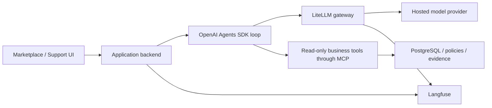

# Agentic Systems: Marketplace Support Lab

[Local setup](app/LOCAL-SETUP.md) · [Cloud setup](app/CLOUD-SETUP.md) · [Exercises](course/exercises/README.md) · [Contributing](CONTRIBUTING.md) · [MIT license](LICENSE)

A runnable reference application for exploring how AI agents work inside a business system. Use a synthetic marketplace to follow a question from the chat interface through the model, agent loop and tools to a final answer backed by business records and policies.

You can use this repository independently of the **Inside AI Agent Systems: From Components to Platforms** course. The setup guides, sample data, walkthroughs, exercises and reference answers are included. Start with a working baseline, change one capability, repeat the same scenario and compare what happened.

## What you can do

The marketplace simulates buyers, sellers, orders, shipments, payments, returns and seller payouts. Its support agent investigates questions such as:

- What is the payout policy?
- How many sellers are there, and what are their names?
- What are Cedar & Co.'s paid and unpaid balances?
- Why is an order's payout held, and what happened in earlier attempts?

Business actions are simulated. The support agent uses read-only business tools; it does not send real payments or issue real refunds. Inspect its citations, underlying records and traces rather than assuming an answer is correct.

## Capabilities to explore

| Area | What to inspect or change | Start here |
|---|---|---|
| Models and gateway | Provider routes, configured model aliases, usage and gateway behavior | [Model and gateway](course/exercises/model-and-gateway/exercise.md) |
| Tools and context | MCP business tools, instructions, conversation context, retrieval and policy evidence | [Tools/MCP](course/exercises/tools-and-mcp/exercise.md) · [Prompt/context](course/exercises/prompt-and-context/exercise.md) · [Retrieval](course/exercises/knowledge-and-retrieval/exercise.md) |
| State and execution | Session history, agent iterations, tool recovery and stopping | [Session state](course/exercises/session-state/exercise.md) · [Agent loop](course/exercises/agent-loop/exercise.md) |
| Observability and evaluation | Model/tool traces, token usage, answer quality, latency, cost and feedback | [Observability](course/exercises/observability/exercise.md) · [Evaluation](course/exercises/evaluation/exercise.md) |
| Security | Guardrails, trusted identity, tool boundaries and optional screening services | [Guardrails and security](course/exercises/guardrails-security/exercise.md) |
| Advanced behavior | Model routing, agent design patterns and memory across conversations | [Routing](course/exercises/model-routing/exercise.md) · [Patterns](course/exercises/agent-design-patterns/exercise.md) · [Memory](course/exercises/short-and-long-term-memory/exercise.md) |
| Hosted platforms | Separate Google and Lyzr practice agents and optional marketplace integration | [Google setup](course/setup/google-agent-platform/setup-guide.md) · [Lyzr setup](course/setup/lyzr-agent-platform/setup-guide.md) |

Some capabilities require the isolated test workspace, optional services or additional accounts. Each guide states its prerequisites; the baseline does not require every integration.

## Choose a setup path

**Local is the main starting point.** Docker runs the application and supporting services on your machine; model inference and embeddings use your selected provider. No local GPU is required. **Cloud is optional** and has separate infrastructure, credentials, billing and cleanup steps. Local and cloud business data do not synchronize automatically.

| Path | Guide | Prerequisites and coverage |
|---|---|---|
| Local | [Local Setup](app/LOCAL-SETUP.md) | Git, Docker with Compose 2.24.4+, Python 3, a shell, browser and funded provider access. Mac walkthrough; fresh Ubuntu acceptance recorded; Windows/WSL2 notes remain untested. |
| Cloud | [Cloud Setup](app/CLOUD-SETUP.md) | Your own Google Cloud project, billing and the accounts/services listed in that guide. Deploy only your own lab resources. |

For local planning, the guide recommends 16 GB RAM, about 8 GB available to Docker, and roughly 20 GB of free disk for initial images and lab data. These are planning allowances, not measured minimums. Node, PostgreSQL, LiteLLM and Langfuse do not need separate host installations for the baseline.

## First local run

Read [Local Setup](app/LOCAL-SETUP.md) for prerequisites and provider/model access before running these commands:

```sh
git clone --branch main https://github.com/smakam/agentic-systems.git
cd agentic-systems/app
[ -f .env ] || cp .env.example .env
chmod 600 .env
```

Edit `.env` in this directory privately: keep `INFERENCE_PROVIDER=openai` and supply your own `OPENAI_API_KEY` for the default route. OpenRouter is an optional alternative described in the setup guide. Leave generated gateway-key fields empty on a fresh installation. Keep provider keys out of browser code, screenshots and commits.

From `app/`:

```sh
./scripts/start.sh
docker compose ps
curl --fail http://localhost:58000/api/health
```

Startup launches the main and isolated test workspaces plus shared services. The first run downloads/builds images and prepares documents; wait for document preparation to show **Ready** before testing retrieval. Normal startup preserves existing workspace data.

| Surface | Address | Purpose |
|---|---|---|
| Main marketplace | [localhost:5178](http://localhost:5178/) | Explore business journeys and Support chat |
| Isolated test marketplace | [127.0.0.1:5179](http://127.0.0.1:5179/) | Repeatable labs with separate data and sessions |
| Local Langfuse | [localhost:3000](http://localhost:3000/) | Inspect model/tool traces and usage |
| LiteLLM | [localhost:4000/ui](http://localhost:4000/ui/) | Inspect the local model gateway |
| Backend API documentation | [localhost:58000/docs](http://localhost:58000/docs) | Explore API contracts; protected operations require authentication |

For your first question, sign in to the main marketplace as `support` with the public **local demo** password `demo-marketplace`. Choose **OpenAI Agents SDK**, start a new conversation and ask **“What is the payout policy?”** Open its policy evidence, then inspect the corresponding Langfuse trace. Service logins and all demo roles are listed in [Local Setup](app/LOCAL-SETUP.md#3-start-both-workspaces-and-shared-services). These demo credentials are for the local lab, not a hosted authentication configuration.

Next, follow the [marketplace business journeys](app/USER-JOURNEYS.md) and [first-agent walkthrough](course/exercises/first-agent/exercise.md). For a controlled comparison, hold the scenario and starting data constant, change one setting, and record the answer, tool evidence and trace. The [exercise index](course/exercises/README.md) links each topic and its separate reference answers. Watching the course is not a prerequisite for following the written guides.

## How the baseline fits together



The backend preserves conversation state and selects the configured runtime. Business tools retrieve transactional and policy evidence; remembered facts are not a substitute for current business records or trusted identity. Optional Google and Lyzr runtimes have their own execution boundaries. See [Architecture](SPECIFICATION.md), [Runtime selection](app/RUNTIME-SELECTOR.md) and the [application guide](app/README.md) for details.

## Repository map

| Location | Contents |
|---|---|
| `app/backend/` and `app/frontend/` | Application, support-agent implementation, UI and tests |
| `app/data/` and `app/infra/` | Synthetic data/policies and local service configuration |
| `app/scripts/` | Startup, shutdown, lab and evaluation helpers |
| `app/eval/` | Evaluator-only fixtures and runner guidance |
| `app/cloud/`, `app/google/`, `app/lyzr/` | Optional deployment/runtime implementations |
| `app/docs/` | Capability walkthroughs and boundaries |
| `course/exercises/` | Written experiments, companion material and separate `solutions/answers.md` |
| `course/setup/`, `course/diagrams/`, `course/evaluation/` | Platform setup, architecture diagrams and saved comparison material |

Source, dependency manifests/locks, tests and seed fixtures are included. Recordings, slide PDFs, instructor planning, credentials, Terraform state, downloaded dependencies and generated run outputs are maintained separately. Historical instructor evidence mentioned in some technical notes is not required for baseline setup.

## Costs, stopping and troubleshooting

Model answers and document/query embeddings make paid API calls. You need funded API access; a ChatGPT subscription does not fund the application's API requests. Optional cloud, hosted-memory, screening and platform services have separate charges and access requirements. Inspect the relevant guide before enabling them. Application cost estimates and stopping thresholds are not provider billing caps.

From `app/`, stop local services while preserving data with:

```sh
./scripts/stop.sh
```

Run `./scripts/start.sh` to resume. Do not use `docker compose down -v` for routine shutdown: it deletes named volumes. Resets and database-backed test scripts can change the test workspace; follow the relevant guide and preserve data you need. Cloud resources require their own cleanup, and stopping a local stack does not stop cloud billing.

If startup or an answer fails, begin with [Troubleshooting](app/LOCAL-SETUP.md#9-troubleshooting): check Docker/server health, occupied ports, provider credentials/model access, billing, gateway connectivity and document preparation. The [evaluation guide](app/eval/README.md) explains fixture isolation and runner costs; do not treat a successful startup check as a successful agent evaluation.

## Extend and contribute

Use your own fork and a focused branch. Add a useful agentic capability or configurable experiment, explain the intended behavior, validate it and open a pull request. The instructor/maintainer reviews changes before merge; merging does not automatically deploy services or update anyone's existing checkout. See [Contributing](CONTRIBUTING.md) for the workflow and worked example.

This is a teaching and experimentation lab using synthetic data. Scores are sample-specific observations, not general model rankings or production-readiness claims. Existing Mac use, fresh Ubuntu checks and bounded cloud rehearsals do not establish validation of every clean installation, operating system, provider or account. `main` can change; record the commit you use when reporting results. No versioned release is pinned yet.

## License

This repository's original software and accompanying documentation are available under the [MIT License](LICENSE). You may use, modify and redistribute them, including commercially, while retaining the copyright and license notice. Third-party dependencies and services retain their own licenses and terms; the repository license does not provide API credits or rights to separately distributed course recordings.
