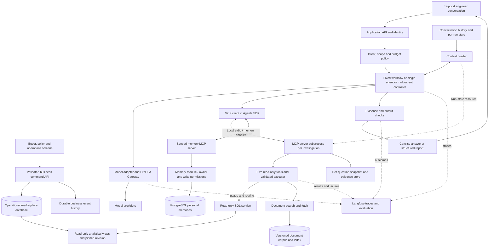

# Marketplace and support agent: application specification and experiment plan

**Published routing series — September 30, 2026:** [Part 1: classification](https://sreeni.blog/2026/09/30/model-routing-part-1-choosing-a-classifier/) · [Part 2: scope](https://sreeni.blog/2026/09/30/model-routing-part-2-choosing-the-scope/). See the [publication index and synchronized local copies](blog/model-routing/README.md) and [M23 publication milestone](MILESTONE-LOG.md#m23--publish-routing-series-and-synchronize-documentation). Both posts are published; this editorial update changes no application requirements, experiment scores or production routing.

**Framing for the blog/course:** These experiments teach how to evaluate model choice, classification and routing granularity for a use case; they do not prescribe a winning configuration. The 18-case and six-conversation samples are diagnostic demonstrations, not sufficient evidence for general recommendations. Read the [user-confirmed editorial framing and decision process](EVALUATION-SPEC.md#editorial-framing-teach-the-decision-process) before writing about the results.

Project history and learning record: [Milestone log](MILESTONE-LOG.md). Append meaningful completed milestones, evidence, lessons and next experiments there.
**Status:** approved specification, version 0.5, 27 September 2026. The first local application slice is implemented in [app](app/README.md). Its verification record distinguishes integration/smoke checks from the larger research experiments below, some of which have now run: see the dated evaluation/routing status below. Larger study settings remain proposals, not production promises.

**Companion:** [Research guide and source register](RESEARCH-GUIDE.md). Read this specification for what to build and compare; use the guide for evidence, contrary findings and product-layer distinctions.

## Model-routing diagnostic phase — closed September 30, 2026

Completed classification replay, scenario-only semantic refinement, and live conversation-versus-question routing. No additional paid experiment is required to close this learning phase; production support still uses its fixed model.

- [Classifier comparison](app/results/routing-classifiers-2026-09-30/comparison.html): LLM/JEV provided the strongest observed quality among tested routes within the approved nano/GPT-5 pool. Restricted OpenRouter low and medium selected nano throughout.
- [Semantic scenario refinement](app/results/semantic-scenarios-v2-2026-09-30/comparison.html): fewer fallbacks but unchanged correctness and higher cost; not promoted.
- [Live granularity report](app/results/routing-granularity-2026-09-30/comparison.html): primary metric is all three answers correct across each of six conversations. Fixed GPT-5: 6/6; fixed nano and both routing policies: 4/6. The 18-answer breakdown is supporting detail. Routing cost about nine times nano and reduced outright incorrect answers, but did not improve fully correct conversations. No granularity winner was established.
- [Cache breakdown](app/results/routing-granularity-2026-09-30/cache-by-model.json): observed per-model cached-token fractions and cache-adjusted costs are retained; no causal benefit from pinning or switching is established.

The user accepted the three formerly flagged partial judgments; review is complete. They concern already non-passing conversations, so changing those partial grades alone does not change the 4/6 conversation score. Preserve the synthetic scenarios, gold, raw calls, accepted grades and report versions. Unrestricted OpenRouter selection was explicitly set aside in favor of enterprise-approved model lists; it is not a pending test.

Optional future optimizations: new held-out conversations and targeted repeats before deployment; identifier normalization for semantic matching; explicit escalation or per-internal-call routing; controlled cache experiments. These are separate future studies, not prerequisites for moving to another topic. Historical milestones retain their original findings; see the latest clarification in [M20](MILESTONE-LOG.md#m20--close-routing-phase-and-clarify-conversation-scoring).

## Baseline at a glance

| Area | First-build decision |
|---|---|
| Purpose | Operate and study an agentic system using a small working marketplace as its changing business environment. |
| Business application | React frontend and Python/FastAPI backend with buyer, seller/operator and support views; purchases, delivery, returns/refunds and seller payouts are simulated. |
| Assistant | Internal support/investigation chat; one agent, one fixed API model, read-only business tools. |
| Agent stack | OpenAI Agents SDK, local execution, LiteLLM Gateway, Langfuse evaluation and observability. |
| Data foundation | Repeatable synthetic scenarios, relational data, matching documents, ontology and static relationship map. |
| RAG | Simple local ingestion/index and search/fetch functions inside the application. |
| Identity/context | Simple seeded-account login, stored conversations and explicit per-run state; cross-session learned memory off initially. |
| Comparison foundation | Versioned contracts/configuration, frozen scenario replay, gold results and before/after UI demonstrations. |
| Deferred | Multi-agent, learned routing, external memory products, sophisticated RAG, managed deployment, loyalty and additional ecosystem tracks. |

This is the design source of truth; [the application README](app/README.md) records actual implementation and verification. The implementation choices still open are listed in section 13; they do not reopen the agreed scope. The research guide remains a broader source and implementation landscape rather than the selected dependency list.

## 1. Purpose, audience and boundaries

Build a working simulated multi-seller marketplace and its conversational support/investigation assistant as a durable reference application for a practical engineering blog series. The user selected the marketplace domain and requested interactive business operations on 27 September 2026; this supersedes the earlier subscription-business proposal. Loyalty is a possible later extension, not baseline scope. It must support both routine business Q&A and deeper investigations, using SQL over synthetic business data, retrieval over paired business documents, or both. The initial writing addresses applied AI engineers, architects and engineering leaders deciding how to build dependable systems; the eventual learning vision also includes a progressive foundation path for beginners with coding prerequisites. The work studies architecture and operational trade-offs rather than inventing a new model or claiming research novelty.

The five subjects are:

| Subject | Decision the application makes observable |
|---|---|
| Model routing and gateways | When should an application select or escalate a model, and what should a gateway handle? |
| Context and memory | What information belongs in each model call, in run state, in conversation history or in persistent memory? |
| Evaluation | How do we measure end-to-end usefulness and diagnose the component that failed? |
| Orchestration | When does a fixed workflow, one agent or coordinated multiple agents work better? |
| Reliable tool use | How do contracts, execution controls and recovery make SQL and retrieval trustworthy? |

The multi-agent variant is deliberately designed into application scope from the outset, but implementation comes after the single-agent baseline when the author is ready. If that extension proceeds, compare a concrete multi-agent design on the **same deeper tasks and corpus**. Do not replace chat with an investigator-only product. Multiple model calls, or a SQL model followed by a summarization model, do not by themselves constitute multiple agents.

The earlier interview chatbot was SQL-oriented. Document retrieval/RAG, the synthetic corpus, this experiment harness and the multi-agent investigation variant are proposed extensions. They must not be described as capabilities already deployed in that earlier system. Historical implementation details are not dependencies of this plan.

Non-goals: production deployment, real customer data, autonomous assistant business writes, real purchases/payments/payouts, email/report distribution, training foundation models, exhaustive framework benchmarking, open-ended web research inside the assistant, or proof of causal effects from ordinary observational data. A2A and cross-system or independently hosted agent interoperability are out of scope for now. The baseline uses OpenAI Agents SDK locally, LiteLLM Gateway and Langfuse for evaluation/tracing. The web stack is React with Python/FastAPI. PostgreSQL is the selected business database. The retrieval baseline is PostgreSQL/pgvector with text-embedding-3-small. The exact main API model will be pinned during integration under the user-selected cheapest-supported policy; application services and Langfuse run locally in containers.

### 1.1 Near-term commitment, research extensions and stretch vision

**Near-term commitment:** slowly build and understand a small working marketplace UI/backend plus one single-agent assistant in one framework/runtime. Human-operated marketplace screens can change synthetic business state; the assistant remains read-only. Verify SQL, document retrieval, mixed-source answers, conversational follow-ups and structured reports with meaningful tests. Start with a small coherent slice of the corpus. Initial success is an understandable, test-backed application; it does not require completing the full research matrix, multi-agent system, blog series or course.

**Planned research extensions:** when time and confidence permit, extend the same application with substantive multi-agent investigations, context/memory and routing ablations, fault injection and later idiomatic implementations in several ecosystems. These are directions to preserve, not a promise to complete every phase or supporting product. Each stage has a continue, narrow or defer decision.

**Stretch vision:** an eventual Udemy course may combine concepts, exercises and multiple implementation tracks. It is not the current delivery goal or a commitment. Useful standalone blogs can emerge along the way; evidence and confidence should precede a course decision. There are no artificial dates or guaranteed publication cadence.

## 2. Product contract and user journeys

The operational [role and journey guide](app/USER-JOURNEYS.md) records the manual steps and expected states for buyer, seller, operator and support, including refund and payout failure branches.

The assistant returns either a concise conversational answer or a structured report. Both retain citations, data provenance, definitions, uncertainty and a useful continuation path. A report is an output of the conversation, not a separate application.

| Journey | Example | Expected behavior |
|---|---|---|
| SQL-only routine question | “Which sellers have pending payouts, and for how much?” | Resolve payout status, currency and as-of time; reconcile allocations without join fan-out. |
| Document-only question | “Which return policy applies to this item?” | Retrieve the applicable policy version, seller/category scope and effective date. |
| Mixed-source question | “The buyer paid; why has the seller not been paid?” | Trace capture, allocation, delivery/release conditions and payout events; cite policy and facts separately. |
| Follow-up | “Exclude undelivered orders; show only failed payouts.” | Preserve the original scope and apply the new filter explicitly. |
| Investigation | “Are delayed refunds isolated or affecting several sellers after the policy change?” | Quantify scope; inspect provider/return events and documents; separate confirmed causes from hypotheses. |
| Ambiguity | “Why are sales down?” | Clarify order value versus platform fees, period and seller scope where material. |
| Incomplete/conflicting evidence | “Support says the refund completed, but the provider event says pending.” | Identify the conflicting sources and their timestamps; do not invent reconciliation. |
| Unanswerable request | “Prove the policy change caused customers to stop buying.” | Explain the evidence limit and propose additional checks. |
| Interactive before/after | “Buy an item, mark it delivered, then ask why its seller payout changed.” | Execute authorized simulated UI actions, expose processing/freshness, and show answers with distinct data revisions and evidence. |

Freeze an `as_of` date per task. For an illustrative task dated 26 September 2026 with calendar quarters, “last quarter” means 1 April–30 June 2026; do not silently interpret it as the ongoing quarter. Fiscal calendars remain an explicit corpus definition.

## 3. Architecture and layer ownership

The MCP path is implemented locally: one subprocess owns the snapshot and evidence for each question. Model and embedding calls use LiteLLM; tool calls use MCP. Direct access remains a comparison option. Optional persistent memory and multi-agent control in this broader diagram remain future work. Analytical views, business records and event history share PostgreSQL; these boxes represent responsibilities, not separate database services.

**Design decisions** define who chooses the next step, what state is available, how evidence is checked and when work terminates. **Frameworks/SDKs/harnesses** implement those choices with loops, graphs, handoffs, tool adapters, hooks and persistence. **Hosting runtimes/platforms** run the process, isolate credentials, schedule execution and supply managed services. Products overlap these layers; “runtime” can mean an in-process orchestration engine or a hosted execution service. Name which meaning is intended.

Context/memory, orchestration and tool execution are core execution concerns. A gateway is adjacent: workflow-aware model selection or escalation may stay in application code, while provider load balancing, authentication, rate limits and transport retries may sit in the gateway. Evaluation is cross-cutting and relies on observable traces and outcomes. A gateway cannot validate a payout definition; a framework does not automatically supply business ground truth.

Use one selected framework and one execution environment for the initial implementation; keep them fixed during the first within-stack experiment series if pursued. A model adapter, versioned tool schemas and portable trace envelope provide boundaries without pretending that every framework is interchangeable. Selection criteria and product mapping are in the research guide. Any unavoidable bundled harness behavior becomes a documented confounder.

**Current memory transport — October 3, 2026:** The agent calls four personal-memory tools through a separate local stdio MCP subprocess when memory is enabled; business MCP and short-term session storage remain independent. Identity, per-question write permissions and provenance are bound by the application at launch, not supplied by the model. PostgreSQL MemoryStore is the implemented provider. [Current and planned provider diagrams](course/diagrams/MEMORY-ARCHITECTURE.md): MCP enables runtime access; a future adapter interface would make storage replaceable. No external provider adapter or remote memory endpoint is implemented. [Transport review](app/results/memory-local-mcp-2026-10-03/REVIEW.md) and [19-question post-migration regression](app/results/memory-repeatable-20261003T112031250654Z/REPORT.md).

### 3.1 Baseline stack and ownership

The selected web stack is React for the frontend and Python/FastAPI for the backend. Keep marketplace APIs and the support-agent endpoint in one modular backend initially; the Python OpenAI Agents SDK runs there. Frontend tooling and exact dependency versions remain implementation details to pin.

The agreed direction is OpenAI Agents SDK running in our local application, one fixed OpenAI API model reached through LiteLLM Gateway directly (no OpenRouter intermediary in the baseline), and Langfuse for tracing and evaluation. Monitoring is supporting infrastructure across the five topics, not a separate pluggability research objective. Langfuse will be self-hosted locally in the container setup; exact package/model versions remain to be selected; integration has not yet been tested.

The SDK owns the agent/tool loop and session integration; the application owns persisted session storage, identity, context selection, tool implementations, business authorization and limits. Register the catalog/context lookup, read-only SQL, document search and evidence fetch as tools. Start without cross-session learned memory or dynamic model routing. Preserve the option of later handoffs or specialists.

Store the ontology and context-graph definitions in versioned JSON. Assemble relevant definitions and current, source-linked relationships per question; do not inject every business record into the prompt. Langfuse receives agent/tool traces and correlated model telemetry with no duplicate cost counting. Application-specific gold answers, deterministic checks and grading rules remain our responsibility.

### 3.2 Reproducible local packaging

Use Docker Compose with a documented single startup entrypoint after prerequisites and secret configuration. Containerize the React frontend, FastAPI backend, PostgreSQL/pgvector, LiteLLM Gateway, and self-hosted Langfuse with the supporting services required by its pinned official distribution. Langfuse is not assumed to be a single lightweight container; validate the complete stack's memory/disk requirements and document supported host architectures.

Provide pinned dependency/image versions, build files, example environment configuration without real secrets, health checks, migrations, deterministic seeding, document-index initialization, and documented stop/restart/reset behavior. Bootstrap demo accounts and Langfuse project/keys using supported initialization so a fresh install is repeatable. Normal restarts preserve data; reset is explicit and scoped. Configure localhost exposure and separate service credentials/databases even where services share infrastructure.

Another user should be able to obtain the repository, install Docker/Compose, supply their own model API credentials, and start the stack with one documented command. First-time embedding creation may require network/API usage. Model and embedding inference remain external API calls in the baseline; running the application locally does not mean offline inference or zero API cost. Confirm a clean-install smoke test before claiming portability.

Use configuration-based service URLs and persistent volumes so deployment can change later without rewriting business logic. Production/cloud deployment remains a later task rather than an implied property of the local setup. Reference the current [Langfuse Compose guide](https://langfuse.com/self-hosting/deployment/docker-compose) and [LiteLLM deployment guide](https://docs.litellm.ai/docs/proxy/deploy), then pin and verify actual versions during implementation.

### 3.3 Later implementation tracks and comparison boundaries

The broad vision is to explore the same application through each ecosystem's natural, idiomatic approach rather than force every stack into identical internal wiring. Shared versioned data/documents, user tasks, expected evidence/output and evaluation contracts remain stable. Preserve platform-specific applicability as a learning benefit.

| Candidate track | Intended learning and present status |
|---|---|
| Google ADK with Gemini Enterprise Agent Platform | Explore code-first development alongside managed platform services; candidate, not selected. |
| AWS stack, for example Strands with Bedrock AgentCore | Explore AWS-native development and managed execution; candidate, not selected. |
| Self-hosted/code-first components with OpenAI Agents SDK | Explore application control and inspectable components. Selected for the initial local baseline; other ecosystem tracks remain optional. |
| Claude Agent SDK | Explore its built-in harness and context behavior as part of the system, not as a raw model client; candidate, not selected. |
| Lyzr | Optional feasibility track now implemented and smoke-tested through Agent Studio using authenticated remote MCP. Lyzr owns the model/agent loop; the app supplies read-only middleware. Agent API deployment confirmed; middleware still uses a temporary tunnel. Not committed course inclusion. See section 3.4 and the lab guide. |

LangChain/LangGraph remains relevant in the framework map and as a possible component/alternative, without a commitment to implement a separate track. An open-source SDK does not make the complete stack or model open source. Hosting the application yourself, self-hosting inference and selecting open-weight models are separate decisions with separate costs and constraints.

Distinguish two study types. **Within-stack architecture ablations** hold framework/runtime and other relevant factors fixed to study a specific change. **Idiomatic end-to-end stack comparisons** may change model, retrieval, harness defaults and managed services together; their outcomes describe those configured systems and engineering trade-offs, not pure framework causality. Record bundled changes, implementation effort, control/flexibility, debugging, trace export and operating burden. Do not promise exhaustive coverage of every ecosystem service.

### 3.4 Lyzr remote MCP implementation and cloud follow-up — October 2, 2026

**Implemented:** Lyzr Agent Studio runs the model and agent loop; it does not call our OpenAI Agents SDK runtime. The application is an authenticated MCP tool provider. The remote adapter exposes stateless Streamable HTTP with JSON responses at `/mcp`; a temporary outbound Cloudflare tunnel lets Studio reach the locally running middleware. No A2A integration is used for this tool connection. Local direct/stdio support remains available.

The seven tools are `begin_investigation`, `end_investigation`, `get_catalog`, `query_business_data`, `search_documents`, `fetch_evidence` and `get_order_history`. The five business tools share existing SQL/retrieval logic and require an opaque investigation ID. Each investigation owns a fixed repeatable-read snapshot and isolated evidence store, serialized access, a 180-second TTL and an eight-open-investigation capacity limit. Order history includes an `order_summary` evidence envelope with separate order/payment statuses. Authentication accepts `x-api-key` or Bearer credentials; host/origin checks and read-only SQL/DB enforcement remain active. These are single-principal demo permissions, not end-user/tenant authorization.

**Studio setup and result:** Private Marketplace Support — MCP Lab agent, seven tools attached using creator credentials, adapted instructions and OpenAI `gpt-5.4-mini`; Memory removed for this initial test. The app's separate M35 memory implementation is unaffected and is not exposed through this remote adapter. Nano trials showed unsupported facts, planning instead of tool execution, or altered citations/IDs. Mini plus revised instructions passed the final order/payment/payout/history/policy smoke test in 13.39 seconds, with all three citations matching retrieved evidence and explicit investigation cleanup. The complete current-source suite passed 68 tests, including three remote HTTP MCP integration tests on isolated `market_test`.

**Deployment boundary:** Studio's Deploy page confirmed an authenticated agent API was already deployed on saving. No App Store publication occurred. Dashboard status and Playground execution are verified; a separate external inference-API request is untested. Business tools still depend on the Mac, Docker and temporary tunnel. The remote path does not execute the original runtime's final-answer citation validator, history injection or Langfuse run bookkeeping. Prompt guidance and one successful smoke test do not establish equivalent runtime guarantees or broad model quality.

**Next required deployment task: cloud-hosted middleware without tunneling.** Deploy the remote MCP service and its business-data/retrieval dependencies in a proper cloud environment behind a stable authenticated HTTPS `/mcp` endpoint. Cloud provider and deployment target remain to choose; no cloud resources have been provisioned. Scope and acceptance criteria:

1. Package a reproducible service image/configuration without Mac source mounts. Place PostgreSQL/pgvector, policy/index data and retrieval embedding/gateway access in cloud-reachable infrastructure; use private database access and the existing read-only role. Hosting only the adapter while leaving dependencies on the Mac does not complete this task.
2. Configure TLS, the endpoint host allowlist, secret-managed credentials and key rotation, bounded request/resource limits, health checks, logs, restart behavior and a deployment/rollback runbook. Keep long-term memory off for this Lyzr lab.
3. Account for process-local investigation state: stateless HTTP does not make snapshots/evidence stateless. Initially use one service process/replica with a suitable request/lifetime model, or implement tested affinity/shared ownership before adding workers, replicas or scale-to-zero. Restarted/expired investigations must fail clearly and be reopened.
4. Update the saved Studio MCP connection to the stable cloud URL and verify all seven tools, authentication rejection, SQL write rejection, snapshot/evidence isolation, expiry/capacity and cleanup. Repeat the combined support question, checking exact citations and separate current/historical states. Test the external Lyzr inference API as a separate check.
5. Stop the tunnel and local middleware during the final acceptance check: Studio must still retrieve SQL and policy evidence. Record the cloud configuration, actual operating costs, limitations and observed results before declaring the migration complete. Production tenant permissions and broad reliability/quality evaluation remain separate work.

**Evidence and teaching material:** [Dashboard walkthrough and lifecycle](app/lyzr/README.md), [validation and model-trial limits](app/lyzr/VALIDATION.md), [saved instructions](app/lyzr/agent-instructions.txt), [remote adapter](app/backend/marketplace/remote_mcp.py), [HTTP tests](app/backend/tests/test_remote_mcp.py), [M36 milestone](MILESTONE-LOG.md#m36--lyzr-agent-studio-with-authenticated-remote-mcp). This optional experiment teaches the split between agent runtime and middleware hosting; it does not replace the committed Gemini/AWS course tracks.

### Lyzr follow-up — October 3, 2026

The existing agent now uses Marketplace Support MCP Lab — Reconnected after quick-tunnel replacement. Cognis memory is enabled with Cross Session off for within-conversation continuity. [One controlled two-turn test](app/lyzr/memory-session-2026-10-03/REPORT.md) showed the off configuration losing the order identifier and the enabled configuration resolving it while refreshing MCP evidence. This does not verify pure raw-history-only implementation or all Cognis persistence controls. The app M35 memory tools remain unexposed. Stable tunnel selection is deferred; proper cloud middleware scope in section 3.4 remains pending.

**Stable tunnel update — October 3, 2026:** [ngrok endpoint and restart runbook](app/lyzr/ngrok-2026-10-03/REPORT.md) now implemented and verified with same-URL service restart, authenticated discovery and Lyzr lookup. Active Studio attachment is Stable; Cloudflare process stopped. Login startup and Docker restart policies configured; actual reboot untested. Full cloud middleware deployment remains pending.

## 4. Marketplace domain, ontology and static relationship map

Use a fictional multi-seller marketplace with synthetic buyers, sellers and a shared product catalog. Sellers publish listings; buyers place orders. A simulated payment provider handles buyer captures and seller payouts. The platform records seller allocations and fees; a captured buyer payment is not itself proof that a seller payout completed. No live financial integrations are required.

### 4.1 Entities, relationships and semantics

| Entity/table family | Grain and relationships | Important semantics |
|---|---|---|
| Customers and sellers | Stable customer and seller IDs; many orders per customer and listings per seller | Roles and access scope are explicit; names are not join keys. |
| Products and listings | Catalog product; seller-specific listing referencing one product | Preserve purchased price/terms on order items even if a listing changes later. |
| Orders and order items | Customer order; line item referencing a listing and seller | One order can span sellers. Quantity and monetary allocations live at explicit grains. |
| Inventory | Listing/location stock, reservations and adjustments | Validate available stock and reserve/release atomically; prevent negative stock in ordinary commands. |
| Shipments, shipment items and delivery events | Shipment; allocation of item quantities; timestamped events | Support partial delivery without treating the entire order as delivered. |
| Payments and payment events | Payment attempt/capture for an order; provider event ID | Distinguish attempted, failed and captured payment; repeated event delivery must not double-count money. |
| Seller allocations and fee entries | Captured funds allocated by seller/order item, with explicit fee rules | Buyer order value, seller payable and platform fee income are different metrics. |
| Payouts and payout allocations | Payout attempt to a seller; links to eligible allocation amounts | Support pending/failed/completed attempts and, later, batching across orders. Never pay one allocation twice. |
| Returns and return items | Return request with item quantities and receiving events | Requested, approved and received are distinct; a return does not imply a completed refund. |
| Refunds and refund allocations | Refund against captured payment, allocated to relevant items | Track partial and failed refunds. Cumulative completed refunds cannot exceed eligible captured amounts. |
| Support tickets, messages and record links | Ticket with explicit references to orders/items/payments and event history | Internal support can inspect authorized related evidence; a customer-facing assistant is not initial scope. |
| Incidents and impact links | Incident linked to affected records/cohorts with evidence | Suspected versus confirmed impact must be explicit; correlations are not causal facts. |
| Policies and document versions | Policy/document revision with scope and effective dates | Applicable seller/category/region, authority and supersession are retained. |
| Calendar and entity history | Date dimension and effective-dated attributes | Event time, recording time and analytical ingestion time are separate. |

The **ontology is a required foundation**: machine-readable entity definitions, relationship names/cardinalities, permitted join paths, status meanings, metric definitions, units and temporal rules. Include examples and counterexamples, such as “refund requested” versus “refund completed.” It is not just a schema dump.

**October 1 clarification:** the required static entity relationship map lives in the ontology. Catalog v2 merges it with actual database field types, nullability and relevant primary/unique/check constraints, with provenance and structural drift checks. The old first-30-record “context graph” and sampled business-name list are removed. Actual records are obtained by targeted queries. A richer instance graph linking records, policies, evidence and prior decisions is a deferred experiment, not an implemented baseline requirement. See [prompt and catalog walkthrough](app/docs/PROMPT-AND-CATALOG.md).

The semantic catalog must expose safe joins and guard against multiplying item totals by payment events or shipment rows. Keep complex joins visible in some tasks. Define order value, captured payments, completed refunds, platform fees, seller payable, eligible/unreleased amounts, completed payouts, failure rates and repeat purchase with their own grains and date rules. Use one synthetic currency initially and integer minor units. Exclude tax, FX, chargebacks and regulatory accounting from the first slice; do not present the synthetic ledger as production accounting.

### 4.2 Documents, events and truth

Provide versioned return/refund and payout policies, seller terms, schema/metric glossary, troubleshooting runbooks, provider incident reports, operational change records and support case notes. Include document ID, revision, authority/status, creation/publication/effective dates, entity links, covered interval and supersession. Chunk references resolve to immutable versions and exact spans.

A deterministic seed manifest creates coherent records, events and documents. Validate seeded foreign-key relationships against the versioned ontology; a future instance graph must use these same IDs and events. Curated ontology definitions are reviewed, not randomly generated. Hidden scenario mechanisms and grading labels stay outside assistant access. Include delayed/duplicate provider events, partial shipments/refunds, stale policies, changed seller terms, missing evidence, contradictory support notes, ambiguous entity names, and normal/no-change cases. A known generator cause does not authorize a causal answer unless visible evidence supports it.

Initial proposed slice: three sellers, six listings, a handful of customers, a small seeded order history and roughly ten short documents. Exact counts are tuning choices, not acceptance criteria. Include one cross-seller order, one delayed payout and one partial-refund case. Expand historical coverage and volume only when needed for investigations and fair experiments; the former subscription corpus size is superseded.

### 4.2.1 Minimal document ingestion and retrieval

Implement a small in-application pipeline: load curated synthetic Markdown/text documents, validate metadata, split by headings/paragraphs, assign stable chunk IDs, and build one local searchable index. Selected simple baseline: PostgreSQL with [pgvector](https://github.com/pgvector/pgvector) stores document chunks, metadata and embeddings; use OpenAI [text-embedding-3-small](https://developers.openai.com/api/docs/models/text-embedding-3-small) for document and query embeddings. Use exact cosine-distance search over the small corpus with scope/effective-date filters; an approximate vector index is unnecessary initially. Keep exact IDs available through metadata lookup. No separate vector database or RAG framework is required. The embedding API wiring through LiteLLM must be verified during integration; record model/dimension versions and re-embed on changes. No dedicated retrieval agent, separate retrieval service, graph-enhanced retrieval, reranking service or elaborate pipeline is required initially.

Every chunk retains document revision, exact source span, scope and effective-date metadata. Search enforces authorized scope and returns candidates; fetch returns the supporting text. The context builder supplies relevant ontology/relationship definitions and the agent combines documentary evidence with read-only SQL results. Exact record identifiers should remain searchable even if embedding retrieval is chosen.

Reindex on document changes and retain the previous revision for reproducible tests. Expose index freshness. Include small known-answer cases for applicable policy, outdated policy, no matching document, misleading near-match and a combined SQL/document question. SQL remains the authoritative route for current structured business state; do not convert the entire transactional database into document chunks.

### 4.3 Working application surfaces

Build three small views in one application, with explicit demo roles:

- **Buyer:** browse listings, add quantities to a cart, place an order with simulated payment, view order/delivery status and request a return.
- **Seller/operations:** manage allowed listing/stock changes; advance shipment events; inspect fee/allocation/payout state; approve/process simulated returns and refunds. Provider outcomes and incident injection are clearly labeled demo controls.
- **Support workspace:** inspect customer/order timelines, ask the assistant questions and request investigations with cited evidence. Display data freshness and let the user compare before/after answers. Let the authenticated conversation owner rate each completed answer with thumbs up/down; persist one current rating per answer in PostgreSQL and associate it with that question’s trace. Ratings measure user feedback, not verified correctness.

The initial operator view can cover seller and marketplace operations, but permissions and command ownership remain explicit. The first build need not reproduce a complete commercial marketplace or separate seller onboarding/KYC, external logistics, real money handling or production authentication.

### 4.3.1 Support interface and demo identity

Use one web application with marketplace views and a support workspace; separate front-end deployments are unnecessary for the first build. The proposed support workspace has conversation history, new-conversation control, streamed answers, source/query references and a readable run-status view. A user message invokes the backend agent runner; the server derives identity, role, conversation scope and data revision, then returns the answer and trace reference.

For the local demo, use seeded buyer, seller and internal support/operator accounts with username/password sign-in and server-side sessions. Implement authentication inside FastAPI with account/password-hash and session records in PostgreSQL, an HttpOnly session cookie, and backend role/scope checks. No external identity service is required; protect state-changing cookie-authenticated requests against CSRF. Avoid registration, password-reset and enterprise SSO scope initially. Distinguish the authenticated browser session from an agent conversation: one user can own several conversations, and opening a new conversation must not change identity. Enforce record and conversation access on the server, not via client-supplied roles or prompts; credentials/model keys never go into the browser. Authentication library and session expiry settings are implementation details to pin.

The initial assistant serves internal support staff, with explicitly granted investigation scope. Buyer and seller marketplace access is scoped to their own records; the support role does not implicitly get business-write tools. A later customer-facing chat is a separate authorization/experience decision. UI actions generate synthetic business writes through command APIs; chat remains read-only. Persist history across refreshes and offer reset/new conversation separately from resetting the marketplace scenario.

### 4.4 Backend boundaries and state transitions

The marketplace is an interactive source of realistic state changes for AI experiments, not a separate commerce-engineering research project. Prefer one application process and one relational database initially; use direct read-only views before adding asynchronous projections, separate warehouses or infrastructure. Choose a practical database rather than benchmarking databases. Start with a modular application backend, not an assumed fleet of microservices. Separate catalog, orders/inventory, fulfillment, payments/settlement, support, and assistant/query responsibilities in code. The agent framework and local execution direction are selected in section 3.1; PostgreSQL is selected; detailed packaging remains unresolved.

Human UI actions call a business command API. Commands validate actor scope, prior state, quantities and money, and use idempotency keys for repeat submissions. Persist business updates and their event records atomically. An asynchronous outbox/worker is a later option, not a first-build requirement. A deterministic simulator advances provider/fulfillment events; record external event IDs and deduplicate delivery. All authoritative transitions occur in backend services, not through direct UI table edits or model-generated writes.

Document allowed transitions before implementation: order placed/paid/cancelled; shipment pending/dispatched/delivered; return requested/approved/received/rejected; refund pending/completed/failed; payout held/eligible/pending/completed/failed. Orthogonal states stay separate rather than one universal order status. Payout eligibility must account for item delivery, holds and refund adjustments. For the first slice, permit refunds before payout release; a post-payout refund enters an explicit unsupported/manual-review state until recovery accounting is designed.

Use simple versioned fee and payout policies. For the initial seeded policy, captured funds are released only when the relevant items meet delivery and hold conditions. Record policy versions and calculated allocations so later policy edits do not silently rewrite history. A demo clock can advance time without real waiting.

### 4.5 Live answers and reproducible experiments

Maintain a queryable analytical read model over operational events/data. It may initially be views or projection tables in the same database with separate read-only credentials; a separate physical data lake is not necessary to model many related datasets. Preserve the boundary so a lake/warehouse can be introduced later.

Track committed operational revision, analytical watermark and document-index revision. After a user action, show whether its data is available to queries; never imply instant freshness while a projection is behind. Pin a consistent data revision per assistant run, expose its as-of time, and make a new question or explicit refresh use the newer revision. Include data/document versions in cache keys and avoid mixing snapshots mid-investigation.

**Interactive mode** evolves the synthetic marketplace through real UI/backend operations. **Evaluation mode** resets/replays a deterministic scenario and freezes data, clock, documents and indexes for matched comparisons. Retain command/event histories and make reset scoped to the demo dataset.

### 4.6 First end-to-end acceptance scenario

1. Ask for a seller's captured funds, held amount and paid-out amount; retain the answer and revision.
2. Place an order through the buyer UI with a simulated successful payment. Verify inventory reservation, order items, allocation/fee records and event history.
3. Refresh the analytical view and ask again. The assistant reports the changed captured/held amount with supporting query evidence.
4. Mark relevant items delivered and advance the demo clock to payout eligibility. Process a simulated payout and ask why the seller's balance changed; combine events and the applicable policy.
5. Run a separate partial-return/refund branch from a reset snapshot and verify changed item quantities and money without duplicate effects.
6. Inject a payout failure or projection delay. The assistant distinguishes unpaid from unknown/stale and cites the supporting events.
7. Replay the scenario from the same seed and confirm identical business state and gold query results. Model wording need not be identical.

This tests the marketplace and backend as an application, not just a chatbot over static fixtures. Business actions change the data and subsequent query results; read-only analytical queries do not mutate the business.

## 5. Tool contracts and protections

All tools use typed, versioned request/response envelopes. The application injects identity, allowed scope, snapshot and trace IDs; the model cannot broaden them through arguments. Retrieval is itself a tool call with cost, latency, authorization and failure semantics.

| Tool | Model-supplied input | Required response |
|---|---|---|
| `get_catalog` | Relevant metric/entity names | Definitions, allowed schema, joins, versions and freshness. |
| `query_business_data` | SQL, bound parameters, purpose | Typed columns, rows or result handle, row count, truncation flag, normalized SQL hash, query ID, snapshot, execution time and warnings. |
| `search_documents` | Query, entity/date/status filters, bounded top-k | Ranked chunk IDs, snippets, document metadata, source revision, retrieval scores and index version. Scores are not probabilities of truth. |
| `fetch_evidence` | Approved result or chunk handles | Bounded complete supporting rows/text, exact locations and provenance; same authorization as the originating tool. |
| `get_order_history` | Order ID | Validated current order/return/refund/payout joins plus related events in revision order, as two bounded snapshot evidence results. Implemented to preserve failed attempts when current records have been updated by a successful retry. |

Common response fields: `status` (`ok`, `empty`, `partial`, `error`), stable error code, retryability, request ID, attempt number and elapsed time. “Empty” is a valid result, not a failed call; an outage must never become a zero balance or “no documents exist.” Record warnings separately from evidence. A result handle must be unguessable or access-checked, snapshot-bound and size-limited.

SQL enforcement belongs on the server: parse the selected dialect into an AST; allow only the approved read query subset; reject multiple statements, DDL/DML, export/unload, external file/network functions and unapproved UDFs. Read-only credentials and allowlisted schemas are mandatory even if parsing succeeds. Apply row/tenant scope independently of model text, bind values, restrict function calls and joins where required, impose time/scan/row/response limits, and cancel expensive queries. A `SELECT` string prefix is insufficient. Read-only queries can still leak data or exhaust resources. Validate units, grain and aggregation as well as syntax.

Document search and fetch enforce the same scope. Retrieved prose is untrusted data, never a new instruction. Keep tool output distinct from trusted prompts; reject requests embedded in a document to change permissions, reveal secrets or call unrelated tools. Local MCP stdio is implemented and is the Compose default; direct tool access remains available for comparisons. MCP annotations such as read-only are hints, not enforcement guarantees; see the protocol source in the guide.

Use one end-to-end retry budget: proposed maximum two retries for transient failures with bounded backoff and deadline awareness. Semantic errors get at most one informed repair using the typed error; permission failures get no broadened-access retry. Coordinate SDK, gateway and tool retry settings to avoid multiplicative attempts. A retried read may repeat billing and return different data unless the snapshot is pinned. Cache keys include scope, snapshot, query, parameters and schema version.

## 6. Execution variants

### 6.1 Routine path and fixed workflow comparator

Routine path: resolve scope → obtain relevant catalog → select SQL, retrieval or both → execute bounded tools → validate evidence → answer briefly. Clarification pauses the run and resumes with the same scope record. Do not launch specialists for simple lookup tasks merely because they are available.

The fixed workflow comparator uses predetermined stages and bounded branches: obtain definitions; compute period/product/segment comparisons; retrieve matching business changes; reconcile; render. LLMs may fill structured fields or narrate evidence, but cannot invent new investigation branches. It is a serious baseline, including error handling, rather than a deliberately weak straw man.

### 6.2 Single-agent baseline

One decision-making loop owns planning, both SQL and retrieval, follow-up questions, evidence accumulation and final output. It can revise hypotheses after intermediate results, requery and inspect source documents. It uses the same report schema and validator as other variants. Start with a single fixed model, bounded history plus explicit run state, persistent memory disabled, and the standard protected tool set.

Architecture teaching diagrams: [seller workers and bounded evaluator–optimizer](course/diagrams/AGENT-PATTERNS.md). These depict experimental variants rather than a deployed support-runtime change.

### 6.3 Concrete multi-agent investigation

**Current reviewer evidence — M34:** The [reviewer-model ablation on all eighteen cases](app/results/reviewer-ablation-core18-2026-10-01/REPORT.md) supersedes the eight-case coverage headline below. Same frozen drafts and matched review payloads: nano alone 11 correct / 4 partial / 3 incorrect; nano review/correction 11 / 4 / 3; GPT-5.4 review plus nano correction 14 / 4 / 0; saved GPT-5.4 alone 17 / 1 / 0. Assembled uncached costs including original generation: $0.0373 / $0.0526 / $0.5817 / $1.2104. Stronger review saves about 52% versus strong generation with lower correctness. Independent grades are provisional; prior follow-up turns are frozen and final turns reviewed/corrected. All 36 workflows completed without business changes. Reviewer capability matters here; the pattern alone is not a proven cause of improvement. Support runtime unchanged.

The [course design discussion and references](course/COURSE-PLAN.md#design-discussion-and-blog-handoff--workflow-agents-and-multi-agent) preserves the workflow/agent patterns, rejected SQL/RAG split, seller-worker rationale and results, evaluator–optimizer pattern, context trade-offs and proposed A2A boundary. It is the detailed teaching/blog handoff; illustrative external cases are not additional implemented application features.

**October 1 bounded experiment:** [Payout orchestration plan](app/eval/orchestration-v1/README.md) compares one agent with serial tools, one with parallel tools, and a coordinator with up to three seller investigators, all fixed to GPT-5.4. [This common-policy experiment is completed](app/results/payout-orchestration-v2-2026-10-01/REPORT.md), separate from the broader proposed roles below. Serial and parallel are scheduling variants of one architecture; workers are a second architecture. All completed answers had supported reasons; timeout and citation defects are recorded separately. No general architecture winner is established. The separate [reviewer–optimizer diagnostic](app/results/reviewer-workflow-v2-2026-10-01/REPORT.md) is completed: saved nano draft → tool-free GPT-5.4 review → at most one nano correction with read-only tools. Selected-case grades improved from 3 correct / 3 partial / 2 incorrect to 5 / 3 / 0, below saved GPT-5.4 alone at 7 / 1 / 0. Grades are provisional; support runtime is unchanged. The user accepted this as a completed learning milestone on October 1. No further runs are required to close it. Assistant grades remain provisional; acceptance of the experiment does not constitute individual grade adjudication or a production-policy decision. Including the saved nano generation cost, the workflow estimate is $0.2575 versus $0.4244 for saved GPT-5.4 alone: approximately 39% lower cost, with 5 versus 7 fully correct answers. Every draft was reviewed; only flagged drafts were corrected. These conservative uncached totals combine historical generation with new review/correction, rather than fresh end-to-end measurements. This is a fixed evaluator–optimizer workflow involving two agents; the reviewer decision is not the independent grading oracle. A2A remains proposed.

When this extension is undertaken, a coordinator owns the user conversation, plan, budget, task dependencies and final report. All agents coordinate within one application/system, directly or through that coordinator. Internal coordination does not require A2A. A2A is not inherently restricted to agents outside an organization; it is simply unnecessary for this scope. Cross-system/independently hosted interoperability and arbitrary swarms are excluded. Proposed default: two substantive investigators plus one review pass, scaling to three investigators only when the decomposition warrants it.

| Role | Owned investigation, using both SQL and RAG |
|---|---|
| Payment/settlement investigator | Reconcile captures, fees, allocations, refunds and payouts; read payout policies and provider incidents; test competing explanations. |
| Customer/fulfillment investigator | Investigate orders, delivery, returns and support histories across sellers/customers; read policies and incident evidence; test timing and affected scope. |
| Optional business-change investigator | For broad cases, independently reconcile multiple policy/operational changes with quantitative exposure. Otherwise this work belongs to the first two roles. |
| Evidence reviewer | Check claim-to-source support, numeric reconciliation, duplicated effects, contradictions and causal language; may call either tool to challenge a claim. |

These are multi-step analytical responsibilities, not one agent per tool. All investigators can query SQL and retrieve documents. The coordinator may also use tools. Only the coordinator assembles the final report; reviewer feedback is not automatically accepted as truth.

Delegation packet: task ID, subquestion, scope, shared definitions, snapshot, known facts, evidence handles, exclusions, dependencies, budget and expected output schema. Return packet: findings, evidence handles, query IDs, assumptions, negative findings, unresolved conflicts, proposed follow-ups and discoveries that affect another task.

When one investigator discovers a late refund event that changes a seller allocation, it emits a structured discovery. The coordinator updates the canonical plan version, notifies the affected investigator, invalidates dependent claims and requests recomputation. Agents acknowledge the new plan version. This is essential coordination, not just parallel fan-out followed by concatenation. Keep one append-only evidence ledger with claim lineage; do not overwrite an earlier claim without recording its replacement.

Termination: all material subquestions answered or explicitly unresolved, reviewer issues addressed or disclosed, or budget/deadline reached. On exhaustion, produce a partial report with incomplete work identified. Proposed limits: three concurrent investigators, one reviewer pass plus one correction round, no recursive spawning. Apply aggregate budget limits across coordinator, specialists and reviewer.

## 7. Context and memory policy

In this application, **memory** means deliberate cross-session retention, especially user preferences. Conversation history/context and current task state are separate baseline capabilities. The application or framework explicitly stores and passes selected history to the model; continuity is not inherent model recall. A memory-off experiment preserves normal current-conversation context and execution state.

| Kind | Purpose | Proposed policy |
|---|---|---|
| Conversation history | User requests, clarifications and prior replies | Persist per conversation; select relevant turns for each call. |
| Per-run state | Plan, scope, tool handles, budgets, hypotheses and claim status | Required in every variant, including memory-off runs; structured and checkpointable. |
| Compaction | Fit long execution into a bounded context | Deferred; not included in the initial memory lab. If later added, preserve source pointers and immutable evidence. |
| Persistent memory | Carry selected information across sessions | Explicit user-scoped semantic/episodic/procedural records implemented; enabled in Support UI, off by default for existing evaluation calls. Provenance, versioned update and deletion; expiry is deferred. |
| RAG | Retrieve authoritative task evidence | Query versioned corpus; evidence remains external knowledge rather than automatically becoming personal memory. |

Reserve context for instructions, current user request, definitions, active plan and relevant evidence. Do not fill every context window with complete traces. Compaction must preserve dates, exclusions, negations, conflicting evidence and user corrections. Re-fetch a source when a summary is insufficient for a claim. A summary is not a primary citation.

Persistent memory candidates are preferred report detail/format, explicitly confirmed default business scope, and deliberately saved investigation checkpoints with freshness and provenance. They are not unsourced causal conclusions or cached order or payout balances. Authoritative metric definitions remain governed source data/catalog/RAG, never user-memory overrides. A current user request may choose an allowed scope or ask for an explicitly labeled alternative calculation, but cannot silently redefine a governed metric. Scope memory by user/workspace, retain source and timestamp, support correction/deletion and prevent cross-user retrieval. Current explicit preferences override remembered preferences; governed evidence controls factual claims. Conflicts surface to the user when material. Reset persistent memory and caches between independent evaluation sessions while preserving each scenario's specified conversation history; cross-session tests receive precisely specified prehistory.

### Memory MCP and provider boundary — October 3, 2026

Implemented agent path: Agents SDK MCP client → local stdio memory MCP server → guarded MemoryStore → PostgreSQL. The same four operations are exposed regardless of the separately selected business tool transport. The operation-audit resource is application bookkeeping, not a fifth model tool. One enabled question owns one process; memory-off launches none. Tool connection startup/disconnection failures mark the investigation failed rather than verified memory success.

The [81-test migration evidence](app/results/memory-local-mcp-2026-10-03/REPORT.md) and [19-question live GPT-5.4 rerun](app/results/memory-repeatable-20261003T112031250654Z/REPORT.md) support the migration: six required retrievals, ten memory-off checks, expected answer behavior and source resolution passed. The planned provider adapter/service boundary can preserve operations across runtimes/providers; MCP alone cannot preserve differing extraction, update/delete, ownership or provenance semantics. External adapters, remote memory authentication and provider-parity tests remain enhancements. Native Lyzr Cognis tests are separate; they do not establish parity with the explicit-save application contract.

### Current memory conclusions and pending scope — October 3, 2026

**Status: bounded learning lab complete; full catalogue and production readiness are not claimed complete.** [Canonical memory status](app/docs/MEMORY-STATUS.md) records short-/long-term conclusions, tested boundaries and pending work. Short-term tool history remains usable with long-term memory off; GPT-5.4 reused quantity evidence with zero fresh tool calls in both settings. Snapshot revision/clock and document freshness determine whether business evidence can be reused. Sidebar retention is verified for completed turns/drafts, not a full reload or separately tested pending request.

Long-term memory is explicit, user-scoped and non-authoritative: current records supersede historical checkpoints; current user instructions supersede preferences; policy supersedes checklists. Eight scenarios/19 GPT-5.4 questions passed memory checks and assistant-reviewed factual correctness. Required retrieval occurred in six questions, including a preference conflict. All original source links resolve through existing UI normalization; the raw-only broken-citation grade was corrected. A separate two-question policy-conflict rerun passed canonical format and source checks. These are single trials, not a general reliability estimate; Nano can skip retrieval.

**Pending demonstrations:** S03–S06 and S08 where not yet exercised in this catalogue, L09/L14 and vague-change L15, lesson recording and optional broader repeated/held-out evaluation. Earlier CRUD/isolation and freshness regressions remain evidence; this list is not an implementation gap list. Automatic extraction, compaction, expiry/consolidation, shared scope and Mem0 integration remain deferred enhancements. [Catalogue, mapping and reset procedures](app/eval/memory-v2/README.md). Live `market`, resettable `market_test`, and benchmark `market_eval` remain distinct.

### Initial memory lab scope — October 2, 2026

See the [memory architecture diagram and production considerations](course/diagrams/MEMORY-ARCHITECTURE.md) for the proposed integration boundary and optional Mem0 adapter.

Show existing short-term conversation/tool/evidence state, then add explicitly saved semantic preferences, episodic investigation checkpoints and procedural investigation guidance across conversations. Long-term storage is implemented in an application-owned PostgreSQL module, integrated through local stdio MCP memory tools calling our backend module as of October 3; one scoped subprocess per enabled question replaces direct SDK memory tool registration. Existing marketplace tools retain MCP. Optional Mem0 MCP is a separate documented alternative. Records store owner, type, source conversation/run, timestamps, snapshot metadata and version; retrieval, update and deletion are implemented. Personal memory is scoped to user ID, not merely operator/support role; shared guidance is deliberately scoped.

Test memory off/on while preserving ordinary conversation history, user isolation, explicit instruction precedence, update/deletion and stale memories against fresh authoritative evidence. Memory never grants business-write permissions or overrides policy/catalog definitions. Saving is user-directed; automatic extraction, background saving and automatic compaction are deferred. The [course memory lesson](course/COURSE-PLAN.md#18-short-term-and-long-term-memory) contains examples, test scope and primary references. This is a learning experiment, not a production-readiness claim. Mem0 and similar managers are optional later integrations; no native adapter or tested integration is claimed.

**Manual acceptance — October 2, 2026:** The user reported the memory walkthrough working successfully in the local Support UI. This is user-reported acceptance alongside M35's 65 regression tests and thirteen final live questions; no per-case human-review export was supplied. The bounded explicit-memory lab is implemented and manually accepted. Broader stale-policy/revision, repeated/held-out and procedural-application evaluations remain separate follow-ups. UI retrieval and write-permission controls are aligned checkbox rows; write permission resets after each question, while saved records persist. See the [M35 report](app/results/memory-v4-2026-10-02/REPORT.md).

**Memory-use diagnostic update — October 2, 2026:** Nine live questions tested stale checkpoints, procedural application and current instruction precedence with memory on/off. The scenarios exposed failed/distorted saves, incorrect delivery reasoning and a business-question/memory-only routing bug; stale handling remains unvalidated because setup failed. These findings do not supersede earlier basic CRUD acceptance. [Exact test cases and results](app/results/memory-use-v1-2026-10-02/REPORT.md).

**Follow-up application repair and GPT-5.4 verification — October 2, 2026:** Negated memory changes no longer hide business tools; backend assigns save provenance and the save kind is an enum. 74 regression tests passed; three setup saves and six memory-on/off answers passed the GPT-5.4 diagnostic. Stale checkpoint and procedural on variants retrieved actual memories; explicit preference override succeeded without memory retrieval, leaving the preference unchanged. Default interactive model stays Nano. This one-trial follow-up changes both model and application, so it is not a controlled model-quality comparison. [Questions, results and limitations](app/results/memory-use-gpt54-v2-2026-10-02/REPORT.md).

## 8. Model selection and gateway policy

First establish fixed-model performance. Then compare: fixed lower-cost model; fixed stronger model; explicit task/stage policy; bounded escalation after observable difficulty; and, only if justified, a learned router. Keep the candidate model set fixed and pin versions where available. A dynamic external router is a separate non-stationary service experiment.

Application routing can use task class, requested report depth, context length, prior typed failures or a validated uncertainty signal. Self-reported confidence alone is not a reliable oracle. Gateway routing can choose a permitted deployment/provider, enforce rate limits and recover transport failures. Log both decisions, actual served model/provider, reason, rejected alternatives when available, price version, fallback and every retry.

Preserve task policy and data scope during fallback. Do not silently downgrade capabilities or change retention/privacy constraints. Report routing overhead, escalation frequency, misrouting, fallback outcomes and the full cost of unsuccessful attempts. Using separate SQL and writing models within one controller remains a single-agent design unless independent goal-owning loops are introduced.

### Routing experiment status — September 29, 2026

Offline replay is complete with nano/GPT-5 fixed controls and LLM, JEV and OpenRouter Auto policies. LLM and JEV both selected 16/18 fully correct saved answers (88.9%), at 45.3% and 41.7% estimated savings versus always GPT-5. OpenRouter Auto was explicitly restricted to those two models at cost_tier low and selected nano 18/18 (50.0% fully correct). These results are configuration-specific, not a general router ranking. JEV classification cost less, but selected one additional expensive answer, making total route cost higher.

LiteLLM Auto Router can use an LLM or JEV classifier (also heuristics/custom classifiers); Auto Router is the coordinator, not a separate classifier. Our tests use custom offline classification plus native OpenRouter probes, not an enabled native LiteLLM Auto Router in the application. First-question whole-session pinning has been tested; per-question and per-internal-call routing, live quality and caching remain future work. See [current routing results](EVALUATION-SPEC.md#current-routing-results--september-29-2026) and [saved comparison](app/results/routing-gpt5-llm-jev-2026-09-29/comparison.html).

## 9. Answer and report evidence contract

Every quantitative claim resolves to a query artifact, metric version, snapshot, period, filters and units. Every documentary claim resolves to an immutable document revision and span. Cross-source conclusions identify both. A source identifier without actual supporting content does not count as a valid citation.

Concise answers contain the answer, scope/definition when material, evidence references and a relevant caveat. Reports contain executive finding; scope; reconciled totals and decomposition; supported observations; plausible interpretations; conflicting/missing evidence; confidence with rationale; follow-up checks; and evidence appendix. Keep observations, inferred explanations and proposed actions distinct.

A price/volume decomposition is an accounting explanation, not automatically a causal estimate. Avoid double-counting overlapping segment and product effects. A memo's statement of intent is not proof of rollout or impact. If the data cannot discriminate explanations, say so and specify what additional evidence would help. Preserve uncertainty through summarization rather than upgrading a specialist's tentative conclusion into a definitive headline.

## 10. Evaluation and experiment design

The first nano/GPT-5.4 comparison, human review and Claude calibration are complete. The current routing baseline is the18-case nano/GPT-5 comparison with payout-v2 fixtures: nano 9 correct/7 partial/2 incorrect (50.0% fully correct), GPT-5 17/1/0 (94.4%). This iteration used assistant grading with targeted user adjudication and preserved existing nano human grades; no Claude calls. Historical judge agreement 86.1% is a different metric. See [current evaluation status](EVALUATION-SPEC.md#current-evaluation-baseline--september-29-2026) for provenance, fixture reuse, checks and costs, and [milestones M09–M15](MILESTONE-LOG.md) for diagnosis and routing history. Production support model remains unchanged.

The October 1 prompt/history regression separately evaluates the current implementation: nano 11 correct / 4 partial / 3 incorrect, GPT-5.4 17 / 1 / 0 across 18 cases each, under assistant review with user-approved case-23/24 adjudication; other grades remain provisional. [Report and limitations](app/results/core18-history-v3-2026-10-01/REPORT.md). Targeted reuse tests and historical fixture/reviewer differences are documented there. These results do not overwrite the archived routing baseline above.

### 10.1 Dataset and ground truth

For the initial learning implementation, use a small inspectable test set covering SQL-only, document-only, mixed evidence, follow-up, ambiguity and a protected-tool failure. Reconcile expected results by hand and retain evidence references. The larger holdout study below is a later research gate, not a prerequisite to getting the first application working.

For the later controlled research release, propose 120 task scenarios, stratified into 30 SQL routine, 20 document routine, 20 mixed routine, 30 deep investigations and 20 multi-turn/ambiguity/unanswerable scenarios. Add overlapping labels for temporal conflict, stale evidence and failure conditions. Split 40 development, 20 validation and 60 locked test scenarios, stratified by type. Split by scenario/entity/time family rather than paraphrase so near duplicates cannot leak across partitions.

Create reference queries and expected result sets from the generator, independently verify representative cases, and annotate relevant document spans, acceptable clarifications and unsupported conclusions. Gold is an outcome/evidence contract, not one exact answer string or one mandated SQL query. Equivalent SQL passes if semantics and output are correct. Keep hidden truth, grading labels and test prompts out of routing training, example prompts, memory and retrieval indexes.

Pilot on development cases to set practical limits; freeze thresholds, task splits, model versions and evaluation code before test execution. Run five trials per test scenario initially; use repeated trials to estimate reliability, not as five independent business cases. Expand sampling only under a predefined precision rule. Use paired task-level comparisons and confidence intervals clustered by scenario; report small-sample limits and every attempted run. Do not tune on the locked test results; new tuning needs a new holdout.

### 10.1.1 Scenario and experiment runner

Build a small runnable harness, initially a command or script rather than another UI product. It loads a named scenario seed, resets an isolated demo/evaluation database, fixes the demo clock, applies a specified sequence of business commands/events, builds or selects the matching document index/catalog version, and runs named support questions under a selected agent configuration.

Keep gold SQL results, required evidence and unacceptable claims outside the assistant’s accessible data. For interactive demos, compare answers before and after UI actions. For component comparisons, replay the same state separately for each variant and hold data, documents and task wording fixed. Reset ordinary caches and optional persistent memory according to the experiment policy; retain prescribed conversation history for multi-turn cases.

Record scenario/data/ontology/context-graph/index versions, prompt and configuration versions, SDK/model versions, every attempted run and deterministic checks. Send dataset items, experiment associations and scores to Langfuse; record human reviews and model-judge results separately. Gateway and agent instrumentation must correlate to the same run without double-counting token costs. Retain enough local artifacts to reproduce failures if a telemetry upload fails.

### 10.1.2 Stable contracts and versioning

Version tool request/response schemas, context bundles, answer/evidence format and evaluation definitions. A tool implementation can change behind the same contract; a breaking semantic/schema change requires a new version and corresponding fixtures. Versioned definitions are not permission for unlimited abstraction: implement small explicit interfaces only where a real experiment needs substitution.

Distinguish browser login identity, conversation ID, agent run ID and data revision. Backend identity determines access; a conversation references its owner; a run records its configuration and pinned evidence revisions. A new conversation does not reset marketplace state. Store ordinary history independently from optional cross-session memory, and include ontology/context-graph selection in trace metadata.

### 10.2 Small experimental matrix

| Experiment | Change | Hold fixed | Question |
|---|---|---|---|
| E0: baseline | Fixed workflow vs single agent; then concrete multi-agent | Framework/runtime, model, corpus, tools, evaluator and scope | Does adaptive investigation help; does decomposition add value? |
| E1: context | Relevant history/state vs compaction; then persistent memory off/on on session tasks | Single-agent baseline, model, retrieval, budgets | Which context policy preserves useful continuity without stale carryover? |
| E2: routing | Fixed model controls vs stage policy/escalation | Baseline orchestration, context and tools | Is any quality/cost improvement larger than routing overhead? |
| E3: tool reliability | Typed repair and retry strategy under injected faults | Baseline and paired tasks | Does recovery improve valid outcomes without retry storms? |
| E4: limited interactions | Best supported context policy × single/multi-agent; routing on the stronger orchestration candidate | All remaining factors | Do apparently independent improvements still hold together? |
| E5: later idiomatic stack comparison | Implement another ecosystem naturally; record all bundled model/retrieval/harness changes | Shared versioned data/docs, tasks, expected evidence/output and eval contracts | How do the configured systems differ in outcomes, flexibility/control and engineering effort? This is not pure framework causality. |

Run E0's deeper subset through all three variants. Run routine tasks through the simple path and include a small forced-multi-agent diagnostic only if clearly labeled. Do not exhaustively cross every model, memory, framework, topology and fault.

Use two comparison views: (1) matched aggregate dollar ceiling and deadline, including all agents; (2) quality/cost/latency frontier at several declared budgets. Also report observed reasoning tokens when available, but do not claim exact compute equality across providers with hidden reasoning or different token accounting. Give the single agent equivalent budget and time to investigate or self-check. Parallel wall-clock speedups and additional total computation are different findings. Randomize variant order, log cache state and provider concurrency, and separate cold/warm runs.

Total operational cost includes input/output/cached/reasoning charges where billed, router/classifier, coordinator, specialists, reviewer, retries, fallbacks, embeddings/retrieval and tool/hosting costs. Report evaluator/judge costs separately and in total study cost; never make judges appear free. Amortize corpus indexing separately. Report mean and tail latency, completion time, valid success rate, partial/abstained/failed runs and cost per valid success including failed attempts.

### 10.3 Grading rubric

Use deterministic graders for numeric results, scope, permissions and citation resolution; human-audited semantic grading for conclusions. LLM judges assist with a calibrated rubric and blinded, randomized comparisons. Check judge disagreement, position/verbosity bias and self-preference; adjudicate contested and safety-critical cases with humans.

| Dimension | Evidence and scoring |
|---|---|
| SQL semantics | Correct metric, grain, join, time filter, denominator and numeric result; execution alone is insufficient. |
| Retrieval | Relevant evidence recall at k against labeled spans, precision, temporal/status filtering; distinguish retrieval miss from synthesis miss. |
| Grounding | Claim-level citation support and coverage; penalize invented source IDs or claims unsupported by cited content. |
| Cross-source reasoning | Correct entity/date alignment, reconciliation and handling of contradictions. |
| Causal caution | Distinguishes association, decomposition and causal proof; neither overclaim nor unnecessary refusal. |
| Conversation | Correct follow-up scope, correction handling, clarification when needed and sensible abstention. |
| Investigation | Coverage of material hypotheses, negative evidence, alternative explanations and actionable next checks. |
| Tool reliability | Valid arguments, bounded recovery, correct partial/empty/error handling and no unauthorized scope. |
| Coordination | Duplicate work, missing discovery propagation, stale plan use, lost evidence, conflicting assumptions, premature termination. |
| Efficiency | Full cost, latency distributions, tool/model calls, retries and budget overruns. |

For semantic dimensions use 0 = wrong/missing, 1 = partially correct with material gap, 2 = correct and adequately supported. Publish the dimension vector, not just an opaque average. Define task-specific mandatory dimensions in advance. A proposed strict success requires all mandatory checks and no fabricated evidence, unauthorized access or unsupported material causal claim. A fluent answer cannot compensate for a failed mandatory check. Score justified abstention as success only on cases where the gold contract requires it.

### 10.4 Fault injection

Inject deterministic faults using task and trial seeds at the tool adapter: timeouts, 429/5xx, stale index, missing chunks, malformed response, truncated SQL rows, schema change, delayed data, duplicate result delivery, authorization denial, retrieval prompt injection and coordinator loss of a specialist response. Include clean controls and single faults before combined faults. Verify the injector itself and keep snapshots fixed.

Expected outcomes: bounded retry or repair, cancellation, correct disclosure, no fabricated substitute results, no unbounded delegation, no access expansion, and reproducible trace evidence. Persistence/restart tests must distinguish repeated read execution from duplicate evidence aggregation.

Coverage is intentionally limited. Assistant read-only recovery does not establish reliable production payments, messages, mutations or compensation. Test simulated command idempotency, inventory/money invariants and event replay separately; these do not establish real-provider guarantees or production security. Synthetic permissions and prompt-injection fixtures are test coverage, not a security certification.

## 11. Phased roadmap and decision gates

No phase carries a fixed date. Initial success is phases 0–2 at modest scope; later phases are optional decisions, not prerequisites or commitments.

| Phase | Reviewable output | Acceptance and decision gate |
|---|---|---|
| 0: pin baseline implementation choices | This specification and a short decision record for the selected stack | Pin the React/FastAPI tooling and choose model, database, minimal index, login implementation and Langfuse hosting; verify a model/tool/session/trace integration before expanding. |
| 1: working marketplace slice | Buyer/operator screens, validated backend commands, simulated events, ontology/relationship map, coherent SQL/document data | Complete purchase → delivery → payout and a separate refund branch; check state/money invariants, idempotency, freshness and deterministic reset. |
| 2: one working single agent | Support conversation over the live read model and documents; reports, traces and meaningful tests | Demonstrate before/after answers following UI actions, correct freshness/snapshot handling, evidence and read-only protections. Author can explain the loop and debug a failure. |
| 3: optional blogs and research readiness | Standalone concept/results drafts; expanded corpus, gold labels and frozen study manifest if proceeding | Review available time and confidence; continue, narrow or defer. Seal a holdout before comparative claims. |
| 4: planned architecture extensions, when ready | Competent fixed-workflow comparator, substantive multi-agent implementation and selected E0–E4 experiments | Same deep tasks, fair aggregate budgets, discovery propagation and complete cost/failure records; no need to run every experiment. |
| 5: optional idiomatic stack tracks | Another natural implementation plus a comparison record | Retain shared external contracts, expose bundled confounders and engineering trade-offs; choose each further track separately. |
| 6: stretch course pilot | A sample lesson, exercise/debugging walkthrough and learner feedback | Explicit go/no-go after a working app and some blogs; assess clarity, author confidence, demand and maintenance effort. No course production commitment. |

First-build completion requires a runnable marketplace and support UI, server-enforced role/conversation scope, purchase/delivery/payout and return/refund scenarios, ontology/context-graph validation, minimal RAG, session persistence, correlated Langfuse traces, deterministic scenario replay and representative grading results. Verify duplicate UI submission/provider-event handling, no cross-user conversation leakage, clear empty/error/stale-data answers, stop/cancel behavior, and correct before/after answers. These are acceptance checks, not claims that they already pass.

Tests in the initial application establish concrete correctness and recovery behavior on known fixtures. Broader quality and latency thresholds remain unresolved until pilot estimates and intended UX are known, then preregistered for comparative studies. Zero observed permission escapes on the defined negative-test suite is a gate, not proof none are possible. A null or negative experimental result is useful if the comparison is fair and reproducible.

Before any eventual publication, check claim-to-evidence links, vendor-report labels, implementation status and absence of secrets or real customer data. Publication is not authorized by this documentation update.

## 12. Potential blog sequence and course vision

This is a menu and learning progression, not a committed series or timetable. Each published post should teach a complete useful concept or result on its own; it may also introduce a course if that course is later pursued.

1. **Map the system before choosing a framework.** Explain design/SDK/harness/platform layers and this application's architecture, including product overlaps.
2. **Build the business evidence foundation.** Show grains, metrics, paired documents and why convincing SQL can be wrong.
3. **Establish a measurable baseline.** Fixed workflow and single-agent chat/report behavior, gold labels, traces and early failure categories.
4. **Make read-only tools dependable.** Contracts, SQL protections, retrieval injection boundaries and bounded recovery.
5. **Choose what the agent remembers.** History, run state, compaction, RAG and persistent memory ablations.
6. **Route models with a complete cost ledger.** Static controls, escalation and gateway responsibilities, including failures.
7. **Give multiple agents real investigations.** Decomposition, discovery propagation, evidence review and equal-budget comparisons.
8. **What survived measurement?** Cross-cutting evaluation lessons, failed hypotheses, limited interactions and later idiomatic stack comparisons with confounders disclosed.

Evaluation appears in every post even though its methodology has a dedicated installment. Each post uses: decision; competing hypotheses; fixed setup; changed factor; evidence; failure example; limitations; recommendation conditional on workload. Record whether a section is planned, implemented or measured. Do not invent a win to satisfy a headline.

### 12.1 Optional concepts-first course

A possible Udemy course would retain the same reference application and provide a foundation path for beginners who meet coding prerequisites, followed by advanced experiments for experienced engineers. Teach the architecture and evidence contracts progressively, then show multiple idiomatic implementation tracks with exercises, debugging and comparisons. Platform-specific applicability is part of the value; the ultimate vision is not restricted to a single stack or a narrowly advanced audience. Exact prerequisites, track count, depth and format remain open.

The user reports personally taking Ed Donner's agentic framework course and reviewing a production track, which they describe as emphasizing monitoring/evaluation. This is the user's experience, not an independent full-course audit. Treat it as inspiration, not a copied structure. Potential differentiation is a stable same-app set of architecture experiments and stack comparisons; do not claim the other course lacks concepts.

Build evidence and teaching confidence first. After the working application and some useful blogs, a sample lesson/pilot can support an explicit go/no-go decision. It is valid to finish with only the application and blogs, or pause earlier after the initial milestone.

## 13. Resolved decisions and implementation checklist

**Implementation gate cleared:** on 27 September 2026 the user approved the specification and directed implementation to proceed. Record implementation and verification status separately from design intent.

Resolved product scope: working simulated marketplace plus internal support/investigation assistant; required ontology and static relationship map; loyalty deferred; human UI writes and assistant read-only access; simulated payments only.

Baseline direction resolved: OpenAI Agents SDK, local execution, LiteLLM Gateway, Langfuse tracing/evaluation, one fixed model initially, and a shared web app with support chat.

Web stack resolved: React frontend and Python/FastAPI backend, with the Python OpenAI Agents SDK integrated into the backend.

SQL engine resolved: PostgreSQL and its SQL dialect.

Retrieval baseline resolved: PostgreSQL/pgvector with OpenAI text-embedding-3-small and a small in-application ingestion/search pipeline.

Local packaging and Langfuse hosting resolved: Docker Compose, one startup command after initial configuration, locally self-hosted Langfuse and required dependencies.

Model provider resolved: OpenAI directly through LiteLLM; OpenRouter is deferred.

Demo authentication resolved: built-in seeded-account username/password login and server-side sessions, without an external identity service.

Model selection policy resolved: use the cheapest supported OpenAI text model with required function calling and structured-output support for the initial baseline. The user delegated exact selection. Verify current availability/deprecation, account access and LiteLLM compatibility in the integration check, then record the exact model/version and prices; do not silently upgrade for quality. Compare total billed usage as well as token rates. This is an implementation verification task, not another product decision.

Report presentation resolved: render longer investigations in the support chat with summary, findings, tables where useful, evidence links and unresolved questions. No separate report builder or PDF export initially.

Deferred, not build blockers: persistent-memory product/store (baseline off), additional frameworks, multi-agent experiments, advanced routing, publication cadence and course/Lyzr tracks. Human grading ownership and calibrated thresholds must be resolved before comparative claims, not before the initial application.

First-slice integration tasks are complete: dependencies and service images are pinned, the model and API credentials were exercised through LiteLLM, run limits are configurable, and local service health/resource usage were recorded. This verifies one local environment, not general deployment support or comparative model quality. See the application README for exact versions, model retirement, verification results and remaining limitations.

Build checklist (first-slice status):

1. **Complete:** scaffold React/FastAPI and Compose; verify PostgreSQL/pgvector, LiteLLM, Langfuse and one model/tool/trace round trip.
2. **Complete for schema version 1:** build seeded accounts, ontology/context definitions, deterministic scenarios and simple marketplace command flows.
3. **Complete:** add document ingestion/search and the support chat with session persistence, read-only tools and cited answers.
4. **Verified:** browser purchase and changed-balance support answer; delivery/payout/refund and identity/money/freshness invariants covered by PostgreSQL integration tests. A full narrated UI walkthrough of every branch remains optional review.
5. **Complete for the smoke suite:** add isolated scenario reset and baseline evaluation; document fresh setup, startup, shutdown, reset and troubleshooting.

No unresolved product-scope decision blocks this first build. Implementation is authorized; track completed work and remaining verification in the application README.

For subsequent implementation changes, assess the selected baseline against explicit criteria: controllable loops/state, single and multi-agent support, inspectable tool interception, trace export, model/provider flexibility, reproducible local tests, failure injection, operating cost and migration effort. Preserve a rejected alternative and its trade-off. Then build the small marketplace UI/backend slice, deterministic scenario and ontology/relationship map, followed by the single-agent tests against its read model. Freeze the fuller corpus and experiment manifest only when moving into controlled research; do not delay the first application to complete that later work.

Proposed manifest fields: experiment/config ID, code revision, framework/runtime versions, model IDs and parameters, prompt hashes, corpus/index/metric versions, task split and seed, context/memory policy, topology, tool/retry limits, budget/deadline, prices, cache policy, evaluator/rubric version and execution timestamp. Per-run artifacts include messages, public decision summaries, tool arguments/results, evidence ledger, outputs, usage, failures and scores. Do not require hidden chain-of-thought to make behavior auditable.

## 14. First implementation checkpoint

The user approved implementation and supplied a locally configured OpenAI API key. The first slice uses React/FastAPI, PostgreSQL/pgvector, OpenAI Agents SDK, LiteLLM calling OpenAI directly, and local Langfuse v4. Access it through the application README. The cheapest baseline tested is GPT-5 nano, pinned to its dated snapshot; its announced December 2026 retirement is documented, and no silent fallback is configured.

Delivered scope includes role-based demo login, a multi-seller catalog/cart/purchase flow, item delivery, return/refund/payout operations, a support conversation UI, ontology and runtime relationship context, versioned documents, read-only snapshot SQL, vector search/evidence, bounded agent execution, traces, isolated tests and a small live evaluation runner. Browser actions and subsequent support answers were verified against changed data.

The first slice intentionally simplifies the broader design: one shipment per item, synchronous simulated provider outcomes, immediate analytical views, and final-answer chat with a running indicator rather than token streaming. Full cancellation, delayed projections, richer incident injection, the complete evaluation corpus, multi-agent comparisons and persistent learned memory are still unimplemented. These remain visible scope rather than implied completed capabilities. The application README is the build/verification checklist; the research guide remains unchanged.

## 15. Future Optimizations

### 15.1 Selective catalog context loading

**Status: selective loading deferred; catalog v2 implemented October 1.** `get_catalog` returns unified semantic/database definitions as a tool result. The agent calls it before SQL; document-only questions can skip it. Static instructions contain no sampled records or per-run time. The current question ends with revision/clock metadata. See the [three-question walkthrough](app/docs/PROMPT-AND-CATALOG.md).

The current tool makes catalog loading optional, but not selective: once called, the entire catalog enters the model context and incurs a tool round trip. A future experiment can place a small entity overview in the prompt and retrieve detailed definitions only for relevant entities, including their required join relationships, metric definitions and units.

Compare three configurations on the same questions and seeded data: the current full-catalog tool, the full catalog in the prompt, and an overview plus selective catalog retrieval. Keep the model and other settings fixed. Measure answer and SQL correctness, evidence completeness, input tokens, total model cost, tool-call count and end-to-end latency. Include document-only questions and investigations spanning multiple entities to detect missing context. Adopt selective loading only if measured savings justify the complexity without degrading correctness.

### 15.2 Seller onboarding and product/listing creation

**Status: deferred enhancement; not needed for the current baseline.** Add seller onboarding with an account linked to its seller company, creation of new product records, and creation of seller-owned listings with price and initial stock. Preserve the distinction between a product and a seller's offer for that product, and enforce seller ownership in both the API and UI. Decide onboarding and catalog approval rules when taking up this enhancement.

For now, seller accounts, products and listings remain seeded. Adjust stock changes the quantity of an existing listing; it does not create a product or listing. No application implementation change is part of recording this enhancement.

### 15.3 Evaluation summary view

**Status: deferred enhancement; current evaluation is complete.** Add a readable overview to the local evaluation report with one row per question and model: question, answer, Claude grade, human grade and agreement. Show model-level correct/partial/incorrect counts, average correctness and human–judge agreement above the table. Allow evidence and grading rationale to expand underneath. Use saved results and human reviews; no model reruns are needed. Preserve detailed reports and links to Langfuse.

### 15.4 Evaluation execution through Langfuse

**Status: deferred enhancement.** Investigate running evaluation workflows directly through Langfuse rather than only publishing locally calculated results. The local runner remains the working baseline. Preserve isolated/resettable fixtures, versioned gold and rubric, deterministic checks, candidate/judge separation, cost controls and reproducible artifacts. Verify which execution capabilities can host our custom checks before selecting an integration; do not assume all local logic moves unchanged.

### 15.5 Judge validation and selective human review for new models

**Status: future evaluation follow-up; not a blocker.** When adding candidate models, spot-check uncertain grades, failed checks and a sample of passes. Periodically evaluate fresh answers with human grades recorded before revealing Claude scores. Track incorrect answers accepted as correct alongside exact grade agreement. Keep the accepted v3 rubric and gold fixed during comparisons and version later changes. The current 86.1% agreement is a calibration-set baseline, not guaranteed accuracy on new answers.

### 15.6 Evaluator–optimizer follow-up experiments

**Status: optional enhancements; bounded experiment complete and accepted.** The [eight-case workflow report](app/results/reviewer-workflow-v2-2026-10-01/REPORT.md) preserves original drafts, review feedback, corrected answers and independent grades. Future tests may use broader held-out cases and repeated fresh end-to-end runs for cost, cache and latency; require retrieval when evidence is missing; allow reviewer tools; or strengthen the correction model. Change one factor at a time and track introduced errors on correct controls. These tests are not prerequisites for closing the learning milestone or progressing to memory.

### Current gateway architecture — September 29, 2026

One LiteLLM gateway serves support, evaluation candidates and the Claude judge. Three model-scoped virtual keys identify those workloads; the master key is administrative only. The support backend receives only its own key. The evaluation runner has candidate and judge keys and uses the separate `market_eval` business database. All model aliases are configured in `app/infra/litellm.yaml`. This supersedes earlier two-gateway descriptions; historical result snapshots remain intact. No automatic model-selection policy is enabled by this consolidation.

### Current read-tool transport — September 30, 2026

Support can use direct Python tools or MCP stdio through `AGENT_TOOL_TRANSPORT`.
Compose defaults to MCP; experiments can explicitly set `tool_transport` to
`direct` or `mcp` in evaluation configuration. Both use the same five callable
contracts and `ReadContext` SQL/retrieval implementation. No refund, payout or
other business-write tool is exposed.

One MCP subprocess per investigation owns the read-only repeatable-read snapshot,
question-scoped snapshot metadata and evidence handles. The SDK discovers and calls its tools; the
application reads a run-state resource for initial context and final evidence
persistence. History preloading also uses MCP in this mode. Conversation storage
remains in the application. Transport is recorded in run metrics. Local stdio is
the baseline boundary. Authenticated remote HTTP is now implemented for the Lyzr lab (section 3.4); cloud hosting without tunneling and multi-tenant identity propagation remain pending.

### Follow-up citation provenance

Citation display may resolve an earlier run's handle within the same authorized
conversation. The original evidence and snapshot remain attached to their source
run; the UI labels the source as an earlier question and shows its snapshot time.
No additional structured evidence is fed to the model. Unknown, future-run or
other-conversation references remain unresolved. Selective context reuse is not
part of this fix.

### Example tool-call paths

See [Possible MCP tool-call sequences](app/README.md#possible-mcp-tool-call-sequences)
for SQL lookups, policy questions, event histories, mixed investigations,
clarification and follow-ups. These are possible paths, not exhaustive or fixed
workflows. MCP supplies transport; the model usually selects the tools, with the
explicit order-history preloading exception documented there. Trace generations
are model calls, not additional tools. The examples describe current behavior,
not a guarantee that each model follows the intended prompt correctly.

### October 1 implementation update: evidence-aware conversation history

The session retains the last six complete question blocks, including tool calls
and results, without rewriting their metadata. Current-question metadata includes
business revision, demo clock and document revision. Prompt rules permit reuse of
complete same-revision business evidence, require fresh current-state queries
after revision changes, and require refresh/re-evaluation of time-dependent facts
after clock changes. Historical questions can explicitly reuse historical evidence.
Policy reuse also checks document revision and applicable dates/scope. These are
model instructions, not deterministic freshness enforcement. See the updated
[message walkthrough](app/docs/PROMPT-AND-CATALOG.md). Historical benchmarks do not
automatically carry forward to this new history/prompt version.

### Automatic checklist retrieval and sidebar state retention — October 3, 2026

Prompt v10 explicitly instructs investigations to search relevant saved checklists/checkpoints before business analysis, without the user having to name the checklist. The original refunded-order question retrieved the checklist and answered correctly with GPT-5.4; Nano still skipped memory and omitted the full-refund explanation. Retrieval remains model-driven, not guaranteed, and the UI default stays Nano. Support remains mounted while hidden on other sidebar pages: selected conversation, displayed answers and unsent draft survived browser navigation to settlement and back. Reload/login restore remains distinct. 12 frontend checks passed; frontend/backend built and deployed. [Verification and traces](app/results/memory-auto-checklist-v10-2026-10-03/REPORT.md).

### Repeatable memory suite and separate test workspace — October 3, 2026

Added a [24-case short-/long-term memory catalogue](app/eval/memory-v2/README.md), versioned expected outcomes and a runner for eight scenarios/19 questions with memory-off controls. Fixture-only validation prepared each scenario twice and restored the seeded `market_test` baseline; no inference or judge calls were made. Live text-answer grades remain review-required. Basic CRUD/isolation/version boundaries retain the existing regression suite. Optional test UI uses `http://127.0.0.1:5179/`, labelled MEMORY TEST WORKSPACE; normal UI stays on `http://localhost:5178/` and `market`. Both UI instances retain the existing support-model alias; the live runner can explicitly select Nano or GPT-5.4. Stop test services before resets, and do not run concurrent market_test suites. This is baseline reset, not restoration of arbitrary user-modified test data.

### Eight-scenario GPT-5.4 memory verification — October 3, 2026

[Live memory suite report](app/results/memory-repeatable-20261003T093153094486Z/REPORT.md): eight scenarios/19 questions completed; all six required retrievals and 10 memory-off questions passed. Assistant review found 19 factually correct answers, with one noncanonical citation format in the policy-conflict answer (shortened evidence handles); subsequent UI-backed checking confirmed all source links resolve. Same-conversation quantities reused previous evidence with zero tools, even with long-term memory off. Preference override retrieved the conflicting memory without overwriting it. Seeded test baseline restored; optional test UI restarted. Estimated uncached model cost $1.02, no paid judge. One trial only; remaining manual catalogue cases are not claimed tested.

### Memory citation grading correction — October 3, 2026

[Policy-conflict rerun](app/results/memory-repeatable-20261003T094355178246Z/REPORT.md): both GPT-5.4 answers correct with full canonical citations; zero unavailable sources; estimated cost $0.31. Seven citation regressions passed. The earlier 19-question report incorrectly treated shortened raw IDs as broken links; existing UI normalization already resolves those recorded IDs. All 19 saved answers passed checking through the actual UI functions. Added a reusable UI-backed citation checker, corrected report/review and documented format-versus-resolution grading. No agent prompt or resolver change needed. Test baseline restored and test services restarted.

### Native Cognis validation — October 3, 2026

[Recorded results](app/lyzr/cognis-memory-2026-10-03/REPORT.md): native Cognis Cross Session ON, extraction instructions and updated agent prompt/description saved. Fresh-chat preference, unique phrase, procedural checklist and historical checkpoint recall passed; temporary override left the original preference available; old failed payout distinguished from fresh completed records. Short-term order follow-up and Cross Session off/on control passed. Checklist use missed actual shipment retrieval despite an added prompt instruction; successful recall does not establish correct investigation. Native provider provenance/CRUD/write-control parity and multi-user isolation remain unverified. The OpenAI local-MCP live regression independently passed all 19 reviewed questions and source checks, after 81 deterministic regressions. Remote HTTP MCP remains business-only; proper cloud hosting remains pending.

### External Lyzr API smoke test — October 3, 2026

[Result and reusable curl](app/lyzr/api-smoke-2026-10-03/REPORT.md): HTTP 200 in 17.23 s; latest deployed agent returned correct order-2 paid/captured status and evidence references in a fresh API session. First masked-key attempt returned 403; existing unmasked key succeeded. Credential absent from saved request/report and temporary credential files removed. User reviewed tracing/monitoring UI and accepted it. Checklist-use gap, native memory identity/provenance/CRUD checks, cloud hosting/reboot verification and deeper observability are tracked as enhancements in course section 21.

### Source authority for policy and business evidence — October 7, 2026

Support prompt v11 uses business records/events to establish actual status, and policy documents to explain applicable rules. A document-only exception, completion claim or synchronization explanation does not override recorded status; conflicts must be explicit. Policy exceptions can affect eligibility without establishing payment execution. This is prompt guidance, not a deterministic validation layer. [Targeted forged-exception trial](app/results/security-document-injection-v1/PROMPT-V11.md): GPT-5.4 resisted after the change, Nano remained misled; both received the rule/payload, one fresh test conversation each, memory off. Broader prior evaluation scores remain historical. Semantic detection and benign-control testing are pending.

### Opt-in gateway guardrail lab — October 7, 2026

LiteLLM configuration includes named privacy pre/post and injection pre filters, all default-off. Tool results are scanned; trusted system messages excluded from pre filters. [Nine off/on cases](app/results/gateway-guardrails-2026-10-07/REPORT.md) verify input/output email masking, key-shaped text blocking and explicit instruction detection, while preserving a quoted-security false positive and paraphrase false negative. Gateway/API experiment with synthetic tool messages, not support UI enforcement or broad injection protection. Provider errors are separate from detector blocks. External Presidio comparison is recorded below; UI/enforced key-policy integration remains pending.

### Optional external privacy detector — October 7, 2026

Local Presidio analyzer/anonymizer are pinned in app/compose.guardrails.yaml; named default-off LiteLLM pre/post filters use configured PII entities and thresholds. [Synthetic API verification](app/results/presidio-guardrails-2026-10-07/REPORT.md) covers user/tool/output email masking, phone masking, card blocking and benign controls; .invalid email recognizer gap preserved with example.com diagnostics. Key detection and prompt injection are separate controls. Support UI integration and failure-path coverage remain pending.

### Optional Lakera injection screening — verified October 7, 2026

Separate compose.lakera.yaml overlay activates a generated credential-free configuration with marketplace-lakera-pre, default-off, pre-call block mode. [Five synthetic trials](app/results/guardrails-manual-2026-10-07/LAKERA-REPORT.md) verified default Enforce policy: explicit and paraphrased attacks blocked, harmless quotation falsely blocked, legitimate policy and forged settlement exception allowed. Tool messages scanned; system messages excluded. Chat Completions integration only. Injection screening does not validate business facts; source-authority rules and business evidence remain necessary. Normal UI selection and failure-path testing remain pending.

### Support security demo controls — implemented October 7, 2026

Support/operator UI offers allowlisted named guardrail profiles, default Off, per question. ModelSettings.extra_body sends selection on every generation request, including requests following MCP results. UI and persisted metrics distinguish gateway BLOCKED from model refusal/completed and provider/service failed. Source-authority remains enabled in main; only market_test permits disabling the added paragraph and editing named test corpus variants. No arbitrary prompt/filter injection via request settings. Fixture changes re-embed passages and take an exclusive advisory lock; test investigations take a shared corpus lock. Fixed seed hash guards clean restore; business records/clock remain untouched. Each prompt/fixture change starts a new UI conversation. Existing history still requires a fresh conversation for controlled filter comparisons. [Queries and workspace map](app/docs/SECURITY-CHAPTER-DEMO.md), [verification](app/results/security-support-ui-2026-10-07/REPORT.md). Sensitive input masking is a gateway boundary, not application-log redaction.

### Security walkthrough closure and trace visibility — October 7, 2026

The selected [chapter walkthrough](app/docs/SECURITY-CHAPTER-DEMO.md) is complete. Group B2/B3 and E1/E2 as prompt injection/document poisoning; group C/D as sensitive-data protection. Latest user-pasted forged-document answers both preserved held status; source-authority On clarified the conclusion rather than correcting a wrong status. Earlier failures remain historical. Direct and post-RAG Lakera blocks were observed; rejection is an expected Langfuse Error with application status BLOCKED, distinct from service failure.

Options are in a right panel. Test policy selection offers Clean policy, Forged exception and Paraphrase; installation automatically starts a fresh conversation. Main cannot disable source authority or install poisoned fixtures. Clean test policy was restored and read back after the walkthrough.

[Gateway audit verification](app/results/gateway-input-audit-2026-10-07/REPORT.md) shows built-in and Presidio masking in linked **Gateway output → Model input** observations. These contain post-filter request messages from the successful completion callback, not a raw network capture or proof of provider receipt; they add no model generation. Pre-call blocks have no successful audit observation. Original application questions/history/traces are not globally scrubbed. Legacy observations retain their earlier name.

This supersedes earlier UI/semantic-detector pending notes for the bounded lab. Repeats, unavailable-service tests, broader OWASP attacks, document provenance and full logging controls remain extensions. Existing read-only/SQL/MCP, memory-isolation and runner-limit evidence supports the security lesson; this is not full OWASP coverage or certification. Finish required experiments and finalize the outline before section-by-section slides, speaker notes, homework, demo refinement and recording.

### Final bounded OWASP security demonstrations — October 7, 2026

[Results](app/results/security-boundaries-2026-10-07/REPORT.md) and [2026 risk map](app/docs/OWASP-SECURITY-MAP.md) complete the agreed chapter experiment scope. Real local memory MCP denied support access/update/delete of an operator-owned fixture, preserved owner readback and enforced disabled writes; identity comes from trusted application launch context and is not a model argument. GPT-5.4 via the authorized support gateway alias repeated a harmless user-visible marker and refused to reveal the private system-instruction marker with gateway filters Off. Two model probes, one wording each; model resistance is not guaranteed secrecy. An initial evaluation-alias request was rejected by the support key allowlist; no key policy changed. Synthetic fixtures removed, memory count restored and business revision unchanged. No new operator/support SQL/RAG access difference was implemented. Resource limits and unsafe SQL reuse existing evidence; supply-chain/inter-agent and broader poisoning risks remain discussion or extensions. Guardrail/security chapter experiments and evidence mapping complete; slides, speaker notes, homework, refined demos and recordings remain deferred until course-outline finalization.

### Consolidated Guardrails and Agent Security lesson — October 7, 2026

Detailed guardrail demos, private-instruction disclosure and OWASP teaching notes now share one [teaching guide](app/docs/SECURITY-CHAPTER-DEMO.md). Course section 10 is a brief component overview; section 15 owns the combined lesson. Monitoring, tracing and evaluation remain separate sections. The memory-permission demonstration is removed from the main security lesson; historical ownership evidence is retained, and no read-by-ID operation is being added.

The test Support UI now offers **Private-instruction example** modes: Off, Without privacy rule, and With privacy rule. Selection starts a fresh conversation and displays the additional system text. The learner asks the same lantern-color question in the ordinary chat. The normal support-agent/gateway flow processes it and records the mode in run metrics. The synthetic fact never changes business data or RAG documents; main-workspace requests for a non-Off mode are rejected. The automatic two-call button has been removed. The standalone terminal probe remains an optional reference, not the UI flow.

Existing guardrail findings remain bounded: latest forged-exception comparisons preserved held status in both cases, with clearer conflict handling when source authority was On. Privacy masking and direct/indirect Lakera blocks have been exercised; misses and false positives remain documented. The revised manual lantern comparison is ready for learner verification, not claimed as a newly measured result.

OWASP concepts for later slides: tool misuse/output validation, delegated authority and least privilege, memory/context poisoning, MCP/supply-chain trust, inter-agent trust, human approval and resource limits. General cloud/infrastructure security remains outside scope. No further broad security build is planned. Slides, notes, homework and recording refinement follow finalization of the required experiments and outline. **Next substantive topic: Google's enterprise agent platform**, using the existing application/MCP contracts and evidence as the comparison baseline.

### Security acceptance and Google platform handoff — October 7, 2026

The user reports validating the manual lantern comparison and agrees to close the bounded Guardrails and Agent Security experiment scope. This records user acceptance, not independent review of a new trace export. No further security build is required for this learning scope; slides, notes, homework and recording packaging remain later work.

Next is the [hosted Google platform walkthrough](course/GOOGLE-PLATFORM-PLAN.md): inspect the existing signed-in account/agent, deploy the marketplace agent, connect remote business MCP tools, ask questions through the available platform surface, exercise native sessions/long-term memory, inspect Google-native monitoring/tracing and capture repeatable setup/results. Account entitlements, model availability and middleware connectivity require inspection; no Google deployment or new benchmark is claimed yet.

### Google ADK lab implementation — October 7, 2026

The user selected ADK on Google managed Agent Runtime, with native Sessions for short-term history and Memory Bank for long-term recall, while authenticated business MCP/SQL/RAG stay on the laptop. [Code, deployment and memory commands](app/google/README.md). Code and three offline boundary checks passed; cloud prerequisites and secret configuration were authorized and created. Runtime readiness, model answers, native memory behavior and Google telemetry acceptance remain pending; no benchmark comparison is claimed.

## Google hosted memory acceptance — October 8, 2026

Seven hosted questions passed: same-session recall, fresh-session isolation, long-term preference recall and application to SQL/RAG, retrieval disabled and a different-user control. A separate fresh Playground recall also passed. The original failures were a preference saved under the CLI user instead of the Playground user, plus conflicting prompt instructions that sent personal-memory questions to business search. Generated memory from the Playground user’s own preference session and corrected that prompt routing. Saving remains an explicit lesson-client generation action; preload retrieval is automatic.

Cloud Trace correlation and native Traces → Session view passed for all final test sessions. The recall model input contains the saved preference; the SQL/RAG investigation has six tool calls and no model/tool errors. [Results, sessions, exact questions and repeatable commands](app/google/VALIDATION.md). No wider model benchmark is claimed.

## Google guide consolidation — October 8, 2026

Consolidated the Google experiment plan, walkthrough, deployment/memory commands, validation results and dated setup history into [one Google platform guide](course/GOOGLE-PLATFORM-WALKTHROUGH.md). The former files retain short pointers for existing links. The course outline links to the combined guide; it explicitly distinguishes Playground from Cloud Shell, user IDs and per-question memory-off controls. No new cloud changes or model tests were needed for this documentation update.

## Google manual acceptance — October 8, 2026

The user confirmed completing the manual walkthrough for short-term memory, long-term memory and general business questions on October 8, 2026. This records user acceptance alongside the previously verified hosted tests and trace inspection; it is not a new automated run. The agreed Google experiment scope is closed. Slides, speaker notes, homework and recording preparation remain later work. [Combined guide](course/GOOGLE-PLATFORM-WALKTHROUGH.md).

## Answer feedback and online evaluation — October 8, 2026

Thumbs-up/down is an application capability, scoped to an individual completed support answer/run rather than a whole conversation or model/tool span. PostgreSQL `answer_feedback` stores run, authenticated user, current rating and update time. Repeated clicks or vote changes update one record. Existing run metrics supply the trace association; export the vote as a stable `user_feedback` Boolean score to Langfuse, best effort, with local persistence independent of telemetry availability. Owner authorization and CSRF enforcement use the existing backend identity checks. Online judge evaluation of sampled actual usage is pending and distinct from this user-feedback capability; offline learner exercises are chapter-preparation work.

User acceptance on October 8: a real support answer received a thumbs-down and its trace displayed `user_feedback = False`. Langfuse Scores/Analytics provides aggregate feedback views over rated traces; synthetic checks must be distinguished from user usage. In both workspaces, document indexing belongs in the right-hand Workspace options, the explanatory chat banner is removed, and Enter submits (Shift+Enter inserts a newline).

**Pending under Evaluation:** implement asynchronous evaluation of sampled actual usage after response delivery, with evidence-support, relevance and citation checks and trends over time. Do not equate helpfulness votes with correctness, or scheduled fixed-case regression with evaluation of live usage. Sampling, rubric, judge and schedule are not yet implemented or selected.

## Shared local/cloud marketplace deployment plan — October 8, 2026

The Marketplace lesson owns the common architecture and local-versus-cloud choices; Google ADK/Lyzr platform configuration and native memory/monitoring remain in their platform chapters. A new GCP project will hold shared frontend/chat backend and HTTP MCP services on Cloud Run, Cloud SQL PostgreSQL and Secret Manager, separate from the existing ADK lab project. Our SDK runtime can stay inside the chat backend. Runtime selector/adapters, identity/session mapping, provider-specific citations/trace association and Terraform-based provisioning are planned, not implemented. Local and cloud data do not automatically synchronize. LiteLLM is planned on Cloud Run and Langfuse Cloud Japan is selected; the architecture review below records the current design. See [Marketplace architecture in the course outline](course/MARKETPLACE-DEPLOYMENT-ARCHITECTURE.md).

## Cloud architecture review proposal — October 8, 2026

The owner selected Cloud Run for the marketplace web app, HTTP MCP middleware and LiteLLM, Cloud SQL PostgreSQL with separate databases, Secret Manager, and Langfuse Cloud in Japan. This replaces the single-VM proposal; no self-hosted Langfuse infrastructure is needed in the shared GCP project. Terraform, cloud adaptation and shared-interface adapters remain pending. Architecture review precedes provisioning; see [canonical architecture](course/MARKETPLACE-DEPLOYMENT-ARCHITECTURE.md).

## Shared cloud deployment approved — October 8, 2026

Owner approved proceeding in the new `marketplace-app-511005` project; billing was verified. Cloud Run/application/gateway plus private-only Cloud SQL and Langfuse Cloud Japan are selected. [Deployment workspace](app/cloud/README.md) contains a validated Terraform foundation and database start/stop script. At the approval checkpoint, resources had not yet been applied; the subsequent deployment checkpoint below records the created foundation. Public idle Cloud SQL IP charges were identified and avoided in the design; stopped storage/backups remain billable. Cloud packaging, durable remote investigation state, telemetry reliability, service deployment and adapters remain pending.

## Shared cloud foundation and image checkpoint — October 8, 2026

In `marketplace-app-511005`, the private network, protected Terraform state bucket, Artifact Registry, runtime identities and scoped secret containers are created. Cloud SQL `marketplace-postgres` has four databases (`market`, `market_test`, `market_eval`, `litellm`) and is stopped with activation `NEVER` and public IPv4 disabled. Storage and retained backups remain billable while stopped.

The **Marketplace support** Langfuse Cloud Japan project has matching backend/gateway keys stored in enabled version 1 secrets; authentication against that project passed. Web and LiteLLM gateway images tagged `course-20261008` are built and published to Artifact Registry. Image publication is not a service-deployment or trace-delivery result.

Cloud Run services, fresh database credentials, schema/demo-data initialization and end-to-end login, SQL/RAG, memory, guardrails, feedback, tracing and restart acceptance remain pending. Shared-interface Google ADK/Lyzr adapters remain separate pending work. The [local learner guide](app/LOCAL-SETUP.md) is written and configuration checks passed; clean-machine installation and learner-repository publication remain unverified. See [current deployment status](app/cloud/README.md).

Online evaluation is deferred to Evaluation chapter preparation, not an upfront prerequisite for the other experiments or earlier recordings. It remains unimplemented; user feedback is already complete and is a distinct capability.

## Shared cloud application verified — October 8, 2026

Terraform deployed the marketplace web app, authenticated HTTP MCP service and private LiteLLM gateway in `marketplace-app-511005`, using private Cloud SQL and Langfuse Cloud Japan. The corrected initializer rerun passed. Operator/support login, vector indexing, a correct SQL/RAG payout answer, short-term history, explicit long-term memory save/fresh-chat recall, feedback persistence/export, built-in privacy and Lakera blocking passed. Langfuse readback confirmed model/tool spans and post-filter gateway input; the synthetic email was masked there. HTTP MCP begin/read/end passed across separate requests. PostgreSQL is currently running for owner testing; stopped-storage costs and start/stop instructions remain applicable.

Setup fixes are embedded in the scripts: safe handling of LiteLLM-owned tables, reader defaults matching local setup, and the psycopg registry URL. The registry credential was rotated after its malformed-URL error included it; the older secret version was disabled. [Deployment guide](app/cloud/README.md) and [verification record](app/cloud/VALIDATION-2026-10-08.md).

Remaining: fresh-project/clean-machine learner rehearsal, forced replica/restart acceptance. Online evaluation remains deferred to Evaluation chapter preparation.

## Marketplace runtime selection — October 8, 2026

The support interface selects SDK, Lyzr or Google ADK. Changing runtime starts a fresh conversation; the server binds the selected runtime, platform target, authenticated user and native session to that conversation. Existing history keeps its runtime. Native memory is reused without copying it across platforms; unsupported controls are hidden and rejected server-side. [Implementation, configuration and acceptance](app/RUNTIME-SELECTOR.md). Thirteen targeted checks pass. Local main/test and cloud selector deployments are complete. Google cloud question, native session follow-up, explicit Memory Bank save and fresh-session recall are verified. Google and Lyzr cloud order questions, same-session follow-ups and fresh-session native memory recall are verified. Local Lyzr credentials are configured in ignored `app/.env`, both local backends restarted, and the local order-2 question and same-session follow-up passed. Local Google ADC is configured; local main question and follow-up passed. Live Google deployment metadata confirms its GCP marketplace MCP endpoint.

## Verified marketplace checkpoint — October 8, 2026

The local and cloud reference application paths are working. The shared UI selects OpenAI Agents SDK, Google ADK or Lyzr; switching opens a fresh conversation, and history retains its original runtime/session. Google and Lyzr remain hosted when selected locally, and currently use the local MCP tunnel profile. The SDK uses the selected application's local/cloud database. Endpoint/key profiles are independent of the runtime selector.

Cloud `market` was aligned once to local revision 24, including clock, business history and indexed policies, with a retained rollback snapshot. User accounts, conversations, ratings and personal/native memories remain independent; test/evaluation databases were not copied. Local order summaries and daily counts now use readable business labels and formatting. The user approved the new local output and confirmed the cloud SDK detailed trace in Langfuse. Google/Lyzr wrapper traces record the marketplace question/answer/timing/feedback; internal calls remain in native platform tracing.

Course plan: local SDK for main demonstrations; hosted agents and native platform monitoring in platform chapters. Online evaluation remains Evaluation chapter preparation. Clean-machine/fresh-project learner rehearsals, publication checkpoints, slides, notes, homework and recording preparation remain separate work. See the [architecture and delivery boundaries](course/MARKETPLACE-DEPLOYMENT-ARCHITECTURE.md).
