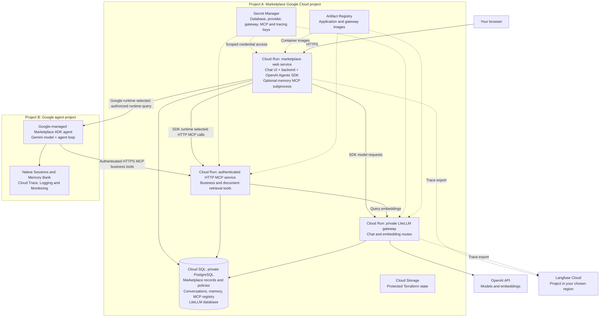

# Google Cloud setup

Deploy the full Marketplace and its Google-managed agent using one configuration file and one setup command. This is an optional course lab, separate from your local Docker environment. It uses **two billing-enabled Google Cloud projects**:

- **Marketplace project:** browser application, backend and SDK runtime, HTTP MCP tools, private model gateway, PostgreSQL, secrets and deployment storage.
- **Agent project:** Google-managed Marketplace agent, Gemini access, native sessions, memory and telemetry.

The [standalone agent setup](../course/setup/google-agent-platform/setup-guide.md) is a separate exercise with fictional data and native tools. It does not require Marketplace, MCP or Cloud SQL. For the Docker environment, use [Local Setup](LOCAL-SETUP.md).

**Validation status:** a fresh two-project baseline deployment and live SDK/Google acceptance passed on October 28, 2026 after installer corrections and resumptions. See the [validation record](cloud/SETUP-VALIDATION.md) for checks and limits. This does not certify organization-specific policies or every optional integration. Use fresh projects for this installer; it does not adopt the instructor's existing deployment.

## 1. Prepare accounts and tools

- **Create two Google Cloud projects and enable billing on both. That is the project preparation you do manually.** Use the Google account that created them when authenticating below. The setup command enables the required APIs, creates the runtime identities and configures their service permissions; do not enable services or deploy components separately.
- **Only for an organization-managed or access-restricted project:** its administrator must allow your deployment account to enable APIs, create the listed infrastructure/service accounts, manage their IAM bindings and deploy the agent. Ask the administrator to confirm those permissions before running setup. Organization policies must also permit the selected regions and the course application’s public Cloud Run endpoints. Setup cannot override an organization policy or grant privileges your account does not hold.
- Install [Git](https://git-scm.com/downloads), [Docker](https://www.docker.com/products/docker-desktop/), [Google Cloud CLI](https://cloud.google.com/sdk/docs/install), [Terraform](https://developer.hashicorp.com/terraform/install) **1.7 or newer, below 2.0**, and **Python 3.12**. Start Docker and make sure `python3.12` is on your path.
- Have an OpenAI API key with credit and access to the configured course models. Cloud Gemini usage is billed to the agent project; it does not use the OpenAI key. The local OpenRouter selector does not configure this cloud deployment.
- Create a [Langfuse Cloud](https://cloud.langfuse.com) project and obtain its public key, secret key and matching regional host.
- Clone the [course repository](https://github.com/smakam/agentic-systems). Run the following commands from its root.

Authenticate both the CLI and Application Default Credentials using the deployment account:

```sh
gcloud auth login
gcloud auth application-default login
```

**Cost:** this creates billable Cloud SQL, Cloud Run, storage and agent resources in your projects, with additional model/API usage. Use a small test deployment, monitor Billing, and stop Cloud SQL between labs. Storage, backups, agent resources and other retained services can continue to incur charges. See [Cloud SQL pricing](https://cloud.google.com/sql/pricing) and [Google Cloud pricing calculator](https://cloud.google.com/products/calculator).

## 2. Fill one configuration file

Create your private configuration without overwriting an existing file:

```sh
[ -f app/cloud/.env ] || cp app/cloud/.env.example app/cloud/.env
```

Edit `app/cloud/.env`:

```sh
export MARKETPLACE_GCP_PROJECT=your-marketplace-project-id
export MARKETPLACE_GCP_REGION=asia-south1
export AGENT_GCP_PROJECT=your-agent-project-id
export AGENT_GCP_REGION=us-central1
export MARKETPLACE_LF_HOST=https://cloud.langfuse.com
```

Use **project IDs**, not display names. Choose regions available to your account and model. The Langfuse host must match the project where you obtained its keys. The file accepts literal values, not shell substitutions. You do not need to source it before running setup.

Keep API keys and passwords out of this file. Setup requests them privately and stores them in Secret Manager. The installer derives the agent service-account and private staging-bucket names from the agent project. Advanced users can override those non-secret references using `AGENT_RUNTIME_SERVICE_ACCOUNT` and `AGENT_STAGING_BUCKET`.

## 3. Run setup

First check the configuration without contacting Google Cloud or creating resources:

```sh
python3 app/cloud/scripts/setup.py
```

Then run the deployment:

```sh
python3 app/cloud/scripts/setup.py --deploy
```

Confirm the two displayed project IDs. Setup then runs the infrastructure, credential, image, database, application and agent steps in order. Supply the demo password, OpenAI key and matching Langfuse keys when requested. Keep the terminal open; infrastructure provisioning and agent deployment can take time.

You do **not** need to run Terraform, build images, provision the agent identity or copy MCP credentials manually. Terraform creates Marketplace infrastructure; the wrapper prepares the agent project and calls the Python agent deployer. It privately copies the generated MCP credential into an agent-project secret and grants the custom runtime identity access to that secret. Google requires injected runtime secrets to be in the agent project; no secret values enter Terraform state or command arguments. The MCP endpoint is reachable over HTTPS and still requires its application API key; the model gateway remains private. Built-in guardrail hooks remain available. Optional Presidio/Lakera hooks load only when their sidecars or provider key are configured; the baseline does not provision Presidio sidecars.

Setup also discovers your Langfuse project ID from its matching keys and builds the correct cloud trace links; no additional project-ID entry is required.

Setup prints the Marketplace URL and stores a non-secret result in:

```text
app/cloud/.setup/YOUR_MARKETPLACE_PROJECT_ID/result.json
```

This directory is gitignored and contains the deployment checkpoints, generated configuration, agent manifest, Terraform working copies and local bootstrap state. **Preserve it:** the bootstrap state is local; the main infrastructure state is in the protected Cloud Storage bucket. Do not delete checkpoints or change project IDs to force a retry. Protect any backups as deployment state can contain infrastructure details.

If a phase fails, fix the reported problem and rerun the **same deployment command** with the same configuration and source revision. Completed phases are skipped. Setup never runs fixture-reset or business-snapshot replacement commands. It refuses an existing Marketplace deployment on the first run.

If agent creation is interrupted, inspect the agent project's runtime list before taking any further action. Setup blocks another create if it cannot establish whether the first one succeeded. Do not delete its safety marker or create another runtime just to make the command proceed. Resolve the returned deployment manifest against the runtime in your project before resuming.

## 4. Verify the result

The installer's HTTP health check is only the first check. Complete this acceptance sequence before calling the installation validated:

| Check | What must pass |
|---|---|
| Login | Open your generated Marketplace URL and sign in as `operator` using the password chosen during setup. |
| Retrieval readiness | In Support, choose **OpenAI Agents SDK → Workspace options → Documents**. Wait for all documents to show Ready. Resolve any credential/indexing errors. |
| SDK investigation | Ask **“What products, quantities and sellers are in order-1? Retrieve current records.”** Verify the answer against the cloud records and open its evidence links. |
| SDK trace | Open your Langfuse Cloud project. Verify model and business-tool observations for the question; confirm HTTP MCP in run metadata. |
| Managed agent | Start a fresh conversation, select **Google hosted runtime**, and ask **“Show the items and quantities for order-2.”** Check the evidence and business tool calls. |
| Session continuity | In the same Google conversation, ask **“What is their total quantity?”** Compare with the preceding records. |
| Native observability | Check the deployed agent's native session and trace in the agent project. Allow time for ingestion; a deployment listing alone is not proof that tools work. |
| Persistence | Stop and resume the database as described below, then confirm login, saved conversations and another data-backed question work. |

After verification or a lab session, follow [Stop Cloud SQL when not in use](#stop-cloud-sql-when-not-in-use).

Record pass/fail, the source revision, both project IDs, selected regions, result/trace references and any correction needed in the guide. Keep secrets out of screenshots and reports. A completed answer alone does not verify correct retrieval, tool authentication or trace export. If any check fails, do not label the entire setup as passed.

<details>
<summary>Architecture: where each component runs</summary>



The SDK runtime stays inside the Marketplace backend. Selecting Google routes execution to the managed agent in the second project; that agent calls the cloud Marketplace MCP tools. Business data, conversations and credentials are independent of your laptop. No supported course setup uses a laptop tunnel or mixes a local application with these cloud business services.

</details>

<details>
<summary>What the setup command does</summary>

1. Verifies tools, authentication, billing and explicit project targets.
2. Creates the protected state bucket and Marketplace foundation with the existing Terraform configuration.
3. Configures database roles, scoped secrets and regional Langfuse export.
4. Builds/pushes the web and gateway images, deploys the private gateway and runs the preserving database initialization job.
5. Provisions scoped gateway keys and deploys Marketplace web/API and authenticated HTTP MCP.
6. Enables agent-project APIs, prepares its runtime identity/private bucket and provisions the agent-project MCP secret and scoped runtime access.
7. Installs/tests the agent package and deploys the Marketplace-compatible managed agent.
8. Grants the Marketplace backend runtime-query access, configures the managed runtime and checks web health.

These are implementation phases inside the single setup command, rather than additional learner commands. The standalone Basics agent is not deployed by this flow.

</details>

## Stop Cloud SQL when not in use

After a lab, stop the Marketplace Cloud SQL instance if nobody else is using this deployment. This pauses the database while preserving its data; do not disable the Cloud SQL API or delete the instance. The app needs the database running for login, records and agent tools.

From the repository root, load your non-secret configuration and stop the database:

```sh
. ./app/cloud/.env
app/cloud/scripts/database.sh status
app/cloud/scripts/database.sh stop
app/cloud/scripts/database.sh status
```

Check that the status reports **STOPPED** with activation policy **NEVER**.

### Resume before the next lab

```sh
. ./app/cloud/.env
app/cloud/scripts/database.sh start
app/cloud/scripts/database.sh status
```

Wait for **RUNNABLE** with activation policy **ALWAYS**, then reopen the Marketplace and check login.

Confirm the Cloud SQL console shows **Stopped** after stopping. Before using the app again, start the database and wait for readiness. Stopping preserves data; it is not deletion or a reset. Do not rerun the installer simply to start the database. An incomplete install can start it again when its pending Terraform apply runs, so finish setup before using stop/resume for routine labs.

Stopping Cloud SQL does not remove retained storage, backups or the other cloud resources. Review the remaining charges in both projects.

For teardown, delete only resources you created and account for both projects. Terraform protects the database and Cloud Run services against accidental deletion. Review any deliberate teardown and check remaining storage, backups, agent deployments and charges.

## Troubleshooting and validation scope

- **Configuration rejected:** use literal project IDs/regions and the matching supported Langfuse host. Project IDs must differ.
- **Tool/authentication/billing failure:** install the named tool, select the intended account, authenticate ADC and enable billing in both projects. Setup does not create projects or attach billing accounts.
- **Existing deployment:** use fresh projects. This installer is not an automatic migration/adoption tool for the instructor deployment.
- **Changed configuration or source:** restore the configuration/source revision that created the checkpoint, or review a deliberate migration separately. Never remove state to bypass the check.
- **Stale lock:** confirm no installer process is running before removing `setup.lock` from this deployment's private working directory.
- **Interrupted agent create:** inspect the remote runtimes and saved manifest before recovery; never blindly retry a create.
- **First hosted request returns 403 immediately after setup:** allow a few minutes for the new cross-project query grant to propagate, then retry. If it persists, inspect the scoped IAM binding; do not grant broad owner access to the application.
- **Native traces absent:** verify `telemetry.googleapis.com` and `cloudtrace.googleapis.com` are enabled in the agent project and the runtime has `roles/cloudtrace.agent`. Allow ingestion time after a new question.
- **Runtime/tool failure:** inspect IAM, the runtime's numeric secret version, model availability and the HTTPS MCP URL. The deployer and runtime identity have different responsibilities.

The [technical deployment reference](cloud/README.md) has deeper infrastructure and credential troubleshooting. The [HTTP MCP acceptance record](cloud/VALIDATION-2026-10-10-SDK-HTTP-MCP.md) documents an existing deployment; it is not a fresh-install certification. Agent identity and staging permissions follow [Google's runtime setup guidance](https://docs.cloud.google.com/gemini-enterprise-agent-platform/build/runtime/setup).

**Rehearsal completed:** see the [fresh-project validation record](cloud/SETUP-VALIDATION.md). Complete the acceptance checklist for your own installation as well.
