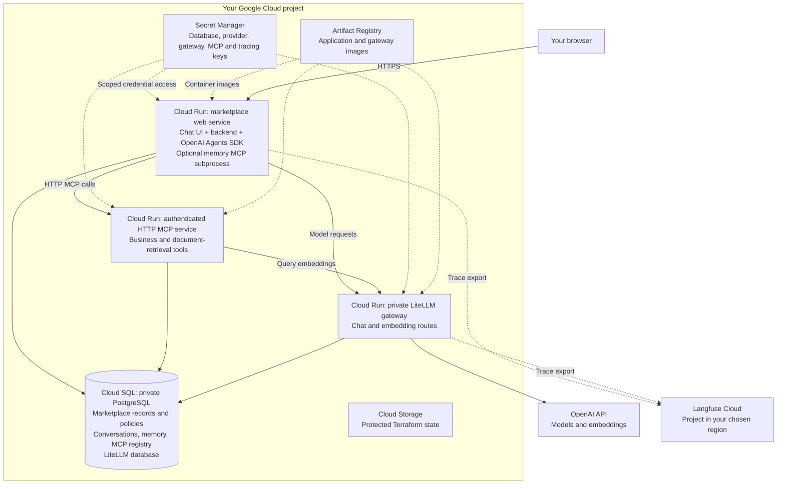

# Optional Google Cloud setup

Use this guide if you want to run the course marketplace and OpenAI Agents SDK in Google Cloud. This optional path is for learners who want cloud deployment experience and are comfortable provisioning cloud services. Most learners can use the local setup for the core course. This deployment is independent of your laptop: data, conversations, memories and credentials are not automatically synchronized.

**Status:** the existing course deployment, agent answers, retained evidence and HTTP MCP traces have been verified. The following installation sequence has not yet been rehearsed end to end in a fresh learner project. That rehearsal is deferred; do not treat this as a validated one-command installer.

## What runs in the cloud



**Cloud SQL is a managed PostgreSQL instance, not a Docker database on your laptop.** The application, tools and gateway use separate database roles. Cloud Run services use private networking/Cloud SQL connections for database access. The gateway remains private with IAM authentication; the HTTP MCP service additionally enforces its application key. Langfuse Cloud and OpenAI are external services, not resources deployed in your Google Cloud project. Artifact Registry and the state bucket support deployment, rather than the agent request loop.

## Estimated cloud cost

For a small course lab, **plan roughly USD 30–40 per month (about USD 7–10 per week) for Cloud SQL and its retained storage/backups if left running continuously**. Stopping it between short labs can reduce that substantially. These are planning allowances, not a measured bill or a quote for every region; model calls and variable cloud-service charges are separate.

The repository selects one zonal `db-g1-small` instance with 10 GiB SSD, backups enabled, private IP and no HA replica. To make the arithmetic inspectable, this illustration uses the public **Iowa** list prices: instance USD 0.035/hour, SSD about USD 0.17/GiB-month and used backups about USD 0.08/GiB-month. It assumes 10 GiB of billed backup storage, which may differ from actual usage. A month is 730 hours; a week is 168 hours.

| Cloud SQL example | One week | One month |
|---|---:|---:|
| Running continuously: instance + 10 GiB SSD + assumed 10 GiB backup storage | About $6.46 | About $28.05 |
| Running 10 hours/week, stopped otherwise: same retained storage/backups | About $0.93 | About $4.02 |
| Stopped for the whole period: same retained storage/backups only | About $0.58 | About $2.50 |

The suggested $30–40 monthly allowance rounds above the continuous-use illustration for regional price differences and backup variation. **The course's default Google Cloud region is Mumbai; select your actual region in the pricing calculator rather than treating the Iowa illustration as a Mumbai quote.** Changing the database tier, storage size, backup retention or availability mode changes the estimate.

Cloud Run is configured with zero minimum instances and request-based billing. Its CPU, memory, requests and network usage can add charges; cold starts and longer model requests affect active time. Artifact image storage, Secret Manager, state storage and logging can add smaller usage-dependent charges. OpenAI model/embedding charges are additional. Langfuse plan charges and free allowances depend on the plan you choose. Free credits are not deducted from the estimates above.

Review [Cloud SQL pricing](https://cloud.google.com/sql/pricing?hl=en), [stopped-instance billing](https://docs.cloud.google.com/sql/docs/postgres/start-stop-restart-instance#stop_an_instance), [Cloud Run pricing](https://cloud.google.com/run/pricing) and the [Google Cloud calculator](https://cloud.google.com/products/calculator). Track actual project spend in Google Cloud Billing. Stop the database between labs when no one is using it; retained resources continue to be billed.

## 1. Prepare accounts and tools

- Use your own billed Google Cloud project and an identity authorized to provision its resources.
- Install Git, Python 3, Docker, the Google Cloud CLI and Terraform (the repository requires Terraform 1.7 or newer, below 2.0).
- Have a funded **OpenAI API key**. The current cloud helper and gateway use OpenAI; the local OpenRouter selector does not configure cloud inference.
- Sign up or sign in through [Langfuse Cloud](https://cloud.langfuse.com), choose a region near you, and create a project. Obtain its matching public/secret key pair and regional host URL; use the same region for login and tracing. See [Langfuse regional hosts](https://langfuse.com/faq/all/where-is-my-project).
- Use the [same repository](https://github.com/smakam/agentic-systems) as the local setup. Commands below start from the repository root unless a directory is specified.

Authenticate the deployment identity and Application Default Credentials with Google Cloud CLI. Select your own project. Do not use another learner's project or the instructor's service URLs as your deployment.

```sh
gcloud auth login
gcloud auth application-default login
export MARKETPLACE_GCP_PROJECT=YOUR_PROJECT_ID
export MARKETPLACE_GCP_REGION=asia-south1
gcloud config set project "$MARKETPLACE_GCP_PROJECT"
# Set this to the regional host where you created your Langfuse project.
export MARKETPLACE_LF_HOST=https://cloud.langfuse.com
```

Cloud infrastructure, retained database storage and model requests can incur charges. Review the cloud provider's current billing information and the [deployment cost guidance](cloud/README.md#cost-boundary) before creating resources. Optional platform credits have eligibility and usage limits.

## 2. Create the infrastructure

The foundation creates private networking, PostgreSQL, databases, runtime identities, an image repository and scoped Secret Manager containers. It does not store secret payloads in Terraform variables.

First create the protected state bucket:

```sh
cd app/cloud/bootstrap
terraform init
terraform plan -var="project_id=$MARKETPLACE_GCP_PROJECT" -var="region=$MARKETPLACE_GCP_REGION" -out=bootstrap.tfplan
terraform apply bootstrap.tfplan
terraform output -raw state_bucket
```

Preserve the bootstrap state. From the repository root, initialize the main configuration using the bucket name printed above:

```sh
cd app/cloud/terraform
terraform init -backend-config="bucket=${MARKETPLACE_GCP_PROJECT}-tfstate" -backend-config='prefix=marketplace'
cp terraform.tfvars.example terraform.tfvars
```

Edit `terraform.tfvars`: set your project and region, and set `database_active = true` for initial creation. Leave image variables empty and optional hosted agents disabled. New instance creation in the tested deployment required the database to be active; stopping is for after setup.

```sh
terraform plan -out=foundation.tfplan
terraform apply foundation.tfplan
```

## 3. Configure private credentials

Return to the repository root. The credential helper configures database users and stores generated secrets in your project. It prompts privately for a new demo login password and the OpenAI key. Lakera is optional; leave it blank for this setup.

```sh
python3 app/cloud/scripts/configure-cloud.py --project "$MARKETPLACE_GCP_PROJECT" --region "$MARKETPLACE_GCP_REGION"
app/cloud/scripts/configure-langfuse.sh
```

The Langfuse helper uses `MARKETPLACE_LF_HOST` and requests the keys from the project in that region. It stores the secret key in the two runtime-scoped secrets and writes the public key/host to `langfuse-public.env`. Set the non-secret Terraform variables `langfuse_host` to the same host and `langfuse_public_key` to that public key. This configures gateway and application trace export consistently. Keep secret values out of source control, Terraform variables, command arguments and recordings.

## 4. Build the images and initialize the database

The [deployment reference](cloud/README.md#build-the-web-image-with-the-cloud-trace-link) explains the image build configuration. Use the **Artifact Registry repository created by Terraform in your Google Cloud project**. You do not need a separate registry account or another repository. The image path below uses that repository:

```sh
export MARKETPLACE_IMAGE_REPOSITORY="${MARKETPLACE_GCP_REGION}-docker.pkg.dev/${MARKETPLACE_GCP_PROJECT}/marketplace"
gcloud auth configure-docker "${MARKETPLACE_GCP_REGION}-docker.pkg.dev"
docker build --platform linux/amd64 -f app/cloud/Dockerfile.web --build-arg VITE_LANGFUSE_URL="$MARKETPLACE_LF_HOST" -t "$MARKETPLACE_IMAGE_REPOSITORY/web:course-setup" app
docker build --platform linux/amd64 -f app/cloud/Dockerfile.gateway -t "$MARKETPLACE_IMAGE_REPOSITORY/gateway:course-setup" app
docker push "$MARKETPLACE_IMAGE_REPOSITORY/web:course-setup"
docker push "$MARKETPLACE_IMAGE_REPOSITORY/gateway:course-setup"
```

In `app/cloud/terraform/terraform.tfvars`, set `web_image` and `gateway_image` to those pushed image references, `application_enabled = false`, and your chosen `langfuse_host` and Langfuse public key. Keep `database_active = true`. Apply a reviewed Terraform plan to create the private gateway and initialization job before enabling the application services.

From the repository root, run the explicit initialization job:

```sh
gcloud run jobs execute marketplace-initialize --project "$MARKETPLACE_GCP_PROJECT" --region "$MARKETPLACE_GCP_REGION" --wait
```

Initialization seeds the cloud databases and configures their read-only roles. It is a setup operation, not a reset to perform whenever you revisit the app. Inspect the job status before continuing.

Read the gateway URL from Terraform's `service_urls` output. Provision its scoped model keys without printing credentials:

```sh
python3 app/cloud/scripts/configure-gateway-keys.py --project "$MARKETPLACE_GCP_PROJECT" --gateway YOUR_GATEWAY_HTTPS_URL
```

## 5. Deploy the marketplace web app and HTTP MCP service

At this point, the images are uploaded, the database is initialized and the private gateway is available. The browser application and business-tool service have deliberately been held back until their scoped keys exist. This step tells Terraform to create/update those two Cloud Run services:

- **Marketplace web service:** serves the browser UI, login/API and OpenAI Agents SDK runtime.
- **HTTP MCP service:** exposes the business and policy tools that the SDK runtime calls over authenticated HTTP.

After deployment, you get the web URL for the browser and the MCP service URL used by the agent. This step does not reseed the database or create another marketplace.

Set these non-secret values in `terraform.tfvars`:

- `application_enabled = true`
- Leave `app_origin` empty for the standard Cloud Run URL. Terraform derives the marketplace browser URL from your project and region. This is the URL the backend permits as the source of browser requests. Set `app_origin` only if you deliberately use a custom domain; use its HTTPS URL without a path or trailing slash.
- `public_web = true` for the browser-accessible course app
- `public_mcp = true` for an externally reachable MCP service **with its application API-key authentication still enforced**

The gateway remains private. Keep the optional Lyzr and Google ADK runtimes disabled for this initial SDK setup. The [Terraform service configuration](cloud/terraform/services.tf) supplies `AGENT_TOOL_TRANSPORT=mcp_http`, the project-specific MCP endpoint and its secret reference to the web runtime. Do not copy local `.env` values into the cloud application.

From the repository root, deploy the services with the updated variables:

```sh
cd app/cloud/terraform
terraform plan -out=application.tfplan
terraform apply application.tfplan
terraform output service_urls
```

Record the `web` and `mcp` URLs from `terraform output service_urls`; the MCP endpoint is the MCP service URL followed by `/mcp`. Record your Langfuse Cloud project URL too. These are the URLs to use in “Your First Agent, End to End” and “Tools and MCP”.

## 6. Verify access and one agent request

1. Open **your cloud marketplace web URL** and sign in as `support` or `operator` with the demo password you chose during credential setup.
2. Open the Support workspace and select **OpenAI Agents SDK**.
3. Ask: **“What products, quantities and sellers are in order-1? Retrieve current records.”**
4. Confirm that the answer completes and its evidence links open the retained records. Expect facts from your cloud data, which may differ from the laptop's modified data.
5. Use the application's Langfuse link to open **your selected Langfuse Cloud project**, then inspect the trace associated with that question. Check model-generation and business-tool observations. Run metadata should identify HTTP MCP; a tool name alone does not establish transport.

The private LiteLLM service is accessed by authenticated runtimes; it is not a public dashboard login checkpoint. Langfuse Cloud is a hosted account, not the laptop's seeded Langfuse login. A first request after idle time may take longer while services start.

“Your First Agent, End to End” optionally repeats this first-agent walkthrough in the cloud. “Tools and MCP” compares the local stdio connection with this cloud HTTP connection. If you skip cloud setup, you can still inspect supplied remote trace evidence in “Tools and MCP”.

## 7. Stop and resume between labs

**This is a useful way to control cost, especially Cloud SQL.** In this small, lightly used course lab, a database left running is usually the largest continuing infrastructure cost. Stop it between labs to remove database compute charges, and start it only when you need the cloud app. Storage and backups still cost money; stopping is not deleting the database or resetting its data. Model/API usage is billed separately.

From the repository root:

```sh
app/cloud/scripts/database.sh status
app/cloud/scripts/database.sh stop
# Before the next cloud lab:
app/cloud/scripts/database.sh start
```

Wait until the database is ready before asking questions. Stop it only when no one is using the deployment. Set Terraform's `database_active` variable to the same intended state before your next apply so Terraform does not reverse your choice. Cloud Run minimum instances are zero in this course configuration; database storage and retained resources remain billable while stopped.

## Troubleshooting and reference

Use the [cloud setup troubleshooting](cloud/README.md#learner-setup-and-troubleshooting-requirements) for initialization, secret formats, read-only role configuration, gateway authentication and frontend trace URLs. Do not publish credentials or raw connection errors that contain them.

The [existing HTTP MCP acceptance record](cloud/VALIDATION-2026-10-10-SDK-HTTP-MCP.md) documents the tested deployed behavior. It is supporting evidence, not a substitute for the pending fresh-project installation rehearsal.
