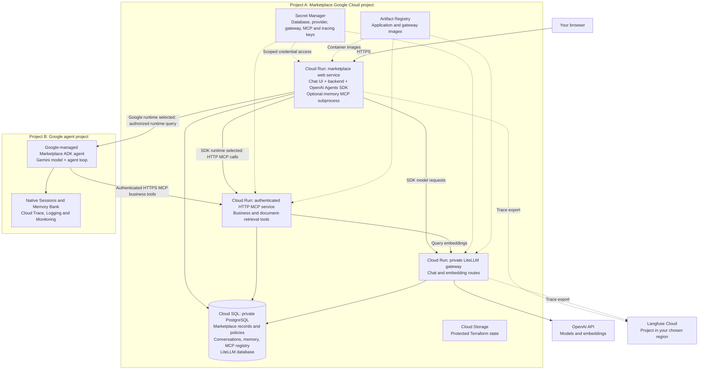

# Google Cloud setup: Marketplace and managed Google agent

Use this as the single setup guide for the **full Marketplace application in Google Cloud**, including its Google-managed agent. The supported full-cloud path uses two separately identified Google Cloud projects: the Marketplace project and the agent project. This is an optional cloud path alongside the local SDK environment. Local and cloud business data, conversations, memories and credentials do not synchronize.

## Choose the correct setup

| Course path | Setup | What it creates |
|---|---|---|
| Local Marketplace with the SDK | [Local setup](LOCAL-SETUP.md) | Local application, tools and databases |
| Standalone Google Support Agent Basics | [Chapter 19 Basics setup](../course/setup/google-agent-platform/setup-guide.md) | Independent Playground agent with fictional JSON/native tools |
| Full Marketplace in Google Cloud | **This guide, sections 1–8** | Marketplace project, managed agent in the agent project, and their connection |

**Full-cloud sequence:** configure both project identities once; deploy and verify Marketplace services (sections 1–6); deploy the Marketplace-compatible Google agent (section 7); connect and verify it from Marketplace chat (section 8). Section 9 covers stop/resume. Section 6 is an SDK checkpoint, not completion of the Google-hosted path. No learner path here uses a laptop tunnel or a local chat application mixed with cloud business services. The standalone Basics agent is not the Marketplace agent and cannot be substituted for it.

The infrastructure commands use the existing Terraform root, `app/cloud/terraform`. The managed agent package is deployed by the existing Python helper from `app/google`; Terraform then grants the cross-project query permission and configures the web backend. **This is one documented setup sequence, not a new one-command installer or a claim that Terraform itself packages the agent.** The shared environment example below identifies both projects; service secrets remain in Secret Manager and deployment outputs remain in their generated manifests.

**Purpose:** this is a small learning and testing deployment, not a production reference architecture. It prioritizes repeatable course experiments and manageable cost; production availability, scaling and operational hardening require additional design.

**Status:** the existing course deployment, agent answers, retained evidence and HTTP MCP traces have been verified. The following installation sequence has not yet been rehearsed end to end in a fresh learner project. That rehearsal is deferred; do not treat this as a validated one-command installer.

## What runs in the cloud



The two project boxes are resource/permission boundaries. The Marketplace backend authenticates its call to the managed runtime in the agent project. The Google agent calls the Marketplace project's authenticated business MCP service. Its native sessions/memory/telemetry belong to the agent project. SDK model calls still go through the Marketplace gateway; the Google agent uses its separately configured Gemini connection. OpenAI and Langfuse Cloud remain external services. Supporting Artifact Registry, secrets and state storage belong to their labelled project; they are not additional agents.

**Cloud SQL is a managed PostgreSQL instance, not a Docker database on your laptop.** The application, tools and gateway use separate database roles. Cloud Run services use private networking/Cloud SQL connections for database access. The gateway remains private with IAM authentication; the HTTP MCP service additionally enforces its application key. Langfuse Cloud and OpenAI are external services, not resources deployed in your Google Cloud project. Artifact Registry and the state bucket support deployment, rather than the agent request loop.

## Estimated cloud cost

> **Stop Cloud SQL when you are not actively using the cloud lab.** In this small course setup, a continuously running Cloud SQL instance is usually the largest ongoing infrastructure cost. Use **Stop** in the Cloud SQL console, or the [stop/start commands below](#7-stop-and-resume-between-labs), and start it only before your next cloud session. Stopping preserves your data and suspends instance compute charges. Storage and retained backups remain billable, typically at a much smaller cost for this lab; stopping does not make the setup free.

For a small course lab, **plan roughly USD 30–40 per month (about USD 7–10 per week) for Cloud SQL and its retained storage/backups if left running continuously**. Stopping it between short labs can reduce that substantially. These are planning allowances, not a measured bill or a quote for every region; model calls and variable cloud-service charges are separate.

The repository selects one zonal `db-g1-small` instance with 10 GiB SSD, backups enabled, private IP and no HA replica. To make the arithmetic inspectable, this illustration uses the public **Iowa** list prices: instance USD 0.035/hour, SSD about USD 0.17/GiB-month and used backups about USD 0.08/GiB-month. It assumes 10 GiB of billed backup storage, which may differ from actual usage. A month is 730 hours; a week is 168 hours.

| Cloud SQL example | One week | One month |
|---|---:|---:|
| Running continuously: instance + 10 GiB SSD + assumed 10 GiB backup storage | About $6.46 | About $28.05 |
| Running 10 hours/week, stopped otherwise: same retained storage/backups | About $0.93 | About $4.02 |
| Stopped for the whole period: same retained storage/backups only | About $0.58 | About $2.50 |

The suggested $30–40 monthly allowance rounds above the continuous-use illustration for regional price differences and backup variation. **The course's default Google Cloud region is Mumbai; select your actual region in the pricing calculator rather than treating the Iowa illustration as a Mumbai quote.** Changing the database tier, storage size, backup retention or availability mode changes the estimate.

Cloud Run is configured with zero minimum instances and request-based billing. Its CPU, memory, requests and network usage can add charges; cold starts and longer model requests affect active time. Artifact image storage, Secret Manager, state storage and logging can add smaller usage-dependent charges. OpenAI model/embedding charges are additional. Langfuse plan charges and free allowances depend on the plan you choose. Free credits are not deducted from the estimates above.

Review [Cloud SQL pricing](https://cloud.google.com/sql/pricing?hl=en), [stopped-instance billing](https://docs.cloud.google.com/sql/docs/postgres/start-stop-restart-instance#stop_an_instance), [Cloud Run pricing](https://cloud.google.com/run/pricing) and the [Google Cloud calculator](https://cloud.google.com/products/calculator). Track actual project spend in Google Cloud Billing. Stop the database between labs when no one is using it; retained resources continue to be billed.

## 1. Prepare accounts and tools

- Use your own two billing-enabled Google Cloud projects and deployment identities authorized for each. Keep their IDs explicit: `MARKETPLACE_GCP_PROJECT` and `AGENT_GCP_PROJECT`. A Google project is distinct from a Langfuse project. Do not use instructor resources.
- Install Git, Python 3, Docker, the Google Cloud CLI and Terraform (the repository requires Terraform 1.7 or newer, below 2.0).
- Have a funded **OpenAI API key**. The current cloud helper and gateway use OpenAI; the local OpenRouter selector does not configure cloud inference.
- Sign up or sign in through [Langfuse Cloud](https://cloud.langfuse.com), choose a region near you, and create a project. Obtain its matching public/secret key pair and regional host URL; use the same region for login and tracing. See [Langfuse regional hosts](https://langfuse.com/faq/all/where-is-my-project).
- Use the [same repository](https://github.com/smakam/agentic-systems) as the local setup. Commands below start from the repository root unless a directory is specified.

Authenticate the deployment identity and Application Default Credentials with Google Cloud CLI. Select your own project. Do not use another learner's project or the instructor's service URLs as your deployment.

```sh
gcloud auth login
gcloud auth application-default login
# From the repository root, create a private, gitignored configuration copy:
[ -f app/cloud/.env ] || cp app/cloud/.env.example app/cloud/.env
# Edit app/cloud/.env with your two project IDs, regions and resource names.
# It contains references only; keep API keys and secret payloads in Secret Manager.
. ./app/cloud/.env
gcloud config set project "$MARKETPLACE_GCP_PROJECT"
```

Cloud infrastructure, retained database storage and model requests can incur charges. Review the cloud provider's current billing information and the [deployment cost guidance](cloud/README.md#cost-boundary) before creating resources. Optional platform credits have eligibility and usage limits.

## 2. Create the Marketplace infrastructure

The foundation creates private networking, PostgreSQL, databases, runtime identities, an image repository and scoped Secret Manager containers. It does not store secret payloads in Terraform variables.

First create the protected state bucket:

```sh
cd app/cloud/bootstrap
terraform init
terraform plan -var="project_id=$MARKETPLACE_GCP_PROJECT" -var="region=$MARKETPLACE_GCP_REGION" -out=bootstrap.tfplan
terraform apply bootstrap.tfplan
terraform output -raw state_bucket
```

Preserve the bootstrap state. From the repository root, initialize the main configuration using the bucket name printed above:

```sh
cd app/cloud/terraform
terraform init -backend-config="bucket=${MARKETPLACE_GCP_PROJECT}-tfstate" -backend-config='prefix=marketplace'
cp terraform.tfvars.example terraform.tfvars
```

Edit `terraform.tfvars`: set your project and region, and set `database_active = true` for initial creation. Leave image variables empty and optional hosted agents disabled. New instance creation in the tested deployment required the database to be active; stopping is for after setup.

```sh
terraform plan -out=foundation.tfplan
terraform apply foundation.tfplan
```

## 3. Configure private credentials

Return to the repository root. The credential helper configures database users and stores generated secrets in your project. It prompts privately for a new demo login password and the OpenAI key. Lakera is optional; leave it blank for this setup.

```sh
python3 app/cloud/scripts/configure-cloud.py --project "$MARKETPLACE_GCP_PROJECT" --region "$MARKETPLACE_GCP_REGION"
app/cloud/scripts/configure-langfuse.sh
```

The Langfuse helper uses `MARKETPLACE_LF_HOST` and requests the keys from the project in that region. It stores the secret key in the two runtime-scoped secrets and writes the public key/host to `langfuse-public.env`. Set the non-secret Terraform variables `langfuse_host` to the same host and `langfuse_public_key` to that public key. This configures gateway and application trace export consistently. Keep secret values out of source control, Terraform variables, command arguments and recordings.

## 4. Build the images and initialize the database

The [deployment reference](cloud/README.md#build-the-web-image-with-the-cloud-trace-link) explains the image build configuration. Use the **Artifact Registry repository created by Terraform in your Google Cloud project**. You do not need a separate registry account or another repository. The image path below uses that repository:

```sh
export MARKETPLACE_IMAGE_REPOSITORY="${MARKETPLACE_GCP_REGION}-docker.pkg.dev/${MARKETPLACE_GCP_PROJECT}/marketplace"
gcloud auth configure-docker "${MARKETPLACE_GCP_REGION}-docker.pkg.dev"
docker build --platform linux/amd64 -f app/cloud/Dockerfile.web --build-arg VITE_LANGFUSE_URL="$MARKETPLACE_LF_HOST" -t "$MARKETPLACE_IMAGE_REPOSITORY/web:course-setup" app
docker build --platform linux/amd64 -f app/cloud/Dockerfile.gateway -t "$MARKETPLACE_IMAGE_REPOSITORY/gateway:course-setup" app
docker push "$MARKETPLACE_IMAGE_REPOSITORY/web:course-setup"
docker push "$MARKETPLACE_IMAGE_REPOSITORY/gateway:course-setup"
```

In `app/cloud/terraform/terraform.tfvars`, set `web_image` and `gateway_image` to those pushed image references, `application_enabled = false`, and your chosen `langfuse_host` and Langfuse public key. Keep `database_active = true`. Apply a reviewed Terraform plan to create the private gateway and initialization job before enabling the application services.

From the repository root, run the explicit initialization job:

```sh
gcloud run jobs execute marketplace-initialize --project "$MARKETPLACE_GCP_PROJECT" --region "$MARKETPLACE_GCP_REGION" --wait
```

Initialization seeds the cloud databases and configures their read-only roles. It is a setup operation, not a reset to perform whenever you revisit the app. Inspect the job status before continuing.

Read the gateway URL from Terraform's `service_urls` output. Provision its scoped model keys without printing credentials:

```sh
python3 app/cloud/scripts/configure-gateway-keys.py --project "$MARKETPLACE_GCP_PROJECT" --gateway YOUR_GATEWAY_HTTPS_URL
```

## 5. Deploy the marketplace web app and HTTP MCP service

At this point, the images are uploaded, the database is initialized and the private gateway is available. The browser application and business-tool service have deliberately been held back until their scoped keys exist. This step tells Terraform to create/update those two Cloud Run services:

- **Marketplace web service:** serves the browser UI, login/API and OpenAI Agents SDK runtime.
- **HTTP MCP service:** exposes the business and policy tools that the SDK runtime calls over authenticated HTTP.

After deployment, you get the web URL for the browser and the MCP service URL used by the agent. This step does not reseed the database or create another marketplace.

Set these non-secret values in `terraform.tfvars`:

- `application_enabled = true`
- Leave `app_origin` empty for the standard Cloud Run URL. Terraform derives the marketplace browser URL from your project and region. This is the URL the backend permits as the source of browser requests. Set `app_origin` only if you deliberately use a custom domain; use its HTTPS URL without a path or trailing slash.
- `public_web = true` for the browser-accessible course app
- `public_mcp = true` for an externally reachable MCP service **with its application API-key authentication still enforced**

The gateway remains private. Keep the optional Lyzr and Google ADK runtimes disabled for this initial SDK setup. The [Terraform service configuration](cloud/terraform/services.tf) supplies `AGENT_TOOL_TRANSPORT=mcp_http`, the project-specific MCP endpoint and its secret reference to the web runtime. Do not copy local `.env` values into the cloud application.

From the repository root, deploy the services with the updated variables:

```sh
cd app/cloud/terraform
terraform plan -out=application.tfplan
terraform apply application.tfplan
terraform output service_urls
```

Record the `web` and `mcp` URLs from `terraform output service_urls`; the MCP endpoint is the MCP service URL followed by `/mcp`. Record your Langfuse Cloud project URL too. These are the URLs to use in “Your First Agent, End to End” and “Tools and MCP”.

## 6. Verify the Marketplace SDK checkpoint

1. Open **your cloud marketplace web URL** and sign in as **operator** with the demo password you chose during credential setup. Cloud SQL and the required cloud services must be ready.
2. Open **Support workspace → OpenAI Agents SDK → Workspace options → Documents**. Document indexing happens automatically; wait for **Ready**. No manual indexing action is required. Existing embeddings are reused; new or changed content incurs document-embedding API usage. Business data is preserved.
3. Check readiness in this cloud deployment even if your laptop is ready: the databases are independent. If preparation fails, correct provider credentials, embedding-model access, billing or gateway connectivity, then use **Retry preparation**. A successful answer alone is not proof that all documents are ready for vector retrieval.
4. Ask: **“What products, quantities and sellers are in order-1? Retrieve current records.”**
5. Confirm that the answer completes and its evidence links open the retained records. Expect facts from your cloud data, which may differ from the laptop's modified data.
6. Use the application's Langfuse link to open **your selected Langfuse Cloud project**, then inspect the trace associated with that question. Check model-generation and business-tool observations. Run metadata should identify HTTP MCP; a tool name alone does not establish transport.

The private LiteLLM service is accessed by authenticated runtimes; it is not a public dashboard login checkpoint. Langfuse Cloud is a hosted account, not the laptop's seeded Langfuse login. A first request after idle time may take longer while services start.

“Your First Agent, End to End” optionally repeats this first-agent walkthrough in the cloud. “Tools and MCP” compares the local stdio connection with this cloud HTTP connection. If you skip cloud setup, you can still inspect supplied remote trace evidence in “Tools and MCP”.

## 7. Deploy the Marketplace-compatible Google agent

### Prepare the agent project

Confirm these three prerequisites:

1. Your cloud marketplace is working after sections 1–6 above, and you know its Cloud Run MCP URL and its Secret Manager MCP-key reference. Do not copy the key into source, prompts or screenshots.
2. You have a billing-enabled Google agent project, an authorized Cloud Shell session, a runtime service account and private staging bucket. Enable Agent Platform, Resource Manager, Secret Manager and required telemetry APIs in that project. The runtime identity needs Vertex AI User and telemetry writer permissions, Storage Object Viewer on its staging bucket, and Secret Accessor on its one MCP secret. Provisioning permissions belong to your authenticated deployer.
3. Decide whether you will **create your own marketplace ADK runtime** or **update your own already compatible marketplace ADK runtime**. A Basics runtime is not compatible. Use your own project and resource names; instructor resources are not values to copy.


Prepare these resources in the **agent project** before running the Python deployment: enable the Agent Platform/Vertex AI, Resource Manager, Secret Manager and telemetry APIs; create the named runtime service account; create the private staging bucket; and grant the scoped permissions described above. Project creation, API enablement, bucket creation and service-account grants are not performed by `app/google/deploy.py`. Confirm them in the Cloud console rather than assuming the Marketplace Terraform root creates them. Use the [official runtime deployment guidance](https://docs.cloud.google.com/gemini-enterprise-agent-platform/scale/runtime/use-terraform) for current requirements. This documented manual preparation is an explicit prerequisite; a unified Terraform bootstrap for both projects has not been implemented or rehearsed.

### Install and configure the agent package

In an authorized Cloud Shell or deployment terminal, use the same repository and the same private project configuration. Keep `app/cloud/.env` available there with your non-secret references. Work in `app/google`, not `app/google/basics`:

```bash
cd YOUR_COURSE_REPOSITORY
. ./app/cloud/.env
cd app/google
python3.12 -m venv .venv
source .venv/bin/activate
pip install -r requirements.txt
python -m unittest test_agent -v

export GOOGLE_GENAI_USE_ENTERPRISE=TRUE
export GOOGLE_CLOUD_PROJECT="$AGENT_GCP_PROJECT"
export GOOGLE_CLOUD_LOCATION="$AGENT_GCP_REGION"
export GOOGLE_STAGING_BUCKET="$AGENT_STAGING_BUCKET"
export GOOGLE_RUNTIME_SERVICE_ACCOUNT="$AGENT_RUNTIME_SERVICE_ACCOUNT"
export GOOGLE_AGENT_MODEL=gemini-3.5-flash
export GOOGLE_MODEL_LOCATION=us
export GOOGLE_MEMORY_ENABLED=true
export REMOTE_MCP_URL=https://YOUR_CLOUD_MCP_HOST/mcp
export GOOGLE_MCP_SECRET="projects/$AGENT_GCP_PROJECT/secrets/$AGENT_MCP_SECRET_NAME"
export GOOGLE_MCP_SECRET_VERSION=YOUR_NUMERIC_SECRET_VERSION
```

Use a model and endpoint available to your project. Runtime/session region and model endpoint are separate settings. These values are references, not secret payloads. The deployed agent reads the MCP key from Secret Manager at runtime. Its URL must address your working business service.

### Connect the business MCP credential

Use the Marketplace MCP key from section 3, not a newly generated unrelated key. If the agent shares the business project's secret, point `GOOGLE_MCP_SECRET` at that existing secret and grant the agent runtime identity access to that secret only. If you use a separate agent-project secret, copy the existing key directly between Secret Manager services with an authorized deployer; do not print it:

```bash
# Only for a separate secret you create in your agent project:
gcloud secrets create "$AGENT_MCP_SECRET_NAME" --project "$GOOGLE_CLOUD_PROJECT" --replication-policy=automatic
gcloud secrets versions access YOUR_BUSINESS_MCP_SECRET_VERSION --secret=YOUR_BUSINESS_MCP_SECRET --project="$MARKETPLACE_GCP_PROJECT" | gcloud secrets versions add "$AGENT_MCP_SECRET_NAME" --project "$GOOGLE_CLOUD_PROJECT" --data-file=-
```

Record the new numeric version and set `GOOGLE_MCP_SECRET_VERSION` accordingly. Grant `roles/secretmanager.secretAccessor` on the chosen secret to the runtime service account. Do not replace a shared key or grant access to all project secrets. The business MCP enforces its application key; verify any additional Cloud Run access policy against sections 3–5 before continuing.

### Create or update your Marketplace agent

**New runtime:** remove any inherited runtime target and create without a profile flag. Your direct URL/secret settings from the configuration and credential steps above supply the cloud business connection:

```bash
unset GOOGLE_RUNTIME_RESOURCE
python deploy.py
```

`deploy.py` creates a new marketplace ADK deployment and writes its resource name, URL and secret reference to `deployment.json`. The code's display name is Marketplace Support ADK Lab; distinguish your resource by project and returned resource ID. If creation fails or times out, inspect your project's runtime list before retrying; do not blindly create duplicates.

**Existing compatible runtime you own:** use its resource ID to update with the same direct settings:

```bash
export GOOGLE_RUNTIME_RESOURCE=projects/YOUR_AGENT_PROJECT_NUMBER/locations/YOUR_RUNTIME_REGION/reasoningEngines/YOUR_RUNTIME_ID
python deploy.py
```

Do not use the saved instructor `--backend local|cloud` profiles for this learner deployment. The explicit cloud MCP URL and secret above define your agent's tool target. The historical laptop/tunnel path is outside the supported course setup. Selecting Google in chat never deploys an agent or changes its MCP target.

### Verify the agent in Playground

Read `deployment.json`; confirm its resource belongs to your project and its MCP URL/secret reference match your cloud stack. Open that deployment in Google Playground, start a fresh session and ask “Show the items and quantities for order-2.” Inspect actual business tool calls and returned evidence. Then ask “What is their total quantity?” in the same session and inspect retained context. Use your own fixture's expected values.

If startup or tools fail, inspect the deployment logs, runtime identity, secret version and endpoint before proceeding. A displayed deployment is not proof that authenticated tools work. Native Sessions and Traces are separate surfaces; allow trace ingestion time.

## 8. Connect Marketplace chat and verify the full-cloud path

After the hosted marketplace agent works, edit the existing `app/cloud/terraform/terraform.tfvars` from sections 1–6 above:

```hcl
google_runtime_project_id = "YOUR_AGENT_PROJECT_ID"
google_runtime_resource   = "projects/YOUR_AGENT_PROJECT_NUMBER/locations/YOUR_RUNTIME_REGION/reasoningEngines/YOUR_RUNTIME_ID"
```

Preserve your other cloud settings and image references. From `app/cloud/terraform`, review and apply the connection change:

```bash
terraform plan -out=google-integration.tfplan
terraform apply google-integration.tfplan
```

The existing Terraform code injects `GOOGLE_RUNTIME_RESOURCE` into the **web backend** and grants its Cloud Run service identity the custom `aiplatform.reasoningEngines.query` permission in the agent project. This project-level query permission is not a per-user session boundary; the backend binds authenticated users to platform identities. It grants no deployment/admin permission. All credentials stay in the backend; no frontend API key or ADC file is required. The existing UI discovers available runtimes from the backend, so no frontend build variable selects the Google resource. See [runtime configuration](RUNTIME-SELECTOR.md#configuration).

### End-to-end verification

Open **your cloud marketplace URL**, select **Google hosted runtime**, and start a fresh conversation. Repeat the order-2 question and same-chat quantity follow-up. Check your business tool evidence, native session/trace and application-boundary trace if Langfuse is configured. The managed agent, cloud business tools and chat backend are distinct components; choosing Google in chat changes the execution adapter, not the database or MCP endpoint.

Record the project/resource references, tool results, session continuity, trace links, failures and actual costs you inspect. Do not submit secrets. Complete the [optional exercise observation table](../course/exercises/google-agent-platform/exercise.md#what-to-document). The instructor's historical integration passed, but these instructions have not been rehearsed from scratch in a fresh learner project.

For cleanup, remove only resources you created and verify remaining billable services. Keep the standalone Basics and instructor resources intact. The learner full-cloud path does not use a laptop tunnel or a local caller.

## 9. Stop and resume between labs

**This is a useful way to control cost, especially Cloud SQL.** In this small, lightly used course lab, a database left running is usually the largest continuing infrastructure cost. Stop it between labs to remove database compute charges, and start it only when you need the cloud app. Storage and backups still cost money; stopping is not deleting the database or resetting its data. Model/API usage is billed separately.

From the repository root:

```sh
app/cloud/scripts/database.sh status
app/cloud/scripts/database.sh stop
# Before the next cloud lab:
app/cloud/scripts/database.sh start
```

After stopping, verify that the Cloud SQL console shows **Stopped**, rather than only a pending stop operation. Before the next session, start the instance and wait until it is ready before signing in or asking questions. The cloud application needs the database for login and data-backed operations; Cloud Run does not automatically start a stopped Cloud SQL instance. Stop it only when no one is using the deployment. The Google-managed agent depends on these cloud business tools and database, so its deployment may remain visible while business requests fail when Cloud SQL is stopped. Agent-runtime, native-state and other retained-service charges are separate; review resources in both projects. Set Terraform's `database_active` variable to the same intended state before your next apply so Terraform does not reverse your choice. Cloud Run minimum instances are zero in this course configuration; database storage and retained resources remain billable while stopped.

## Troubleshooting and reference

Use the [cloud setup troubleshooting](cloud/README.md#learner-setup-and-troubleshooting-requirements) for initialization, secret formats, read-only role configuration, gateway authentication and frontend trace URLs. Do not publish credentials or raw connection errors that contain them.

The [existing HTTP MCP acceptance record](cloud/VALIDATION-2026-10-10-SDK-HTTP-MCP.md) documents the tested deployed behavior. It is supporting evidence, not a substitute for the pending fresh-project installation rehearsal.

## Documentation history and validation scope

The Marketplace infrastructure/SDK checks and the Google-managed-agent integration were originally recorded separately. The old Google Platform Plan and redundant Google SETUP/VALIDATION pointer pages have been consolidated here. Retired local/cloud switching instructions were removed from the active documentation; their historical content remains in Git history and the authoring archive.

This consolidation has been checked against the current deployment code, Terraform query-permission wiring and documented acceptance. It has not deployed or changed any cloud resource, restarted Cloud SQL, or rehearsed a fresh two-project installation. Terraform still provisions Marketplace infrastructure and cross-project query permission; `app/google/deploy.py` packages/deploys the agent after explicit agent-project preparation. A single automated Terraform bootstrap for both projects is not implemented by this documentation change.
