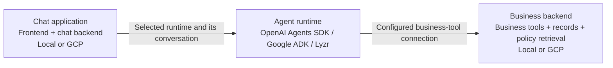

# Local and cloud deployment with multiple agent runtimes

Captured October 8, 2026. This is the main guide for the three-component architecture, runtime selection, backend switching and the local-to-cloud demo test sequence. Detailed implementation and platform setup remain in the linked guides.

**October 10 transport update:** The SDK now supports `mcp_http` using an authenticated remote business MCP endpoint. Cloud configuration selects this path; local Compose retains stdio. Thirteen isolated HTTP protocol/lifecycle tests and Terraform validation passed. Cloud web revision `marketplace-web-00015-8lb` is deployed and ready; a live question and fresh-retrieval follow-up passed with retained evidence and detailed Langfuse tool/model observations. Cloud SQL is confirmed `NEVER`, `STOPPED` after validation. The October 8 smoke results below exercised the earlier cloud stdio path. See [October 10 acceptance](cloud/VALIDATION-2026-10-10-SDK-HTTP-MCP.md).

[Open the architecture diagram](diagrams/deployment-runtime-paths.html) — chat application, three agent runtimes, and local/cloud business backend choices.

## Current working mode — October 8

Use the local marketplace and SDK for the main course demonstrations. The coordinated switch to **local** completed with verified Google and Lyzr configuration readback. Google/Lyzr remain hosted, but their business tools use the laptop MCP tunnel. Keep that tunnel running for platform calls. Cloud SQL is stopped with activation policy NEVER; cloud application/database-dependent requests require a restart. Its retained storage/backups remain billable.

Before pausing cloud, its business snapshot was aligned once to local revision 24; the full copied-table checksum matched. The fresh Google cloud count comparison and local SDK both returned 2 orders yesterday and 1 today. Cloud accounts, conversations and memories were retained separately. The user approved local readable output and confirmed detailed cloud SDK Langfuse tracing. Hosted-platform Langfuse observations contain the question/answer/timing/feedback boundary; native tracing contains internal calls.

The six-path smoke-check table below describes the earlier seed baselines at the time of that test; the later alignment is not continuous synchronization. Main course demos remain local-first; native platform setup/monitoring belongs to platform chapters.

## Three logical components



| Component | Responsibility | Where it runs |
|---|---|---|
| Chat application | User interface, authentication, conversation history, runtime selection and dispatch | Laptop or GCP |
| Agent runtime | Agent loop, model calls, tool invocation and runtime-specific sessions/memory | OpenAI Agents SDK runs in our application backend, on the laptop or GCP. Google ADK runs on Google's managed agent platform. Lyzr runs on Lyzr. |
| Business backend | Marketplace business operations, read-only investigation tools, PostgreSQL business records and policy retrieval | Laptop or GCP; MCP exposes the agent-facing business tools |

These are logical responsibilities, not necessarily three separate processes. “Chat backend” means the application layer handling chat; “business backend” means the marketplace capabilities and data used by its tools. Runtime execution location and model-provider location are also different: a locally running SDK still makes remote model API calls.

## Intended recording and demo workflow

| Demo profile | Chat application | OpenAI Agents SDK | Google ADK | Lyzr | Business data |
|---|---|---|---|---|---|
| Local demo, normal recording workflow | Laptop | Executes locally | Executes on Google; connects to laptop MCP through its HTTPS tunnel | Executes on Lyzr; connects to laptop MCP through its HTTPS tunnel | Local marketplace backend |
| Cloud demo, later hosting walkthrough | GCP | Executes in the GCP application backend | Executes on Google; connects to GCP MCP | Executes on Lyzr; connects to GCP MCP | GCP marketplace backend |

For normal demos, keep the chat application and business backend local, and change only the selected agent runtime in chat. Configure both hosted agents to the local business backend first. “Local demo” does not mean Google or Lyzr execute on the laptop.

For a cloud demo, use the cloud chat application and configure the agents to the cloud business backend. Keep the URL and its matching authentication secret together as one backend profile. Retain local and cloud credentials separately rather than overwriting a key when switching.

The local SDK launches its business MCP server as a subprocess using stdio; that subprocess contains the shared business handlers and queries PostgreSQL directly. It does not forward to a second HTTP middleware or need the laptop tunnel. The cloud SDK configuration uses Streamable HTTP to the separately deployed Cloud Run business MCP service. Google and Lyzr use authenticated HTTP MCP as well. All routes reuse the business handlers; the transport does not change business permissions. SDK preference memory remains a separate owner-bound stdio process, including inside the cloud web container.

## SDK transport configuration and lifecycle

- `AGENT_TOOL_TRANSPORT=mcp`: local stdio; subprocess-owned repeatable-read context and state resource.
- `AGENT_TOOL_TRANSPORT=mcp_http`: SDK-managed HTTP MCP via `SDK_MCP_URL` and secret-backed `SDK_MCP_API_KEY`. HTTPS is required except loopback HTTP for isolated tests. Missing/invalid configuration fails rather than falling back to local tools.
- The application opens/closes an investigation, injects its identity into requests outside model-generated arguments, and exposes only the five business tools to the model. Remote cloud reads use the durable registry's revision checks. Returned nested evidence is retained by the application before cleanup so saved citations still resolve.
- Trace metadata records `mcp_transport` and the endpoint hostname; never put authentication keys in traces. Tool labels alone do not distinguish transport. Verify a cloud question, evidence links, follow-up, cleanup and Langfuse tool spans after deploying the change.

Implementation: [HTTP SDK adapter](backend/marketplace/http_mcp_client.py), [protocol/lifecycle tests](backend/tests/test_sdk_http_mcp.py), [cloud service configuration](cloud/terraform/services.tf). The hosted-backend switch script still manages Google/Lyzr; SDK connection configuration belongs to its application environment.

## How to know which backend will be used

There are two separate selections:

1. **Chat runtime selection:** chooses which agent executes the conversation.
2. **Agent/backend configuration:** determines which marketplace tools and data that agent will reach.

The runtime dropdown does not automatically change a hosted agent's MCP URL. Running the chat app locally can still call a hosted agent configured for cloud data. Similarly, a cloud chat app could call a hosted agent configured for a laptop tunnel. The demo profiles above are the intended combinations, not an automatic routing rule already implemented.

Before recording, check the chat environment, selected runtime, actual hosted MCP endpoint, matching credential reference and a fresh business question. Changing runtime opens a fresh chat conversation; previous conversations retain their original runtime/session. Changing the backend of one shared hosted deployment can affect callers from both local and cloud chat applications. Start a fresh conversation after such a backend switch to avoid mixing earlier data context with a different backend.

## Current implementation versus proposed setup

- **Implemented:** the chat runtime selector and hosted adapters. Google and Lyzr execute remotely; the SDK executes within our backend. Each runtime retains its own sessions and memory.
- **Implemented for Google:** saved `local` and `cloud` backend profiles in [backend_profiles.json](google/backend_profiles.json). [deploy.py](google/deploy.py) selects a matched URL/secret pair and updates the existing hosted agent. See the [Google walkthrough](../course/GOOGLE-PLATFORM-WALKTHROUGH.md#switch-between-local-and-cloud-mcp-backends).
- **Currently verified:** Google uses the GCP MCP backend; deployment metadata, an automated payout investigation, and a Playground question/follow-up passed. The runtime-selector guide also records local Lyzr calling its hosted agent with a cloud MCP target. Therefore, the intended all-local-data demo configuration has not yet been established for every runtime.
- **Local access:** the runtime-selector guide now records configured Google ADC and successful local chat question/follow-up checks. Both hosted agents now target the local business backend; fresh sessions are required after the profile change.
- **Implemented and live switch acceptance verified:** [switch-backend.py](scripts/switch-backend.py) selects the saved business backend for Google and Lyzr together. OpenAI SDK stays bound to the application environment. Ten offline tests cover setting preservation, preflight/action rejection, deployment failure, pending-operation protection, unexpected readback, read-only mode and no-op behavior. Lyzr API metadata confirms both saved URL/authentication pairs and discovery of all seven actions. The script’s live read-only cloud check passed from this Mac for both hosted agents. The first live switch to local passed configuration readback but failed actual Google tool use: its packaged MCP client retained the cloud URL while authentication switched to the local secret. The repair resolves the URL inside the deployed runtime; its local deployment has completed. All three local UI questions have passed after the repair using September 28 / revision 24 data. The return-to-cloud switch completed and all three cloud UI questions passed with September 27 / revision 1 data. [Acceptance record](BACKEND-SWITCH-VALIDATION-2026-10-08.md).

For sequential demos, explicitly switching the existing hosted deployments is sufficient. If local and cloud demos must operate simultaneously, use separate hosted agent targets for each backend profile rather than repeatedly changing one shared target. This is an option to decide later, not an additional deployment request.

Related guides: [Runtime selector and validation](RUNTIME-SELECTOR.md), [local setup](LOCAL-SETUP.md), [cloud setup](cloud/README.md).

## Switch the hosted business backend

Run from `app` on this Mac. The script uses Python's standard library, the existing Lyzr inference key in ignored `.env`, and your existing local Google ADC through the installed official Google CLI container. Keep Docker Desktop running. It can also run in authenticated Cloud Shell with the two script/config files together; there it reads the existing Lyzr inference secret from the marketplace project if `LYZR_API_KEY` is not set. No MCP key is copied, printed or overwritten.

```sh
# Preview only; no credentials or network needed.
python3 scripts/switch-backend.py local --plan

# Check current settings; no changes. Exit 1 means at least one differs.
python3 scripts/switch-backend.py local

# Apply the selected profile to the two existing hosted agents.
python3 scripts/switch-backend.py local --apply
python3 scripts/switch-backend.py cloud --apply
```

The saved targets are in [backend-switch-profiles.json](scripts/backend-switch-profiles.json). Google changes only its MCP URL and matching pinned Secret Manager reference and waits for the deployment operation. This can take several minutes; the script reports the waiting stage and elapsed time approximately every 30 seconds. Lyzr selects its existing local or cloud MCP connection and preserves model, instructions, memory settings and unrelated tools. Google runtime and Lyzr agent identities stay the same. Ordinary runtime switching in chat does not run this script.

The Google deployment must carry the runtime-resolved MCP compatibility marker; apply refuses older packaged agents. Before either update, the script reads both current configurations, validates the selected Lyzr URL/authentication pair and discovers the seven required actions. After an update it reads both configurations back. A successful settings check does not replace a real business question/follow-up test.

The two platforms cannot update atomically. The ignored `.backend-switch/last-switch.json` receipt records completed/pending steps and Google's operation reference. If one step fails, do not record: inspect the receipt, wait for any pending Google operation, and rerun the intended profile. The script refuses a new apply while its previous Google operation is pending. It does not automatically roll back another platform's successful change. Start a new conversation after every switch because earlier sessions and native memory can retain prior context.

Local profile depends on the saved ngrok endpoint. If its hostname changes, update both the saved Lyzr connection and profile URLs before switching. Keep the Google profile file in sync with the coordinated profile if you also use the separate Google deployment command.

## Answer presentation and evidence

All runtimes use the same Markdown renderer, including tables and safe line breaks. New Google answers retain business MCP results from response events; new Lyzr answers retain results from the matching agent/session inference trace. Recorded source handles become database, timeline or policy buttons, showing the saved records used for that answer. Missing sources remain unavailable rather than rereading current data or fabricating a link. Provider trace metadata is excluded, and older history may lack an evidence bundle.

## Your local-to-cloud acceptance process

1. **Prepare local services.** Keep Docker Desktop running; start/check the local application using the local setup guide. Preserve the private Google Compose override. From `app`, run `bash scripts/remote-mcp-ngrok.sh start` and confirm authenticated readiness. Keep the Mac awake throughout hosted tool calls.
2. **Select local business data.** Run `python3 scripts/switch-backend.py local --apply`; wait for both settings to verify. This repoints Google and Lyzr to the laptop tunnel. SDK already uses the local backend.
3. **Test local chat with all three runtimes.** Select OpenAI Agents SDK, Google ADK and Lyzr in turn. Start a fresh conversation for each, ask “What is the status of order-2? Include the current investigation demo clock and cite the evidence.” One question per runtime is sufficient for this switch smoke test; a same-session follow-up is optional. Confirm current tool evidence and readable citations; click View database records, View event timeline or View policy passages when present.
4. **Confirm the actual data source.** Open the saved source records and their business snapshot; use native Google/Lyzr traces for additional debugging. The local chat header describes only the local application database. At the last recorded check, local data was September 28 / revision 24 and cloud data September 27 / revision 1; these are observations, not permanent expected values. Read the current backend before comparing.
5. **Select cloud business data.** Run `python3 scripts/switch-backend.py cloud --apply` and wait for verification before opening the cloud chat application.
6. **Repeat the three-runtime tests in cloud chat.** Use fresh conversations and the same question; follow-ups are optional for this smoke test. SDK automatically uses the cloud application backend. Confirm Google/Lyzr traces point to the GCP MCP endpoint. Cloud tool calls should continue with the laptop MCP tunnel stopped.
7. **Record results.** For each of the six combinations, note backend profile, runtime, question result, follow-up result and source verification. Reopen history and check feedback if desired. Native memory has separate acceptance checks in the runtime selector guide; remembered facts are not proof of the current backend.
8. **Return to the next recording environment.** If continuing normal local demos, switch back to `local --apply` before recording. The script's last successful profile affects the shared Google and Lyzr agents for every caller.

| Chat/data profile | Runtime | Question | Follow-up | Current tool source | Status |
|---|---|---|---|---|---|
| Local | OpenAI Agents SDK | Passed: paid order, held ₹1,618.20 payout; revision 24 | Optional, not run | September 28 / revision 24; database and event evidence | Agent smoke test passed |
| Local | Google ADK | Passed: paid order, captured payment, pending shipment, held payout | Optional, not run | Laptop MCP tunnel; September 28 / revision 24 with evidence citations | Agent smoke test passed |
| Local | Lyzr | Passed: paid order, captured payment, no return/refund, held payout | Optional, not run | Laptop MCP tunnel; September 28 with evidence citations | Agent smoke test passed |
| Cloud | OpenAI Agents SDK | Passed: paid order, no return/refund, held ₹1,618.20 payout | Optional, not run | September 27 / revision 1; database and event evidence | Agent smoke test passed |
| Cloud | Google ADK | Passed: paid order, pending shipment, held payout and policy citations | Optional, not run | GCP MCP; September 27 / revision 1 | Agent smoke test passed |
| Cloud | Lyzr | Passed: paid order, captured payment and held payout with citations | Optional, not run | GCP MCP; September 27 with evidence citations | Agent smoke test passed |

All six one-question agent smoke checks passed October 8. Your own walkthrough remains pending; follow-ups and longer conversations were not rerun in this smoke check. Hosted agents are now set to local; cloud SQL is parked until a cloud walkthrough. This table tracks the new coordinated-switch walkthrough. It does not invalidate earlier runtime-specific checks.

API references: [Lyzr published API schema](https://agent-prod.studio.lyzr.ai/openapi.json), [Lyzr MCP connections](https://docs.lyzr.ai/enterprise/integrations/mcp), [Google Reasoning Engine update](https://cloud.google.com/vertex-ai/docs/reference/rest/v1/projects.locations.reasoningEngines/patch).

Shared presentation and hosted source-viewer validation completed October 8 in local and cloud applications. The additional cloud concurrent-call defect was repaired and the previously timed-out Lyzr payout question passed with database and policy source buttons. Responses can still take tens of seconds or over a minute; see the [validation record](BACKEND-SWITCH-VALIDATION-2026-10-08.md) for observed timings and limits. Hosted agents remain configured for cloud.

## Returning from hosted-platform lessons to local work

Use the local marketplace and select **OpenAI Agents SDK** for the main course demos. The SDK's tools, business data, memory, LiteLLM and Langfuse remain local. `scripts/start.sh` now retains the private Google ADC overlay and test workspace if that overlay already exists, and restarts frontend proxies after backend rebuilds. Fresh learners start both local workspaces with the same startup script. Provider switching and automatic workspace startup were validated on the configured Mac on October 12, 2026; see the provider-switch report.

The independent hosted-backend switch is `python3 scripts/switch-backend.py local --apply` from `app`. It selects the retained local tunnel/key profile for both Google and Lyzr and affects every caller of those shared agents. Keep the laptop MCP service and tunnel running; start fresh platform conversations after switching. Switch back with `cloud --apply` only after restarting the cloud database.

Cloud SQL may be stopped between labs. This preserves cloud records, conversations and memories but makes the cloud marketplace and cloud MCP unavailable until restarted. Storage and retained backups remain billable; stopping SQL does not erase other cloud resources or guarantee zero total project cost. Keep Terraform `database_active=false` while parked so a later apply does not restart compute unintentionally.
