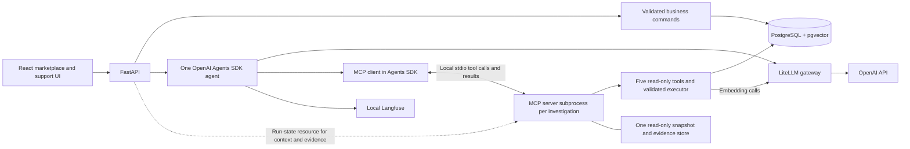

# Fieldwork — marketplace and support-agent lab

[Access reference: local/cloud URLs, users and credential locations](.access-reference.md).
**Published routing series — September 30, 2026:** [Part 1: classification](https://sreeni.blog/2026/09/30/model-routing-part-1-choosing-a-classifier/) · [Part 2: scope](https://sreeni.blog/2026/09/30/model-routing-part-2-choosing-the-scope/). See the [publication index and synchronized local copies](../blog/model-routing/README.md) and [M23 publication milestone](../MILESTONE-LOG.md#m23--publish-routing-series-and-synchronize-documentation). Both posts are published; this editorial update changes no application requirements, experiment scores or production routing.

## Latest agent regression — October 1, 2026

[Current nano/GPT-5.4 evaluation](results/core18-history-v3-2026-10-01/REPORT.md) · [Side-by-side answers](results/core18-history-v3-2026-10-01/comparison.html). Includes earlier/current comparison, provisional assistant grades, strict citation checks and targeted revision/clock reuse tests. This evaluates the current implementation; the routing results below retain their historical baseline.

## Latest routing results

The diagnostic routing phase is complete. See the [current findings and optional future work](../SPECIFICATION.md#model-routing-diagnostic-phase--closed-september-30-2026), [classifier comparison](../app/results/routing-classifiers-2026-09-30/comparison.html), and [live granularity report](../app/results/routing-granularity-2026-09-30/comparison.html). The live report leads with six-conversation success, with 18-answer scores and cache breakdowns below. These experiments do not enable production routing.


A working **local simulation** for studying agent behavior. The marketplace changes business state; the internal support agent investigates it with read-only SQL and document tools. No real payment, shipping, email, or customer data is involved.

## Run

For the complete learner path, use [Local laptop setup](LOCAL-SETUP.md): prerequisites, first run, main/test workspaces, evidence and trace checks, memory, feedback, cleanup and troubleshooting. The commands below are a quick reference.

**Choose or change the inference provider:** in `app/.env`, set `INFERENCE_PROVIDER=openai` and fill `OPENAI_API_KEY`, or set `INFERENCE_PROVIDER=openrouter` and fill `OPENROUTER_API_KEY`. From `app`, rerun `./scripts/start.sh`. Startup regenerates routing for chat, embeddings and OpenAI evaluation models, recreates the gateway to load it, and reruns document indexing. A page refresh alone does not apply a provider change. Existing marketplace records and conversations are retained. Startup also provisions the isolated test database if absent and starts its UI at `http://127.0.0.1:5179`; existing test data is preserved, and fixture resets remain explicit. Anthropic judge and Lakera keys remain optional. See the [setup guide](LOCAL-SETUP.md) for key purposes and validation coverage.


Prerequisites: Docker Desktop with Compose, internet access for initial downloads, Python 3 for local key provisioning, and an OpenAI API key with billing enabled for live inference. The complete Langfuse stack is substantial; allow several GB of disk/RAM. This machine is the tested environment, not a guarantee for every host.

```sh
cd "ai-systems-blogging/app"
cp .env.example .env  # Only for a new checkout; never overwrite an existing key.
# Edit .env and add OPENAI_API_KEY.
./scripts/start.sh
```

- **Application:** http://localhost:5178
- **Langfuse:** http://localhost:3000
- Backend API documentation: http://localhost:58000/docs
- **LiteLLM gateway dashboard:** [http://localhost:4000/ui/](http://localhost:4000/ui/)
- LiteLLM OpenAI-compatible API base: `http://localhost:4000/v1` (key protected)
- PostgreSQL: localhost:55432

### LiteLLM gateway access

Open [the LiteLLM dashboard](http://localhost:4000/ui/). The installed gateway defaults to username `admin` and uses `LITELLM_MASTER_KEY` as its UI password unless `UI_USERNAME`/`UI_PASSWORD` are overridden. The local demo master key is configured in `compose.yaml`; use that gateway key, not your OpenAI API key. Dashboard login requires the dedicated `litellm` database on the existing PostgreSQL server. `scripts/start.sh` provisions it for existing installations; fresh installations use `infra/init.sql`.

The current gateway is configured from `infra/litellm.yaml`: `support-model` selects the fixed OpenAI model and `embedding` selects the embedding model. It does not currently choose a model based on question difficulty. Model configuration remains file-based. The dedicated `litellm` database supports gateway authentication and management metadata; it is separate from marketplace and Langfuse data. All traffic now uses this single gateway. `eval-nano`, `eval-54`, and the targeted diagnostic alias `eval-5` route candidate calls to OpenAI; `eval-judge` routes grading to Anthropic. The evaluation runner is a separate process, not a second gateway. Evaluation business data remains isolated in `market_eval`.

Seller accounts see only their own listings and products in **My listings**. Buyers see the full marketplace; operators can manage every seller’s stock. The API enforces both visibility and write permissions.

Application accounts: `buyer`, `buyer2`, `seller`, `operator`, `support`. Password for all seeded accounts: `demo-marketplace`. Langfuse account: `operator@example.local`, same password. These deliberately public demo credentials are suitable only for this loopback-bound local environment. Do not expose the services publicly.

The browser never receives the OpenAI API key. Only the gateway container loads `.env`; Git ignores that file. Candidate/support model and embedding calls leave the machine for OpenAI; judge calls go to Anthropic. Business data, application services, and Langfuse stay local. Google Fonts is currently a visual asset dependency; system fonts provide a fallback.

Sign in as **operator**, open **Support workspace**, and click **Index documents** to create vector embeddings. Without indexing, search exposes an explicitly labeled lexical fallback. Reindexing only embeds missing chunks. Editing source text requires a new document version; rebuilding/restarting ingests new versions.

## Try the before-and-after loop

For the complete role-by-role sequences, see [Marketplace roles and journey walkthroughs](USER-JOURNEYS.md): purchase to payout, normal refund, post-payout manual review, and failed refund/payout retries.

1. As operator, inspect Seller settlement. The seeded Cedar & Co. balance is captured ₹4,998, fee ₹499.80, unpaid ₹4,498.20, paid out ₹0.
2. In Support workspace, ask: “Why has Cedar & Co. not been paid for order-1?” It should inspect the provider timeout and settlement policy, with evidence references.
3. Switch to buyer. Purchase a Canvas Weekender. No real charge occurs. The order and its allocations appear immediately in the database.
4. Switch to operator. Ask for Cedar & Co. balances again. The captured and unpaid amounts increase, and the answer has a newer revision.
5. In Orders & fulfillment, dispatch then deliver the new shipment. Advance the demo clock by 24 hours in Seller settlement. Release its payout and investigate again.
6. For a separate refund branch, use the buyer’s seeded delivered order to request one unit returned, then operator approve → receive → refund. An active return blocks payout. Failed refunds do not change balances.

A failed payout can be retried. Repeated requests using the same idempotency key do not duplicate a write. A post-payout return goes to manual review; seller fund recovery is outside this slice.

## Architecture



- `backend/marketplace/db.py`: explicit relational entities and restricted analytics views.
- `business.py`: transactional state transitions; commands serialize on one demo-state row. Correctness and readability take priority over commerce throughput.
- `seed.py`, `data/`: reproducible relational fixtures, eight versioned documents, curated ontology.
- `tools.py`: SQL AST validation plus a separate database read role, 100-row cap, 3-second SQL deadline, fixed repeatable-read snapshot, exact pgvector search, evidence handles.
- `agent.py`: one agent, maximum eight turns, 150-second deadline, 4,096 completion-token cap per call (including reasoning), low reasoning effort, no hidden provider fallback. The last six complete question blocks retain tool results; revision, clock and document-revision checks guide evidence reuse.
- `api.py`: server-side login sessions, CSRF checks, roles and conversation ownership.
- `evaluate.py`: isolated four-task smoke evaluation and Langfuse scores. Gold expectations are never put in an agent prompt or tool table.

Catalog v2 combines the ontology’s static business relationship map with database types, nullability and relevant constraints. It validates structural drift and contains no business-record samples. Targeted queries resolve names and return actual records. Revision and demo clock are appended to each question, not the static instructions. See [three-question prompt and SQL walkthrough](docs/PROMPT-AND-CATALOG.md) for exact history retention, tool-result placement and caching limitations.

The agent has five read-only tools: `get_catalog`, `query_business_data`, `search_documents`, `fetch_evidence`, and `get_order_history`. The last uses validated joins to return current order records plus events ordered by revision and recorded time. Refund/payout rows hold current state; event records preserve failures and retries. Explicit history/timeline/attempt/retry questions naming an order ID preload this lookup for up to three orders. Other questions can call it as a tool; this is not a general natural-language intent classifier. Each result retains the existing snapshot, evidence and truncation contract. Allocation totals can repeat across returns and must not be summed across those rows.

The catalog includes up to 200 actual seller/product names, with a truncation flag; absent names or a truncated list require targeted lookups. Name resolution: before interpreting a bare business name as a seller or product, the agent is instructed to check actual records for both. A unique match can proceed with a stated interpretation; competing matches require one concise clarification. Simple query failures should be repaired within the run budget, not delegated to the user. This is prompt-guided behavior, so live scenario checks remain necessary. Wildcard SQL regression tests cover literal patterns, bound patterns, mixed literal/bound filters and values containing SQL-like text.

Answer citations display readable source links (database records, event timeline or policy passages). Source panels show rows or passages, with internal IDs and raw envelopes under technical details. Citation formatting tests run with `cd frontend && node --test src/evidence.test.js`.

Model baseline: `gpt-5-nano-2025-08-07` through LiteLLM, selected for low price under the user’s cheapest-model policy. It is currently callable in the integration test but is **scheduled for retirement on 11 December 2026**. Update the explicit model config before then; there is no automatic upgrade. [OpenAI deprecations](https://developers.openai.com/api/docs/deprecations). Published estimate: $0.05 input / $0.40 output per million tokens; cost shown by the app is an estimate, not an invoice, and excludes embedding charges and cached-input discounts. Embeddings use `text-embedding-3-small`, 1,536 dimensions. Record model changes as experiments.

Langfuse receives agent/model/tool observations through OpenInference. The default OpenAI trace exporter is replaced, so traces are not sent to a second tracing service. The app records actual token counts, tool count, elapsed time, snapshot and document revision; the smoke evaluator attaches explicit checks to the run traces. Observability failure must not be confused with business-data correctness.

## Test and evaluate

The [30-case model comparison](../EVALUATION-SPEC.md) has a separate [runner and human-review workflow](eval/README.md). The four-task command below remains the original smoke test.

```sh
./scripts/test.sh       # PostgreSQL integration tests; isolated market_test DB
./scripts/evaluate.sh   # Paid live model calls; resets only market_eval DB
```

Evaluation writes `results/evaluation.json`. The four tasks check balance terms, current policy, mixed-source investigation, and refusal to mutate. These are smoke checks, not a benchmark, semantic correctness guarantee, or evidence of superiority. Review the answer and sources. Change one component at a time and preserve the scenario, model/config, document hashes, and comparison inputs.

Tests do not erase the interactive marketplace. The reset command is deliberately explicit:

```sh
./scripts/reset.sh --confirm-demo-reset
```

This stops the backend, resets demo business data, sessions and conversations, then restarts it. Langfuse traces remain. Sign in and reindex documents again. To stop without losing data: `docker compose stop`. To resume: `./scripts/start.sh`. Do not use `down -v` unless you intend to erase all app and Langfuse volumes.

## Baseline boundaries

Implemented: single-agent support, business UI, backend permissions, real SQL/RAG, synthetic data, semantic context, persisted conversations/evidence, repeatable smoke evals, tracing, local container packaging.

Deliberately small: one shipment per item (multi-seller orders can be partially delivered); synchronous simulated provider results; immediate transactional analytics views; no delayed projection service; no customer-facing agent; chat shows a running status and final answer rather than streaming individual tokens. Independent model sessions have bounded context, not cross-session learned memory. Complex semantic evaluation, split shipments, cancellation, richer incidents, memory, routing and multi-agent orchestration remain later work.

Service image digests and Python/npm dependency locks are pinned. Schema version 1 is recorded and creation is idempotent; subsequent schema changes require explicit versioned migrations before preserving existing data across upgrades. Docker credentials and demo passwords need replacement before any deployment outside localhost.

## Verification record — 27 September 2026

- **20 real PostgreSQL integration tests pass.** They cover permissions/CSRF, conversation isolation, atomic money transitions, duplicate submissions, concurrent duplicates, SQL restrictions, snapshot consistency, policy dates and actual pgvector search with a deterministic test vector.
- Four paid live smoke tasks: 17/17 checks passed after fixing vector schema qualification. The numeric evaluator was corrected to ignore commas/trailing zeros and rescored the **same model answers**. Original results are retained in `results/evaluation-v1.json`; current results in `results/evaluation.json`. This is smoke coverage, not a broad accuracy score.
- OpenAI embeddings indexed 20 chunks. Real model calls went through LiteLLM. Langfuse v4 observation and score APIs were read back successfully, including generation and tool spans.
- Browser walkthrough: login → buyer purchase → database revision 2 → seller balance view → support answer → clickable SQL evidence. A follow-up asking about “that same seller” returned the correct ₹749.70 fee from a fresh query, and both turns persisted across refresh. Cedar & Co. captured increased from ₹4,998 to ₹7,497; unpaid from ₹4,498.20 to ₹6,747.30. The demo is currently left with that extra simulated order.
- Frontend production build passes; npm audit reported zero vulnerabilities after compatible dependency updates.
- Nine app containers were running. An idle/light-use snapshot totaled about 3.3 GiB RAM against a Docker allocation of 7.75 GiB. This is one observation, not a maximum or a hardware minimum.

Run limits are backend environment settings in Compose: maximum turns, seconds, completion tokens, and an estimated $0.05 model-cost stop. The dollar check occurs **after** a completed model call and can overshoot by one call; it excludes embeddings and uses conservative uncached input rates. Failed/truncated-call billing is available in Langfuse spans and may not be complete in the app's aggregate metrics. There is no billing-account spending cap implemented by this demo.

## Project learning record

Record meaningful milestones, decisions, results, lessons and next experiments in the [running milestone log](../MILESTONE-LOG.md). Detailed run artifacts remain under `results/`; the log links to them for future blogs and lessons.

## Gateway identities (single-gateway architecture)

`./scripts/start.sh` creates or validates three model-scoped virtual keys and stores them in the gitignored `.env` (owner-only permissions). The master key is for gateway administration, never the application's inference client.

| Key alias in LiteLLM | Environment variable | Model permissions |
|---|---|---|
| marketplace-support | SUPPORT_GATEWAY_KEY | support-model, embedding |
| marketplace-evaluation | EVAL_GATEWAY_KEY | eval-nano, eval-54, eval-5, support-model (smoke tests), embedding |
| marketplace-judge | JUDGE_GATEWAY_KEY | eval-judge |

The support backend receives its key as `LITELLM_API_KEY`. The on-demand `eval-runner` container receives the evaluation key as `LITELLM_API_KEY` plus `JUDGE_GATEWAY_KEY`. Provider keys stay in the gateway. Inspect all three identities in [Virtual Keys](http://localhost:4000/ui/api-keys/). This separates model permissions and usage attribution; no new strict spending caps or Redis-backed rate limits are configured. Historical traffic from the retired gateway is not backfilled into LiteLLM; archived evaluation artifacts remain unchanged.

## Read-only tools over MCP

The support agent now supports the same five tools over local MCP stdio:
`get_catalog`, `query_business_data`, `search_documents`, `fetch_evidence`,
`get_order_history`. Refund execution, payout release and other business mutations
remain UI/API operations governed by application roles; they are not MCP tools.

Compose defaults to `AGENT_TOOL_TRANSPORT=mcp`. To compare or roll back, set
`AGENT_TOOL_TRANSPORT=direct` in `.env`, then run `docker compose up -d backend`.
The model, prompt, SQL restrictions and evidence format remain the same.

Each investigation starts a private `python -m marketplace.mcp_server` subprocess.
It owns one repeatable-read, read-only database transaction and evidence store.
All tool calls, including application-preloaded history, use that process.
The application reads `marketplace://run/state` to build the initial context and
persist evidence afterwards. A new question gets a new snapshot; conversation
history still belongs to the existing application session. `tool_transport` in
run metrics identifies the access path. The child receives the read database URL
and embedding gateway key, not business-write or provider credentials.

The SDK also supports `AGENT_TOOL_TRANSPORT=mcp_http` with `SDK_MCP_URL` and
`SDK_MCP_API_KEY`. This connects directly to authenticated HTTP business MCP;
the application binds investigation identity, retains returned evidence and
closes the investigation. Cloud configuration selects HTTPS; local Compose keeps
stdio. SDK memory remains a separate user-bound stdio server. The new path passed
nine isolated protocol/lifecycle tests; cloud revision `marketplace-web-00013-sc6` is ready; live acceptance needs
approval to start the parked database. See [deployment and runtime paths](DEPLOYMENT-AND-RUNTIME-PATHS.md).

Verification: `scripts/test.sh` runs real MCP protocol tests against `market_test`.
`scripts/compare-mcp.py` runs four questions per transport (eight paid candidate
answers, no judge), requires `market_test`, and writes `/results/comparison.json`.
Its output mount and gateway credentials are supplied by Docker Compose; it never
resets the interactive database. See `results/mcp-transport-2026-09-30/` for the
initial smoke comparison. This is transport validation, not a quality benchmark.

### Follow-up citation links

The support UI resolves citations against current evidence first, then evidence
from earlier runs in the same authorized conversation. Earlier sources are labeled
`(earlier question)` and show their original question, revision and snapshot time.
Unknown references remain unavailable; later runs and other conversations are not
used. This is display-only resolution: it does not copy old evidence into a new
run, pass it to the model, or change retrieval/query decisions.

### Possible MCP tool-call sequences

These are **illustrative paths, not an exhaustive list or fixed routing rules**.
The model selects tools using their descriptions, the prompt, conversation context
and returned evidence. It can combine tools, repair a query or ask for clarification.
MCP transports the calls; it does not classify questions or choose the workflow.

| Question type and example | One possible sequence |
|---|---|
| Order contents: “What products and quantities are in order-1?” | `get_catalog` → `query_business_data` → answer |
| Policy only: “What is the return window?” | `search_documents` → answer |
| Event history: “Explain refund attempts for order-1.” | `get_order_history` → answer |
| Facts plus policy: “Why is this order’s payout held?” | `get_order_history` → `search_documents` → additional SQL if needed → answer |
| Ambiguous name: “Show orders for Cedar.” | `get_catalog` → clarification if multiple plausible matches → SQL after clarification |
| Follow-up: “Total the quantities you just showed me.” | Answer from the previous answer if it contains enough information, or `get_catalog` → `query_business_data` → answer |
| Revisit evidence collected within the current investigation | An evidence-producing tool → `fetch_evidence(handle)` → answer; usually redundant because the original response already includes the data |

Important implementation details:

- Catalog-first is a prompt instruction before model-written SQL, not a mandatory
  first call for every question or a code-enforced sequence.
- `get_order_history` returns current order/return/refund/payout records and events.
  It is not a general product-and-seller lookup triggered by any order ID.
- The application preloads `get_order_history` for questions with a recognized
  order ID plus history/timeline/attempt/retry wording, for up to three orders.
  This occurs through MCP before the model answers; other tool selections are
  model-driven. See `agent.py` for the exact matching rule.
- A follow-up retains complete tool history from the last six questions but starts
  a new snapshot. Reuse complete same-revision records; refresh current facts after
  revision changes and time-dependent results after clock changes. Policies also
  require matching document revision and effective scope. See the prompt walkthrough.
- `fetch_evidence` accepts a generated evidence handle from the current run,
  not an order ID and not a handle from an earlier question. Cross-run citation
  resolution is a separate UI feature; it does not call this tool.
- Each “generation” in a trace is a model call: it may select a tool, repair a query
  or compose the final answer. Several generations and repeated calls to the same
  tool can occur within one user question. Actual traces establish the path taken.


## Explicit long-term memory lab

**Current conclusions — October 3, 2026:** The bounded short-/long-term memory learning lab is complete. [Conclusions, evidence and pending work](docs/MEMORY-STATUS.md) · [24-case catalogue and live/test workspace instructions](eval/memory-v2/README.md). Eight automated scenarios/19 GPT-5.4 questions passed memory checks and assistant-reviewed factual correctness; all cited sources resolve through the UI. The initial broken-link diagnosis was a grading mistake, now corrected. Test runs restore `market_test`; live `market` remains separate.

**Pending:** Request-in-progress sidebar navigation, login-persistence and remaining manual catalogue demonstrations; recorded lesson and optional repeated/held-out comparisons. Automatic extraction, compaction, shared procedures and Mem0 integration are enhancements. Nano retrieval remains model-dependent; these GPT-5.4 results do not establish Nano reliability.

The Support workspace now includes **Use long-term memory**, a per-question **Allow memory changes** control, and a **Saved memories** panel with Edit/Forget. Records are personal to the authenticated support/operator user. New conversations share those records; ordinary SDK session history remains separate. The backend exposes four local stdio MCP memory tools backed by PostgreSQL as of October 3; marketplace tools retain their separate transport and remote HTTP MCP remains business-only. No Mem0 dependency or automatic extraction/compaction is added. See the [walkthrough and test plan](eval/memory-v1/README.md) and [architecture](../course/diagrams/MEMORY-ARCHITECTURE.md).

## Lyzr remote MCP experiment

Run the same read-only marketplace tools from Lyzr Agent Studio using the authenticated temporary endpoint. See [setup, lifecycle and limitations](lyzr/README.md). Long-term memory is disabled for this initial test.

**Initial acceptance — October 2, 2026 (historical; see current conclusions above):** The user reports the manual memory walkthrough works in the local UI. M35 also records 65 regression tests and thirteen final live questions; no per-case human grading export was supplied. The two memory checkboxes use aligned rows. “Allow memory changes” becomes unchecked after each question; stored memories persist, and “Use long-term memory” remains enabled until changed. Broader stale-policy/revision and procedural-use tests remain follow-ups. [Verification report](results/memory-v4-2026-10-02/REPORT.md).

**Memory-use diagnostic update — October 2, 2026:** Nine live questions tested stale checkpoints, procedural application and current instruction precedence with memory on/off. The scenarios exposed failed/distorted saves, incorrect delivery reasoning and a business-question/memory-only routing bug; stale handling remains unvalidated because setup failed. These findings do not supersede earlier basic CRUD acceptance. [Exact test cases and results](results/memory-use-v1-2026-10-02/REPORT.md).

**Follow-up application repair and GPT-5.4 verification — October 2, 2026:** Negated memory changes no longer hide business tools; backend assigns save provenance and the save kind is an enum. 74 regression tests passed; three setup saves and six memory-on/off answers passed the GPT-5.4 diagnostic. Stale checkpoint and procedural on variants retrieved actual memories; explicit preference override succeeded without memory retrieval, leaving the preference unchanged. Default interactive model stays Nano. This one-trial follow-up changes both model and application, so it is not a controlled model-quality comparison. [Questions, results and limitations](results/memory-use-gpt54-v2-2026-10-02/REPORT.md).

### Automatic checklist retrieval and sidebar state retention — October 3, 2026

Prompt v10 explicitly instructs investigations to search relevant saved checklists/checkpoints before business analysis, without the user having to name the checklist. The original refunded-order question retrieved the checklist and answered correctly with GPT-5.4; Nano still skipped memory and omitted the full-refund explanation. Retrieval remains model-driven, not guaranteed, and the UI default stays Nano. Support remains mounted while hidden on other sidebar pages: selected conversation, displayed answers and unsent draft survived browser navigation to settlement and back. Reload/login restore remains distinct. 12 frontend checks passed; frontend/backend built and deployed. [Verification and traces](results/memory-auto-checklist-v10-2026-10-03/REPORT.md).


### Repeatable memory suite and separate test workspace — October 3, 2026

Added a [24-case short-/long-term memory catalogue](eval/memory-v2/README.md), versioned expected outcomes and a runner for eight scenarios/19 questions with memory-off controls. Fixture-only validation prepared each scenario twice and restored the seeded `market_test` baseline; no inference or judge calls were made. Live text-answer grades remain review-required. Basic CRUD/isolation/version boundaries retain the existing regression suite. Optional test UI uses `http://127.0.0.1:5179/`, labelled MEMORY TEST WORKSPACE; normal UI stays on `http://localhost:5178/` and `market`. Both UI instances retain the existing support-model alias; the live runner can explicitly select Nano or GPT-5.4. Stop test services before resets, and do not run concurrent market_test suites. This is baseline reset, not restoration of arbitrary user-modified test data.


### Eight-scenario GPT-5.4 memory verification — October 3, 2026

[Live memory suite report](results/memory-repeatable-20261003T093153094486Z/REPORT.md): eight scenarios/19 questions completed; all six required retrievals and 10 memory-off questions passed. Assistant review found 19 factually correct answers, with one noncanonical citation format in the policy-conflict answer (shortened evidence handles); subsequent UI-backed checking confirmed all source links resolve. Same-conversation quantities reused previous evidence with zero tools, even with long-term memory off. Preference override retrieved the conflicting memory without overwriting it. Seeded test baseline restored; optional test UI restarted. Estimated uncached model cost $1.02, no paid judge. One trial only; remaining manual catalogue cases are not claimed tested.


### Memory citation grading correction — October 3, 2026

[Policy-conflict rerun](results/memory-repeatable-20261003T094355178246Z/REPORT.md): both GPT-5.4 answers correct with full canonical citations; zero unavailable sources; estimated cost $0.31. Seven citation regressions passed. The earlier 19-question report incorrectly treated shortened raw IDs as broken links; existing UI normalization already resolves those recorded IDs. All 19 saved answers passed checking through the actual UI functions. Added a reusable UI-backed citation checker, corrected report/review and documented format-versus-resolution grading. No agent prompt or resolver change needed. Test baseline restored and test services restarted.


### Memory MCP review and provider-portability architecture — October 3, 2026

Reviewed code and the related “Prepare for Lizer CTO discussion” implementation/regression evidence. Agent memory now uses local stdio MCP; PostgreSQL MemoryStore still enforces ownership, explicit mutation permission, provenance and optimistic version checks. Business MCP and short-term conversation history remain independent; remote HTTP MCP exposes only business/lifecycle tools. [Review](results/memory-local-mcp-2026-10-03/REVIEW.md), [81-regression migration evidence](results/memory-local-mcp-2026-10-03/REPORT.md), and [19-question post-migration GPT-5.4 report](results/memory-repeatable-20261003T112031250654Z/REPORT.md): all expected answer/operation/source checks passed, cost about $0.99. This documentation review reused existing evidence and made no paid calls or database resets.

Updated [memory architecture and provider-extension diagrams](../course/diagrams/MEMORY-ARCHITECTURE.md) and specification overview. **MCP makes operations accessible across runtimes; an adapter interface makes storage replaceable.** The interface and external adapters are planned; current MCP code directly creates PostgreSQL MemoryStore. Future providers must preserve or explicitly adapt permission/isolation, extraction/save fidelity, provenance, update/delete and freshness behavior. Native Lyzr Cognis is a separate test track, not already wired behind our memory MCP. No remote personal-memory endpoint or multi-provider switching is claimed implemented. Existing manual/held-out memory pending work remains; provider adapters/parity testing are optional enhancements.


### Optional gateway guardrail experiments

[Built-in filter results and test command](results/gateway-guardrails-2026-10-07/REPORT.md). Three named filters in infra/litellm.yaml are default-off: marketplace-privacy-pre, marketplace-privacy-post, marketplace-injection-pre. Request them through the Chat Completions `guardrails` array. Nine paired synthetic cases cover email masking, key-shaped data blocking, tool-result injection and benign controls. The support Security demo selector now requests these profiles. External Presidio and Lakera comparisons and support-flow verification are linked below.


### External privacy guardrail lab

[Presidio setup, cases and results](results/presidio-guardrails-2026-10-07/REPORT.md). Optional local analyzer/anonymizer services use compose.guardrails.yaml and named marketplace-presidio-pre/post guards. Support requests default to filter Off; the Security demo selector enables a named profile. The report includes startup/stop commands and preserved recognizer misses. Presidio handles configured PII; it is not the injection detector.


[Manual guardrail walkthrough](docs/GUARDRAILS-MANUAL.md): one synthetic API case at a time across built-in, Presidio and activated Lakera profiles. [Lakera five-case results](results/guardrails-manual-2026-10-07/LAKERA-REPORT.md) preserve detections, a false block and factual-poisoning allowance; support UI selection is now available in the Security demo panel.

[Security chapter demo catalog](docs/SECURITY-CHAPTER-DEMO.md): copy/paste queries, poisoned-document conditions, expected observations and recorded user walkthrough outcomes. Workspace options sit on the right; selecting one of three test policy documents installs it and starts a fresh conversation automatically. The bounded walkthrough is complete; lesson slides, notes, homework and recording preparation come later.


[Post-filter input audit](results/gateway-input-audit-2026-10-07/REPORT.md): new successful support traces include **Gateway output → Model input**, showing gateway request messages after filtering. Built-in privacy and Presidio email masking were verified there. It is not a raw wire capture; original app logs/history remain unchanged. Gateway rejection is BLOCKED in the app and Error in Langfuse; successful masking is not an error. Pre-call blocks have no successful input-audit observation.


[OWASP security scope](docs/OWASP-SECURITY-MAP.md) and [final boundary/disclosure tests](results/security-boundaries-2026-10-07/REPORT.md): real memory MCP permissions plus a synthetic GPT-5.4 internal-marker probe with a visible control. Bounded chapter experiments complete; teaching artifacts follow later. No role-specific SQL/RAG permissions or guaranteed prompt confidentiality are claimed.

### Consolidated Guardrails and Agent Security lesson — October 7, 2026

Detailed guardrail demos, private-instruction disclosure and OWASP teaching notes now share one [teaching guide](docs/SECURITY-CHAPTER-DEMO.md). Course section 10 is a brief component overview; section 15 owns the combined lesson. Monitoring, tracing and evaluation remain separate sections. The memory-permission demonstration is removed from the main security lesson; historical ownership evidence is retained, and no read-by-ID operation is being added.

The test Support UI now offers **Private-instruction example** modes: Off, Without privacy rule, and With privacy rule. Selection starts a fresh conversation and displays the additional system text. The learner asks the same lantern-color question in the ordinary chat. The normal support-agent/gateway flow processes it and records the mode in run metrics. The synthetic fact never changes business data or RAG documents; main-workspace requests for a non-Off mode are rejected. The automatic two-call button has been removed. The standalone terminal probe remains an optional reference, not the UI flow.

Existing guardrail findings remain bounded: latest forged-exception comparisons preserved held status in both cases, with clearer conflict handling when source authority was On. Privacy masking and direct/indirect Lakera blocks have been exercised; misses and false positives remain documented. The revised manual lantern comparison is ready for learner verification, not claimed as a newly measured result.

OWASP concepts for later slides: tool misuse/output validation, delegated authority and least privilege, memory/context poisoning, MCP/supply-chain trust, inter-agent trust, human approval and resource limits. General cloud/infrastructure security remains outside scope. No further broad security build is planned. Slides, notes, homework and recording refinement follow finalization of the required experiments and outline. **Next substantive topic: Google's enterprise agent platform**, using the existing application/MCP contracts and evidence as the comparison baseline.

### Security acceptance and Google platform handoff — October 7, 2026

The user reports validating the manual lantern comparison and agrees to close the bounded Guardrails and Agent Security experiment scope. This records user acceptance, not independent review of a new trace export. No further security build is required for this learning scope; slides, notes, homework and recording packaging remain later work.

Next is the [hosted Google platform walkthrough](../course/GOOGLE-PLATFORM-PLAN.md): inspect the existing signed-in account/agent, deploy the marketplace agent, connect remote business MCP tools, ask questions through the available platform surface, exercise native sessions/long-term memory, inspect Google-native monitoring/tracing and capture repeatable setup/results. Account entitlements, model availability and middleware connectivity require inspection; no Google deployment or new benchmark is claimed yet.

### Google ADK lab implementation — October 7, 2026

The user selected ADK on Google managed Agent Runtime, with native Sessions for short-term history and Memory Bank for long-term recall, while authenticated business MCP/SQL/RAG stay on the laptop. [Code, deployment and memory commands](google/README.md). Code and three offline boundary checks passed; cloud prerequisites and secret configuration were authorized and created. Runtime readiness, model answers, native memory behavior and Google telemetry acceptance remain pending; no benchmark comparison is claimed.

### Current Google lab guide — October 8, 2026

The hosted Google lab passed SQL/RAG, short-/long-term memory and native tracing checks. Use the [single Google walkthrough](../course/GOOGLE-PLATFORM-WALKTHROUGH.md) for architecture, setup, commands, user identities, demos and results. Earlier checkpoints above remain historical.

**Manual acceptance — October 8, 2026:** The user validated general questions and short-/long-term memory. The agreed Google experiment phase is complete; course-production materials remain later work.

### Support-answer feedback

Completed answers in the main and test Support workspaces have **Was this answer helpful?** thumbs-up/down controls. Feedback is saved per answer in PostgreSQL, restored when reopening the conversation, and can be changed without double counting. Only the conversation owner can rate it. Its existing trace receives a best-effort Langfuse `user_feedback` score (1 up / 0 down); local storage is authoritative, not dependent on telemetry export. Aggregate statistics can be computed from these records; no statistics dashboard or automatic online judge is implemented by this change. A positive vote is not proof of factual correctness.

To inspect feedback, open the answer’s Langfuse trace: `user_feedback = True` is thumbs-up and `False` is thumbs-down. For aggregate views, use **Evaluation → Scores → Analytics**, select `user_feedback`, object type **Traces**, and a time range. This covers rated answers only and can include the clearly labelled synthetic verification trace. The user confirmed the feedback on a real question’s trace on October 8.

Support UI: **Index documents** and indexing status are under **Workspace options → Documents** on the right. The explanatory investigator banner was removed. **Enter** submits a question; **Shift+Enter** adds a new line. Both main and test workspaces use these controls.

**Pending — Evaluation lesson:** Add asynchronous online evaluation of sampled real questions, answers and evidence after the response has been delivered. Assess evidence support, relevance and citations over time without delaying replies. This is separate from user votes and from periodically rerunning fixed regression cases; sampling, rubric, judge and scheduling remain to be agreed.

### Cloud deployment verified

The local Docker setup remains available. [Open cloud marketplace](https://marketplace-web-327903210973.asia-south1.run.app/) and use the demo password chosen during setup. Cloud Run hosts web/chat, HTTP MCP and private LiteLLM; private Cloud SQL stores data, and Langfuse Cloud Japan receives traces/feedback. Cloud login, SQL/RAG, short/long-term memory, feedback, email masking and Lakera blocking passed; see [deployment guide](cloud/README.md) and [verification](cloud/VALIDATION-2026-10-08.md).

Cloud SQL is now parked with activation policy NEVER; restart it before cloud use. Storage and retained backups remain billable, and public IPv4 remains disabled. Local/cloud data are separate. Fresh-project and clean-machine learner rehearsals remain pending; hosted ADK/Lyzr cloud connections and shared UI adapters are verified. Online evaluation is deferred to Evaluation chapter preparation.

## Runtime selector follow-up — October 8, 2026

[Marketplace runtime selector](RUNTIME-SELECTOR.md) documents conversation binding, native memory controls, configuration and remaining live validation. Changing runtime opens a fresh conversation; history preserves the original platform. The selector is deployed locally and in cloud. Google question/follow-up and native cross-session memory save/recall are verified. Google and Lyzr cloud order questions, same-session follow-ups and fresh-session native memory recall are verified. Local Lyzr credentials are configured in ignored `app/.env`, both local backends restarted, and the local order-2 question and same-session follow-up passed. Local Google ADC is configured; local main question and follow-up passed.

Local SDK responses use readable business tables and concise date-labeled counts. The cloud `market` comparison baseline was aligned to local revision 24 on 8 October; this is a one-time copy, not automatic synchronization. See [runtime selector](RUNTIME-SELECTOR.md) and [cloud validation](cloud/VALIDATION-2026-10-08.md) for evidence and scope.


## Verified marketplace checkpoint — October 8, 2026

The local and cloud reference application paths are working. The shared UI selects OpenAI Agents SDK, Google ADK or Lyzr; switching opens a fresh conversation, and history retains its original runtime/session. Google and Lyzr remain hosted when selected locally, and currently use the local MCP tunnel profile. The SDK uses the selected application's local/cloud database. Endpoint/key profiles are independent of the runtime selector.

Cloud `market` was aligned once to local revision 24, including clock, business history and indexed policies, with a retained rollback snapshot. User accounts, conversations, ratings and personal/native memories remain independent; test/evaluation databases were not copied. Local order summaries and daily counts now use readable business labels and formatting. The user approved the new local output and confirmed the cloud SDK detailed trace in Langfuse. Google/Lyzr wrapper traces record the marketplace question/answer/timing/feedback; internal calls remain in native platform tracing.

Course plan: local SDK for main demonstrations; hosted agents and native platform monitoring in platform chapters. Online evaluation remains Evaluation chapter preparation. Clean-machine/fresh-project learner rehearsals, publication checkpoints, slides, notes, homework and recording preparation remain separate work. See the [architecture and delivery boundaries](../course/MARKETPLACE-DEPLOYMENT-ARCHITECTURE.md).

## Chapter 12 hybrid hosting exercise

See [exercise](../course/exercises/chapter-12-runtime-and-hosting/exercise.md) and [validation](../course/exercises/chapter-12-runtime-and-hosting/validation.md). The dedicated Compose overlay uses a disposable database, local chat/history, separate Cloud Run agent with direct OpenAI Responses, and laptop HTTP MCP through a tunnel. It is opt-in and does not change normal runtime routing. The temporary instructor cloud deployment was cleaned up after successful tests.

## Starting all course workspaces

`./scripts/start.sh` starts main and test plus the existing **Agent Loop** and **Runtime and Hosting** lab UIs. Use `./scripts/stop.sh` to stop them together without deleting data. See [Local setup](LOCAL-SETUP.md#chapter-specific-lab-environments) for the UI/database mapping and cloud prerequisites. Initializing an empty lab is separate from resetting an existing fixture; startup does not reset data or deploy cloud resources.
