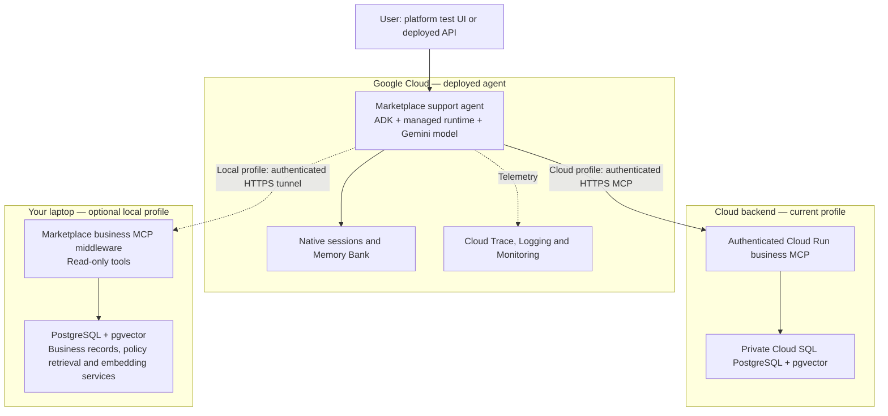

# Google Gemini Enterprise Agent Platform — marketplace support walkthrough

Single setup, demo and results guide. Updated October 8, 2026. The bounded hosted lab is complete: SQL/RAG, seven memory checks, a fresh Playground recall and native tracing passed. Slides, speaker notes, homework and recording preparation remain later work.

**Manual acceptance — October 8, 2026:** The user confirmed completing the manual walkthrough for short-term memory, long-term memory and general business questions on October 8, 2026. This records user acceptance alongside the previously verified hosted tests and trace inspection; it is not a new automated run. The agreed Google experiment scope is closed. Slides, speaker notes, homework and recording preparation remain later work.

## What this lesson demonstrates

Deploy the marketplace support agent with ADK on Google’s managed Agent Runtime and select either the hosted Cloud Run business MCP backend or the original laptop backend through saved profiles. The current deployment uses the cloud profile; the laptop tunnel remains an optional switch-back configuration. This existing verified integration uses Google Playground and a supporting CLI to demonstrate native Sessions, Memory Bank, monitoring and tracing. Marketplace UI integration is optional. The proposed simplified lesson is described separately below and is not implemented. This is a learning deployment, not a production hosting design or platform-quality benchmark.

Use this document for the whole Google lesson. The former plan, setup and validation files now point here.

- [Architecture](#architecture)
- [Proposed standalone native lab](#proposed-standalone-native-lab-under-discussion)
- [Cloud Shell and deployment](#cloud-shell-and-deployment)
- [Playground and user IDs](#playground-and-user-ids)
- [Memory demo commands](#memory-demo-commands)
- [Monitoring and tracing](#monitoring-and-tracing)
- [Verified results](#verified-results)
- [Limits and remaining work](#limits-and-remaining-work)
- [Setup history](#setup-history)

## Architecture



[Original laptop-profile visual architecture](diagrams/google-platform-architecture.html) · [Original editable source](diagrams/google-platform-architecture.mmd). The diagram above includes the newer cloud profile.

| Runs in Google Cloud | Runs on the laptop |
|---|---|
| ADK support-agent code and managed runtime | Existing business MCP middleware |
| Gemini model calls | Marketplace PostgreSQL / pgvector |
| Native sessions and Memory Bank, after configuration | Business SQL, policy retrieval and existing embedding dependencies |
| Available Cloud Trace, Logging and Monitoring telemetry | Authenticated tunnel connection to local middleware |

The table above describes the original laptop profile. User questions enter through the available platform test/chat surface or deployed API. With the current cloud profile, business MCP and PostgreSQL are hosted in GCP, so the laptop and tunnel are not required. With the local profile, the laptop must stay on with its services and tunnel running. The remote business server does not expose personal-memory tools: use Google-native memory for this first experiment; remote PostgreSQL personal memory is a separate optional adapter.

## Proposed standalone native lab under discussion

The latest Chapter 19 proposal is a standalone managed ADK agent with a small packaged, synthetic JSON order dataset and native function tools. Learners would use Google Playground and inspect native Sessions, Memory Bank and tracing. That proposed core would not require the marketplace chat application, separate business MCP middleware, a tunnel or Cloud SQL. Scope is still under discussion: the static dataset/tools have not been implemented, deployed or verified, and the existing commands below do not create that proposed lab.

The existing verified ADK integration remains a secondary reference and possible optional extension for learners who want the full marketplace stack. In that implementation, business tools use an authenticated MCP service backed by PostgreSQL/policy retrieval. Its saved `local` profile targets laptop MCP through an HTTPS tunnel; its `cloud` profile targets Cloud Run MCP/Cloud SQL. The managed agent executes on Google in both. Native Playground can call it without the marketplace chat frontend/backend, but its configured business-tool service must still be available.

Marketplace UI integration is optional. A local marketplace caller uses backend ADC; a cloud caller uses its service identity with runtime query permission. Caller placement and the hosted agent's MCP target are independent. Selecting Google ADK in the UI does not change the tool target. `python deploy.py --backend local|cloud` updates the existing managed deployment's endpoint/secret profile and affects its callers; it is not a UI selection or a static-JSON lab deployment command. See [runtime credentials](../app/RUNTIME-SELECTOR.md#configuration) and the [coordinated backend switch](../app/DEPLOYMENT-AND-RUNTIME-PATHS.md#how-to-know-which-backend-will-be-used) for that optional integration.

The current walkthrough describes the cloud profile; read back actual deployment metadata before using it. October 8 local ADC and repaired local/cloud checks are historical evidence, not a new switch-back rehearsal. No runtime, tool implementation, tunnel, credentials or deployment was changed for this documentation clarification.

## Cloud Shell and deployment

### Existing lab

| Setting | Verified value |
|---|---|
| Project | `customer-support-agent-510915` (display name: customer-support-agent) |
| Deployment | **Marketplace Support ADK Lab** |
| Runtime | `projects/299748367836/locations/us-central1/reasoningEngines/1966208540318105600` |
| Runtime and Sessions region | `us-central1` |
| Model | `gemini-3.5-flash`, model endpoint `us` |
| Runtime identity | `marketplace-google-runtime@customer-support-agent-510915.iam.gserviceaccount.com` |
| Staging bucket | `gs://customer-support-agent-510915-adk-staging` |
| Active MCP profile | `cloud` |
| Active MCP secret | Secret Manager `marketplace-cloud-mcp`, version 1 |
| Local switch-back secret | Secret Manager `marketplace-business-mcp`, version 1 |
| Cloud Shell directory | `~/marketplace-google-lab` |
| Cloud Shell environment | `~/marketplace-google-venv` (Python 3.12) |

Open Google Cloud Shell in this project. For all demo commands below, first run:

```bash
cd ~/marketplace-google-lab
source ~/marketplace-google-venv/bin/activate
```

The prepared directory contains `deployment.json`, which identifies the existing runtime. The CLI calls that deployed agent; it does not start a separate local agent. You do not need to redeploy to test memory.

### Setup steps used

1. Create/select the project, authorize Cloud Shell and confirm billing.
2. Enable Agent Platform (`aiplatform.googleapis.com`), Resource Manager, Telemetry, Cloud Trace, Logging and Monitoring APIs. App Hub was also enabled for the console views.
3. Create the dedicated runtime identity, private staging bucket and MCP secret. Store the existing read-only MCP key in the secret; keep its value out of source, prompts and this guide.
4. Give the runtime identity Vertex AI User, Logs Writer, Trace Agent and Monitoring Metric Writer. Restrict Storage Object Viewer to the staging bucket and Secret Accessor to the one MCP secret.
5. Upload the code package to Cloud Shell and install the pinned [requirements](../app/google/requirements.txt) in the isolated Python 3.12 environment. The working package includes Agent Platform/AI Platform 2.3.0, ADK 2.11.0 and MCP 1.30.0.
6. Configure the selected read-only HTTPS MCP profile (laptop tunnel or Cloud Run), model, secrets and telemetry; deploy with [deploy.py](../app/google/deploy.py). The lab requests minimum instances 0 and maximum 1.
7. Verify the deployment in the console, run business/memory checks and inspect native traces.

For an intentional update of the **existing** lab, use these non-secret settings. The saved backend profiles select the URL and matching secret reference together. This update uploads code and modifies the runtime; it is not needed for the memory demos.

```bash
export GOOGLE_GENAI_USE_ENTERPRISE=TRUE
export GOOGLE_CLOUD_PROJECT=customer-support-agent-510915
export GOOGLE_CLOUD_LOCATION=us-central1
export GOOGLE_STAGING_BUCKET=gs://customer-support-agent-510915-adk-staging
export GOOGLE_RUNTIME_SERVICE_ACCOUNT=marketplace-google-runtime@customer-support-agent-510915.iam.gserviceaccount.com
export GOOGLE_AGENT_MODEL=gemini-3.5-flash
export GOOGLE_MODEL_LOCATION=us
export GOOGLE_RUNTIME_RESOURCE=projects/299748367836/locations/us-central1/reasoningEngines/1966208540318105600
python deploy.py --backend cloud
```

### Switch between local and cloud MCP backends

[backend_profiles.json](../app/google/backend_profiles.json) holds only URLs and Secret Manager references. The local profile keeps `marketplace-business-mcp`, version 1. The cloud profile points to `https://marketplace-mcp-327903210973.asia-south1.run.app/mcp` and a separate `marketplace-cloud-mcp` secret, version 1, in the agent project. Keep both keys; switching does not replace either secret. If the laptop tunnel changes, update only the local profile's URL.

After setting the shared deployment variables above and activating the Cloud Shell virtual environment in `~/marketplace-google-lab`, choose one:

```bash
python deploy.py --backend cloud
# To switch back later:
python deploy.py --backend local
```

Both commands update the existing runtime; `--backend` refuses to run without `GOOGLE_RUNTIME_RESOURCE`, to avoid accidentally creating another lab. A successful deployment records the selected profile, URL and non-secret reference in `deployment.json`. Verify a fresh support question after each switch. Local mode still needs the laptop services and active tunnel; cloud mode needs the hosted backend and database running.

**Migration status, October 8:** profile selection is implemented and checked locally. Cloud Shell copies match the local file hashes. With explicit user authorization, the cloud backend key was copied into the separate agent-project secret and verified equal; the dedicated runtime identity has access scoped to that secret. The existing managed runtime update completed successfully. Live metadata confirms the cloud URL and separate secret reference. Hosted acceptance passed with exit 0: a fresh memory-disabled payout investigation called begin, catalog, order history, SQL, policy search, a second SQL check and end, then returned a cited explanation that the shipment is pending and the payout requires delivery plus the policy hold. `verify_backend.py` checks the deployed URL/secret pair and records the session events in `cloud-profile-acceptance.json` in Cloud Shell. Playground acceptance also passed in fresh session `730625648455843840`: “Show the items and quantities for order-2” returned 2 × Ceramic Mug Set; “What is their total quantity?” retained the order context and returned 2 units with fresh evidence after a new investigation. Native logs show successful HTTP 200 requests to the Cloud Run MCP endpoint. Existing native long-term-memory settings were preserved; cross-session memory was not retested during this backend switch. Switching back to the local profile has not been deployed again in this migration.

For a new lab, supply its own project/resources and omit `GOOGLE_RUNTIME_RESOURCE` only when intentionally creating a new deployment. Keep the runtime/Sessions region distinct from the model endpoint; the initial `us-central1` model call returned 404, while `us` worked.

## Playground and user IDs

In the selected project, open **Agent Platform → Agents → Scale → Deployments → Marketplace Support ADK Lab → Playground**. This ADK deployment is separate from Studio’s agent list. ADK was selected by agreement; the unsaved Studio editor was not evidence that Studio lacks MCP support.

| Client | User ID in this lab | How it is supplied |
|---|---|---|
| Google Playground | `vais-query-reasoning-engine` | Supplied by Playground; confirmed from the stored session. It is not a voice-user identity. |
| Our Python CLI | `course-operator` by default | Explicit default in `demo.py`; override with `--user`. It is not automatically tied to the marketplace operator login. |

The model does not infer these IDs. Session/memory services use the client-supplied identity and the app name `marketplace_support`. The browser URL’s `userId=user` is not the stored owner. To test the preference saved from Playground, use `--user vais-query-reasoning-engine` consistently. A production application must derive its stable user ID from authenticated backend context; these CLI labels are lab controls.

Start a fresh Playground session and ask:

> What is my preferred format for payout investigation answers?

Expected for the already saved lab preference: **Status, Reason, Next step**, without business SQL/RAG calls. Then ask:

> Why is the payout for order-2 held, and what does the payout policy say?

Expected on the recorded fixture: those headings, held payout ₹1,618.20, pending shipment, and the delivery-plus-24-hour hold rule with supporting evidence. Live business state can change; check current records before grading the answer.

Playground has no memory-off control in our current setup. **A new session clears conversation history, but does not disable long-term retrieval.** Use Cloud Shell for the controlled on/off comparison below.

## Memory demo commands

All commands run from the prepared Cloud Shell directory/environment above. Replace uppercase session placeholders with returned IDs. Answers and events print as JSON.

### Short-term memory

Create a session with long-term retrieval disabled:

```bash
python demo.py new-session --user vais-query-reasoning-engine --memory-off
```

Copy its ID as `SESSION_SHORT`. Ask both questions in that same session:

```bash
python demo.py ask --user vais-query-reasoning-engine --session SESSION_SHORT --memory-off --question 'For this conversation only, call the demo lantern blue mango. Acknowledge that name.'
python demo.py ask --user vais-query-reasoning-engine --session SESSION_SHORT --memory-off --question 'What name did I just give the demo lantern?'
python demo.py session --user vais-query-reasoning-engine --session SESSION_SHORT
```

Expected: **blue mango**, from retained session context. Now create another session with `--memory-off`, and ask using its ID as `SESSION_FRESH`:

```bash
python demo.py new-session --user vais-query-reasoning-engine --memory-off
python demo.py ask --user vais-query-reasoning-engine --session SESSION_FRESH --memory-off --question 'What name did I give the demo lantern in the previous conversation?'
```

Expected: it cannot find the name from the other session. Short-term history remains available when long-term retrieval is off. Include `--memory-off` on **each ask** in this control, since an ask without the flag enables retrieval again.

### Save a new long-term preference

In Playground, state a harmless preference, for example:

> For payout investigations, I prefer answers with three headings: Status, Reason, Next step.

Copy that session’s ID as `SESSION_PREFERENCE`, then explicitly generate and inspect memory from Cloud Shell:

```bash
python demo.py save --user vais-query-reasoning-engine --session SESSION_PREFERENCE
python demo.py memory --user vais-query-reasoning-engine --question 'preferred format for payout investigation answers'
```

Saying “remember” alone does not save Memory Bank entries in this implementation. Wait until the extracted preference appears before testing recall; a `null` generation response is not proof extraction has completed. The service extracts selected information from session events, rather than promising verbatim storage.

Our optional `PreloadMemoryTool` automatically retrieves memory before the model answers. It is not a model-selected MCP call. Native Google memory is separate from the laptop PostgreSQL personal-memory implementation. Memories do not establish current payout status.

### Compare long-term retrieval off and on

Create a fresh memory-off session, copy its ID as `SESSION_OFF`, then ask:

```bash
python demo.py new-session --user vais-query-reasoning-engine --memory-off
python demo.py ask --user vais-query-reasoning-engine --session SESSION_OFF --memory-off --question 'What is my preferred format for payout investigation answers?'
```

Expected: no saved preference found. Create a separate memory-on session and copy its ID as `SESSION_ON`:

```bash
python demo.py new-session --user vais-query-reasoning-engine
python demo.py ask --user vais-query-reasoning-engine --session SESSION_ON --question 'What is my preferred format for payout investigation answers?'
python demo.py ask --user vais-query-reasoning-engine --session SESSION_ON --question 'Why is the payout for order-2 held, and what does the payout policy say?'
```

Expected: recall **Status, Reason, Next step**, then apply it while obtaining current SQL/RAG evidence. To check user scope, create a new session for `memory-verification-other-user` and ask the same preference question with that user and session ID; it should not find the Playground user’s preference.

### Repeat the hosted suite

```bash
python verify_memory.py --user vais-query-reasoning-engine
python verify_traces.py
```

The memory runner saves questions, sessions, answers, tool calls and full events in `memory-verification-results.json` in Cloud Shell. Its completion message does not automatically grade answers: inspect them against the expected results below. The trace checker reads a recent one-hour window; allow ingestion time and retry if fresh spans have not appeared. Model runs consume paid tokens; the trace checker only reads telemetry.

## Monitoring and tracing

Open the deployment’s **Dashboard** for Overview, Models, Tools, Usage and Logs. Use the separate **Traces** tab for Session view (whole conversation), Trace view (one request) and Span view (individual operations). The **Sessions** tab stores conversation events/state; it is not the trace view.

Deployment configuration uses:

```text
GOOGLE_CLOUD_AGENT_ENGINE_ENABLE_TELEMETRY=true
OTEL_SEMCONV_STABILITY_OPT_IN=gen_ai_latest_experimental
OTEL_INSTRUMENTATION_GENAI_CAPTURE_MESSAGE_CONTENT=EVENT_ONLY
OTEL_RESOURCE_ATTRIBUTES=cloud.resource_id=//aiplatform.googleapis.com/projects/299748367836/locations/us-central1/reasoningEngines/1966208540318105600
OTEL_TRACES_SAMPLER=always_on
```

The final two settings are applied when updating the existing lab. Message capture records lab inputs/responses in Google telemetry; never put credentials in prompts. Always-on sampling is a lab choice, not a production recommendation. Follow the session into agent/model/tool spans. Remote MCP internals are not automatically fully instrumented, and enabling export does not backfill requests that were never captured.

## Verified results

October 8, 2026: the suite passed both before and after the final telemetry update. Three offline checks also passed: credentials excluded from serialization, HTTPS endpoint validation and retrieval-on/off dispatch (`python -m unittest test_agent -v` from `app/google`). Authenticated MCP discovery/catalog smoke passed. The following are hosted acceptance observations, not mock results or a broad reliability benchmark.

### Memory results

Seven hosted questions completed without error events. These were real deployed-agent calls, not offline mocks. The same preference was also recalled successfully in a fresh Google Playground session (`5495768305748672512`). [Playground screenshot](../app/google/playground-memory-recall.png).

| Check | Question or setup | Observed outcome | Session |
|---|---|---|---|
| Short-term seed | “For this conversation only, call the demo lantern blue mango. Acknowledge that name.” Long-term retrieval disabled. | Acknowledged; no business tools. | `2523392551684145152` |
| Same-session follow-up | “What name did I just give the demo lantern?” | Returned **blue mango**; no business tools. | Same session |
| Fresh session | “What name did I give the demo lantern in the previous conversation?” Retrieval disabled. | Said it could not find the previous name. | `8540201653851127808` |
| Long-term recall | “What is my preferred format for payout investigation answers?” | Returned **Status, Reason, Next step**; no SQL or RAG calls. | `839046291047579648` |
| Apply preference with SQL and RAG | “Why is the payout for order-2 held, and what does the payout policy say?” | Used the three headings; held ₹1,618.20, pending shipment, confirmed-delivery plus 24-hour hold policy. Six business tool calls; evidence citations included. | Same recall session |
| Retrieval disabled | Ask the preferred-format question in another fresh session, with memory off. | No saved preference found; no business tools. | `8130374087760412672` |
| Different user | Ask the same question as `memory-verification-other-user`. | No saved preference found; no business tools. | `5698430288980344832` |

Business evidence was revision **24**, demo date **2026-09-28**. In the final run, application of the saved format took 24.2 seconds; pure preference recall took 3.97 seconds (client wall time). All seven checks passed both before and after the final telemetry update. These are functional acceptance runs, not a reliability benchmark.

### Memory issue and repair

The earlier CLI memory belonged to `course-operator`. The Google Playground sessions belong to `vais-query-reasoning-engine`, even though the browser URL includes `userId=user`. Memory Bank retrieval is scoped by the actual user ID and `marketplace_support` app name. Searching the Playground scope initially returned no memories.

Generated memory from the user's existing preference session `4205966399576735744`. Once extraction completed, Memory Bank search returned: “For payout investigations, I prefer answers to be structured with three headings: Status, Reason, and Next step.” No private memory was copied between users.

The prompt also had a conflicting opening instruction to begin an investigation for every question. It now distinguishes personal-memory questions first and prohibits using business policy search to infer a user's preferences. The hosted recall and retrieval-off controls both made **zero business tool calls**.

### Trace results and viewing steps

**Passed in both Cloud Trace API and the deployment’s native Traces → Session view.** The native panel displayed 22 sessions in the last-day range, including all final test sessions. The final acceptance sessions show zero model-call and tool-call errors. [Session-view screenshot](../app/google/trace-session-verified.png).

Session `839046291047579648` contains two traces:

- Preference recall: `85de7a116e3e6f4156933ea32ca0568d`, no business tool calls.
- SQL/RAG investigation: `8587103d4880a7dfa0eb8126b75280b5`, six business tool calls: begin investigation, catalog, order history, document search, business query and end investigation.

The session detail view shows the saved **Status, Reason, Next step** preference inside `<PAST_CONVERSATIONS>` in the actual model input. This confirms retrieved memory reached the model, beyond observing answer formatting. The two requests together show eight model calls and six tool calls; client timings differ from span/session durations.

Telemetry uses SDK environment controls instead of the legacy `enable_tracing` argument, message-event capture, the exact numeric runtime resource in `cloud.resource_id`, and `always_on` sampling for this lab. The runtime identity has Trace Agent, Logs Writer and Monitoring Metric Writer. Older sessions also became visible after refresh, so these observations do not isolate resource-label normalization from ingestion/indexing delay as the sole cause of the previously empty panel.

Open **Marketplace Support ADK Lab → Traces → Session view**, choose **Last 1 day**, refresh after ingestion, then open the session above. Inspect its model input for `PAST_CONVERSATIONS` and its business tool spans. **Sessions** stores history separately and is not the trace view.

After the memory suite, run this read-only correlation check in Cloud Shell:

```bash
python verify_traces.py
```

It writes `trace-verification-results.json` and checks every suite session against Cloud Trace spans. Native console inspection is a separate check, completed for this run. Historical failed requests may remain visible in the wider time range; they are not errors in these final acceptance sessions.

## Limits and remaining work

The bounded Google lab is complete. Wider model/platform comparisons, production middleware hosting, checklist/checkpoint memory examples, automatic memory generation and a remote personal-memory adapter are optional follow-ups, not demonstrated here. Different models/frameworks/hosting changed together; these results do not isolate a model effect. Native evidence references were observed; a custom citation-card UI adapter is not claimed implemented.

Finish the course outline and other required experiments first. Then prepare slides, speaker notes, participant homework, refine each section’s recording demo and record it.

For cleanup, remove only this lab’s runtime, native memories, dedicated identity, secret and staging artifacts when no longer needed. Do not stop the shared laptop tunnel while Lyzr uses it. This guide does not delete any resources.

## References

- [Agents overview](https://docs.cloud.google.com/gemini-enterprise-agent-platform/agents)
- [Build paths and ADK](https://docs.cloud.google.com/gemini-enterprise-agent-platform/build)
- [Runtime, sessions and memory](https://docs.cloud.google.com/gemini-enterprise-agent-platform/scale)
- [Manage sessions with ADK](https://docs.cloud.google.com/gemini-enterprise-agent-platform/scale/sessions/manage-with-adk)
- [Memory Bank with ADK](https://docs.cloud.google.com/gemini-enterprise-agent-platform/scale/memory-bank/adk-quickstart)
- [Studio save and MCP prerequisites](https://docs.cloud.google.com/gemini-enterprise-agent-platform/agent-studio/design-agents?hl=en)
- [Tracing setup](https://docs.cloud.google.com/gemini-enterprise-agent-platform/scale/runtime/tracing)
- [Agent trace views](https://docs.cloud.google.com/gemini-enterprise-agent-platform/optimize/observability/traces)

These are the official references used during the lab. Verify current SDK, model/region and entitlement details before recreating it later.

## Setup history

The dated checkpoints below preserve the setup failures and repairs. Their “pending” statements describe that checkpoint; the current results above supersede them.

Verified October 7, 2026 through the signed-in Cloud console.

- Project display name: customer-support-agent.
- Project ID: customer-support-agent-510915.
- Project number: 299748367836.
- User created the project and signed in.
- Opened Agent Platform → Studio → Agents with the explicit new project ID. Welcome shortcuts initially retained the older project ID; avoid those stale links.
- Enabled the Agent Platform API (`aiplatform.googleapis.com`) from the console prompt. Reloaded and confirmed the Agents page opened without the enablement dialog.
- Opened the unsaved new-agent editor. Default visible model: Gemini 3.5 Flash. This is a UI default, not a selected benchmark model.
- Inspected Add tools: only Google Search and URL Context were offered in this editor. No custom MCP option was visible in that inspected panel. This does not establish that MCP is unavailable elsewhere on the platform.
- No agent has been saved or deployed. Billing, region, deployment identity and native memory availability remain to verify.

Next path: native ADK marketplace agent, connected to the existing authenticated remote business MCP endpoint, then managed-runtime deployment. Keep native session/memory and Cloud telemetry tests in the walkthrough.

[Console setup screenshot](../app/google/project-studio-setup.png) · [Full lab plan](#what-this-lesson-demonstrates)

### Selected implementation path

ADK is confirmed by the user, with both short-term Sessions and long-term Memory Bank demonstrations. Correction: the unsaved Studio editor is not evidence of missing MCP support. [Current Google documentation](https://docs.cloud.google.com/gemini-enterprise-agent-platform/agent-studio/design-agents?hl=en) makes Agent Registry MCP tools available after the first save. No Studio agent was saved during that inspection.

### ADK setup progress — October 7

- Cloud Shell authorized by the user; verified billing enabled and Python 3.12.3.
- Installed pinned Google Agent Platform 2.3.0, ADK 2.11.0 and MCP 1.30.0 in isolated Cloud Shell/local environments. The SDK package does not provide the documented `runtimes` extra; use `[adk]` plus explicit MCP dependency.
- Created dedicated `marketplace-google-runtime` service account, private `gs://customer-support-agent-510915-adk-staging` bucket in us-central1 and `marketplace-business-mcp` Secret Manager secret/version 1. User explicitly approved credential transfer and runtime permissions.
- Granted the dedicated identity Vertex AI User, Logging Writer and Cloud Trace Agent on this project, Storage Object Viewer on the staging bucket and Secret Accessor on this one secret.
- Uploaded code-only `marketplace-google-lab.zip` to Cloud Shell. Secret entered through hidden input, not terminal history or source code.
- Public authenticated MCP smoke passed: seven tools, begin/catalog/end; revision 24, clock 2026-09-28T12:00:00Z. Three offline ADK checks passed.
- First managed deployment failed at startup: Agent Platform 2.3.0 imports `google.cloud.aiplatform.utils` to resolve the numeric project ID. Added the compatible `google-cloud-aiplatform[agent_engines,adk]==2.3.0` dependency, and explicit cloudpickle/pydantic pins. The missing import now succeeds in Cloud Shell. No runtime was returned by the resource listing after the failed create; a corrected deployment was submitted.
- Corrected create completed and the deployment is visible in Agent Platform → Scale → Deployments as **Marketplace Support ADK Lab**, resource `projects/299748367836/locations/us-central1/reasoningEngines/1966208540318105600`. This ADK runtime is distinct from the Studio agent list.
- Startup also logged a disabled Cloud Resource Manager API; enabled that API. The native dashboard requested App Hub; enabled it for the console view. Hosted acceptance is running; Gemini responses, native memory and telemetry are not yet verified.
- Native session creation succeeded. Initial answer events contained model-route 404 errors, not successful answers. Gemini 3.5 Flash is unavailable on the selected `us-central1` model endpoint; a direct synthetic probe returned `ROUTE_OK` on `us`. Updated ADK's Gemini client to use `us` while retaining `us-central1` for runtime/Sessions, and submitted an update to the existing deployment. No hosted answer or memory-recall pass is claimed yet.

See [runnable ADK setup and memory commands](#cloud-shell-and-deployment).

### Observability update — October 7

The user received an order answer after the model endpoint update, but Traces → Session view remained empty. The Dashboard opened successfully and showed token usage; its navigation is Overview, Models, Tools, Usage and Logs. Session storage is independent of trace ingestion.

Verified Telemetry API enabled. Runtime metric export logged `403 Forbidden`; granted the dedicated runtime identity Monitoring Metric Writer within the approved telemetry scope. Added explicit telemetry enablement, `gen_ai_latest_experimental` semantic conventions, and `EVENT_ONLY` message capture to `deploy.py`, then submitted an update to the same runtime. Fresh-request trace visibility remains to verify after that update.
