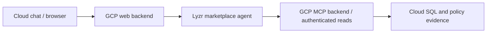

# Optional Lyzr full-cloud marketplace integration

**Complete [app/CLOUD-SETUP.md](../app/CLOUD-SETUP.md) first.** Use your own working cloud marketplace chat/backend, authenticated business MCP service and database/policy store. This guide connects that existing stack to a Lyzr-hosted marketplace agent; it does not repeat infrastructure provisioning.

The required Chapter20 lesson is the separate [Support Agent Basics setup](setup/lyzr-agent-platform/setup-guide.md), using the supplied fictional TXT and native KB in Playground. Its agent has no business MCP tools and must remain unchanged. Create your own separate marketplace-integration agent and connection; preserve the instructor’s deployed agents and all shared resources.

## Which components run where

| Component | Runs on | Setup reference |
|---|---|---|
| Marketplace browser frontend and application backend | Google Cloud Run web service | [Shared cloud application setup](../app/CLOUD-SETUP.md) |
| Authenticated business MCP service | Google Cloud Run backend service | Shared cloud application setup |
| Business records, policy store and application state | Google Cloud SQL (PostgreSQL) | Shared cloud application setup |
| Supporting image registry, secrets, network and configured retrieval/gateway services | Your Google Cloud project | Shared cloud application setup |
| Marketplace agent instructions, model selection, tool attachment and agent execution | Lyzr platform | Steps 1–3 below |
| Application-to-Lyzr inference connection | Google Cloud application backend calling Lyzr | Steps 4–5 below |

**This path does not deploy a Google ADK agent or use Google's managed Agent Runtime.** The shared cloud guide includes an OpenAI Agents SDK baseline and supporting services. Reuse that application infrastructure, then configure the Lyzr runtime connection using this guide; selecting Lyzr routes the agent investigation to Lyzr. Google Cloud is the application/data host, not the agent host in this configuration. The cloud MCP service and Cloud SQL must be available. No laptop tunnel is required.

## Before you start

Confirm your own GCP project, cloud marketplace URL, stable HTTPS MCP endpoint ending in `/mcp`, trusted MCP credential and working business/policy data. Confirm your authorized Lyzr account, model connection and credits. A laptop tunnel and instructor agent ID are not values for your cloud setup. Keep inference and MCP credentials private and distinct.

## Architecture



Lyzr owns the hosted agent loop. Your existing GCP services own chat authentication, business tool access and data. Model inference, KB/memory and telemetry endpoints are separate data-processing choices; selecting Lyzr in chat does not reconfigure the agent’s MCP target.

## 1. Connect your authenticated cloud business tools

In Lyzr Studio choose **Tools → New → MCP Server**. Give the connection a name identifying your own cloud lab. Use your Cloud Setup HTTPS MCP URL, **API Key** authentication, header name **x-api-key**, and blank header prefix. Enter the existing credential privately in the connection; do not paste it into instructions or browser code. Confirm this endpoint’s access policy matches completed Cloud Setup.

Choose **Add Server**, open the **MCP** tab, and verify all seven read-only actions: `begin_investigation`, `end_investigation`, `get_catalog`, `query_business_data`, `search_documents`, `fetch_evidence`, and `get_order_history`. Test authenticated discovery and an actual read. Do not substitute an unrelated KB or Data Query feature for these business tools.

## 2. Create your separate marketplace agent

Create an agent named for your own Marketplace Support cloud lab. Role: internal marketplace support investigator. Goal: answer order, payment, refund, payout and policy questions using verified read-only MCP evidence. Paste [app/lyzr/agent-instructions.txt](../app/lyzr/agent-instructions.txt) as instructions. Attach your connection with all seven actions; keep trusted connection credentials on the server side. Choose your authorized model and record it; the bounded instructor integration used gpt-5.4-mini.

Enable native Cognis with Cross Session OFF if demonstrating same-chat context. This is not proof of cross-session persistence. Create/save the agent once and record its returned ID. Do not edit Basics or an instructor agent. If creation fails ambiguously, inspect your own agent list before retrying.

## 3. Verify the hosted agent before connecting chat

Open its Playground, click **New Chat**, and ask **“Show the items and quantities for order-2.”** Check against your cloud business fixture. In the same chat ask **“What is their total quantity?”** Inspect **Activity** for begin/end investigation, one shared investigation ID across the business calls, tool arguments and returned evidence. Native execution must reach your GCP endpoint without a laptop tunnel. A displayed agent does not prove tool authentication or answer correctness.

## 4. Provision the inference secret and connect the existing web backend

Preserve the existing settings/images in `app/cloud/terraform/terraform.tfvars`. First provision only the dedicated secret and scoped service access:

```hcl
lyzr_secret_enabled = true
lyzr_enabled        = false
```

From `app/cloud/terraform`, inspect and apply the connection change using your existing Cloud Setup workflow:

```bash
terraform plan -out=lyzr-secret.tfplan
terraform apply lyzr-secret.tfplan
```

Then from `app`, enter your **Lyzr inference API key**, not the MCP key, privately:

```bash
python3 cloud/scripts/configure-lyzr.py --project YOUR_PROJECT_ID
```

The helper writes a new version of `marketplace-web-lyzr-api-key` through a hidden prompt. It does not create an agent or deploy the web service. Enable the connection only after the secret has a value:

```hcl
lyzr_secret_enabled = true
lyzr_enabled        = true
lyzr_agent_id       = "YOUR_OWN_MARKETPLACE_AGENT_ID"
```

Review and apply:

```bash
terraform plan -out=lyzr-integration.tfplan
terraform apply lyzr-integration.tfplan
```

Existing Terraform injects the inference credential and agent ID into the **web backend**; no frontend key is needed. The Lyzr MCP connection holds the separate business-service credential. See [runtime configuration](../app/RUNTIME-SELECTOR.md#configuration).

## 5. Verify the end-to-end connection

Open **your cloud marketplace URL**, select the Lyzr runtime, start a fresh conversation and repeat the order-2 lookup and same-chat total-quantity follow-up. Compare business tool evidence and native Activity with the application boundary trace if cloud Langfuse is configured. If the runtime is unavailable, inspect backend configuration, secret access and deployment rather than placing keys in the frontend.

Record your service placement, tool results, context, native trace, optional application trace and observed cost drivers using the [exercise](exercises/lyzr-agent-studio/exercise.md). Instructor historical integration is bounded evidence; this sequence has not been rehearsed from scratch in a fresh learner project. Record adaptations and failures explicitly.

## Cleanup

Disable the optional runtime and remove only lab agents/connections/resources you created. Preserve shared business data, Basics and instructor deployments. Manage lab secret versions using your normal cloud administration process. Historical local/tunnel configurations in [app/lyzr/README.md](../app/lyzr/README.md) are references, not this cloud setup path.
