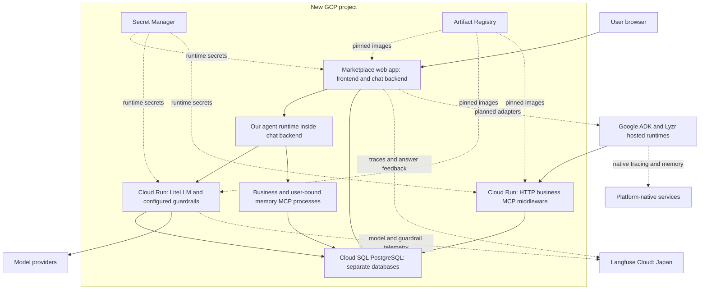

# Marketplace local and cloud architecture

**Status: core local/cloud deployment and shared runtime selection verified, October 8, 2026.** Cloud Run web/MCP/LiteLLM, private Cloud SQL and Langfuse Cloud Japan run independently of the laptop. Both interfaces support SDK, Google ADK and Lyzr. Cloud/native memory checks and local hosted-runtime question/follow-up checks passed; the user also confirmed detailed cloud SDK tracing in Langfuse. Fresh-project and clean-machine learner rehearsals remain pending. [Deployment verification](../app/cloud/VALIDATION-2026-10-08.md) · [runtime configuration and acceptance](../app/RUNTIME-SELECTOR.md).

## Current course delivery and component boundaries

Use **local SDK for the main course demonstrations**. Use Google ADK and Lyzr when teaching their platform chapters; cloud marketplace hosting demonstrates that the complete reference application works without the laptop. Platform-native monitoring belongs to platform chapters; the standalone Monitoring lesson covers LiteLLM and Langfuse.

| Component | Local setup | Cloud setup |
|---|---|---|
| Chat application: frontend and chat backend | Local marketplace interface and backend containers | Cloud Run marketplace web service |
| Agent runtime | OpenAI Agents SDK in the local chat backend; adapters can also call hosted agents | OpenAI Agents SDK in the cloud chat backend, or the existing hosted Google ADK/Lyzr agent |
| Business backend: MCP tools, SQL/RAG and data | Local MCP and PostgreSQL; a tunnel can expose HTTP MCP for a hosted platform | Cloud Run HTTP MCP and private Cloud SQL PostgreSQL |

These are separate placement/configuration decisions. Google ADK and Lyzr remain hosted even when called from the local interface. Changing the UI runtime opens a **new conversation**; old history retains its runtime and native session. The selector does not switch the hosted agent's MCP target. Local/cloud endpoint-and-key profiles configure that separately. Currently Google and Lyzr use the local tunnel middleware; SDK uses the data behind the selected marketplace deployment.

Cloud `market` was aligned once to local revision 24, clock 28 September, with business records, history, commands and 20 indexed policy chunks. Full transaction readback matched; the previous cloud business snapshot is retained for rollback. Accounts, conversations, feedback and personal/native memory were preserved, not synchronized. Test and evaluation databases were not copied. Environments may diverge again after business actions. Use fresh conversations for comparisons.

**Telemetry boundary:** SDK questions have detailed model/tool traces in the relevant local or cloud Langfuse project. Hosted Google/Lyzr questions have a marketplace boundary trace (question, answer, elapsed time and feedback); internal model/tool traces remain in each platform's native telemetry. A boundary trace is not a missing SDK trace.

## Deployment design

Keep the local Docker setup and add a cloud option with no laptop or tunnel dependency:

- **New GCP project:** Cloud Run for the marketplace web application, HTTP MCP middleware and LiteLLM gateway.
- **Cloud SQL PostgreSQL:** one instance, with separate databases and credentials for marketplace/demo, resettable test fixtures, evaluation and LiteLLM.
- **Langfuse Cloud, Japan:** managed tracing and feedback. Do not deploy Langfuse web/worker, ClickHouse, Redis or MinIO in GCP for this option.
- **Secret Manager and Artifact Registry:** credentials and versioned container images.
- **Terraform from the first deployment:** repeatable infrastructure; scripts handle builds, data initialization, application deployment and verification.

This replaces the earlier single-VM proposal. Langfuse Cloud removes the stateful observability stack that motivated that proposal. This is a course reference deployment; cloud hosting alone does not establish high availability or production readiness.

## Architecture diagram

The web app is one Cloud Run service: the backend serves the built frontend and API under one HTTPS origin. This avoids a second web service and simplifies cookies and origin configuration. Combining them requires a packaging change; they currently have separate local containers.

Our runtime orchestrates model and tool calls. LiteLLM handles model access and configured filters; it does not execute business SQL or RAG. Preserve our current local MCP process connections inside the web container for our SDK path, including user-bound memory. The separately exposed HTTP MCP service supports hosted runtimes. Both use the same business tool implementation and database, with their respective connection contracts.

## Component placement

| Component | Local option, available | Cloud option, planned |
| --- | --- | --- |
| Frontend and chat backend | Separate Docker containers | One Cloud Run web service, one HTTPS origin |
| Our agent runtime | Inside backend | Inside web service |
| Business SQL/RAG tools | Local MCP process; HTTP endpoint for platform labs | Local process for our SDK; separate Cloud Run HTTP MCP service for hosted agents |
| Application memory tools | User-bound local MCP process | User-bound process inside web service; persistence in Cloud SQL |
| Business data, indexed policy passages, chats, sessions, feedback, memory | Local PostgreSQL and pgvector | Cloud SQL PostgreSQL; confirm extensions/schema compatibility during implementation |
| Test and evaluation fixtures | Separate local databases | Separate databases and credentials; reset commands target only these databases |
| LiteLLM | Local gateway container | Private Cloud Run service, separate LiteLLM database |
| Built-in/custom guardrails | Gateway configuration and custom hooks | Package our existing configuration/hooks into the gateway image and verify behavior |
| Presidio | Analyzer and anonymizer containers | Optional private Cloud Run services, invoked by gateway during requests |
| Lakera | External detection service | Same external service; key stored in Secret Manager |
| Tracing and answer feedback | Self-hosted Langfuse | Langfuse Cloud Japan; application/gateway export to same cloud project |
| Documents needed for indexing | Local mounted files | Synthetic course documents bundled in image; indexed content in Cloud SQL |
| Secrets | Ignored local configuration | Secret Manager; restricted service identities |
| Google ADK | Existing deployed lab | Remains in its project; cloud middleware URL replaces laptop tunnel |
| Lyzr | Hosted platform | Cloud middleware URL replaces laptop tunnel |

Cloud SQL is shared infrastructure, not a shared database login. Give business tools a read-only business role and application memory its required write privileges. Langfuse Cloud manages its own storage; it does not use our Cloud SQL instance. Keep local and cloud data independent; no automatic synchronization or historical-trace migration is required.

## Request, identity and memory flow

1. The browser signs into the marketplace. The chat backend validates its session cookie and conversation ownership.
2. For our SDK, trusted runtime code binds memory tools to that authenticated user. The model cannot choose the owner identity.
3. Model requests go through LiteLLM; configured input/output checks apply. Tools retrieve business evidence and policy passages, and the runtime produces the answer.
4. Store the question, answer, evidence references, execution reference and per-answer rating in PostgreSQL. Export trace/feedback to Langfuse Cloud.
5. For a hosted runtime, a future backend adapter maps the authenticated user and conversation to provider identifiers. The hosted agent calls the cloud HTTP business MCP endpoint.

The current HTTP business MCP endpoint has a lab key and shared read-only scope, and excludes personal memory. This does not provide different operator/support business-data permissions. Do not expose remote personal-memory access or claim per-user business authorization without implementing those boundaries.

Application long-term memory remains in our PostgreSQL-backed memory service. Short-term conversation history is stored by the application. Google/Lyzr native sessions and memory remain platform-specific; no cross-provider memory synchronization is assumed.

## Shared UI and platform scope

The target UI offers our SDK, Google ADK and Lyzr through a runtime selector. The selector and backend adapters are pending work. Map answers, citations, errors and execution references into the common answer contract; preserve ownership and feedback association.

Google and Lyzr use their configured model access and native monitoring/memory. They do not automatically use LiteLLM or produce a complete Langfuse tool/model trace. For hosted answers, create an application trace for the request/answer/feedback and link native execution references where available, clearly distinguishing it from native internal telemetry. Native playgrounds remain available too.

The Marketplace chapter owns this architecture and learner setup. Platform chapters explain their own deployment, adapter, memory and monitoring features. Monitoring teaches LiteLLM/Langfuse; automatic online evaluation remains pending in Evaluation.

## Cloud Run changes required before deployment

- **State across requests:** cloud HTTP MCP stores investigation metadata, evidence and call budgets in PostgreSQL. Each tool call opens a read transaction and checks that business revision/demo clock and document hashes still match; drift requires a new investigation. This deliberately revises the remote contract to revision-guarded reads. Local MCP keeps its held repeatable-read snapshot. Cross-instance recovery and drift rejection passed a disposable-PostgreSQL test; actual Cloud Run restart validation is still required.
- **MCP transport:** verify streamable HTTP behavior across separate requests, replicas, disconnects and restarts. Avoid dependence on in-memory transport sessions; application investigation state must be separate and durable.
- **Execution lifetime:** configure request timeouts to cover existing agent limits. Keep the initial investigation within an active HTTP request; bound tool/model work and persist interrupted-run outcomes. Do not assume background tasks continue after sending the response.
- **Telemetry delivery:** flush/export SDK and custom post-filter audit observations before completing a request; verify gateway callbacks under request-based CPU allocation. Preserve labels and distinguish a post-filter audit from a network capture. Export failures must not erase the saved answer/rating; provide retry/reconciliation where needed.
- **Scale and connections:** cap instances/concurrency and PostgreSQL pools together; bound model spend and provider requests. In-memory caches or budgets must not be treated as global enforcement across replicas.
- **Packaging:** bundle frontend, synthetic documents and current gateway hooks/configuration; mirror approved pinned images into Artifact Registry. Do not rely on local bind mounts or ephemeral local files for persistent data.

These are implementation gates, not claims that the current stack can be deployed unchanged. [Cloud Run billing and CPU behavior](https://docs.cloud.google.com/run/docs/configuring/billing-settings), [LiteLLM deployment guidance](https://docs.litellm.ai/docs/proxy/deploy).

## Access, secrets and operational safety

Expose the web service through HTTPS with application login, secure cookies and explicit allowed origins. Keep LiteLLM and Presidio private behind Cloud Run IAM; attach service identities and authenticated service-to-service requests. Administrative gateway access needs a documented authenticated path, not public master-key access.

Hosted agents need an externally reachable MCP endpoint. Protect it with a fresh scoped makcloud credential, validate headers/hosts and rate-limit it. Confirm each platform can send the required authentication headers. This is a synthetic read-only lab connection, not a production authorization design.

Use private-only Cloud SQL with a dedicated VPC/subnet, Private Services Access and Cloud Run Direct VPC egress to private ranges. Use the Cloud SQL connector/integration with least-privilege service and database identities. No public database IP, NAT gateway or always-on VPC connector is planned. Validate these connections before deployment acceptance. Store provider keys, gateway keys, database credentials, Lakera keys and Langfuse project keys in Secret Manager. Terraform creates secret containers/IAM; populate secret values separately so they do not enter variable files or Terraform state. Never reuse local bootstrap passwords.

Langfuse Cloud receives configured trace content, including potentially questions, answers and retrieved text. Masking model input does not automatically redact earlier application trace content. Use synthetic course data, document exported fields/retention, and verify tracing does not accidentally record credentials. The Japan endpoint is https://jp.cloud.langfuse.com; creating an account alone does not configure project keys or application export. [Langfuse SDK configuration](https://langfuse.com/docs/observability/sdk/overview).

Enable Cloud SQL backups and deletion protection. Separate ordinary service teardown from explicit data deletion; provide restore and rollback instructions. Cloud Logging covers infrastructure/application failures; Langfuse covers agent execution, scores and evaluations.

## Cost and region decisions

Cloud Run services may scale to zero when idle, with cold starts. Cloud SQL compute while running and retained storage/backups still cost money; stopping database compute does not remove storage charges. Model calls, external detection and Langfuse usage are separate. Planning allowance: about US$30–40/month with a small shared-core database running continuously, subject to regional pricing and capacity validation; usage-based model calls are extra. With the database stopped and no public IPv4 address, retain storage/backups and image/secrets costs only, expected to be a few dollars for a small lab. A public idle Cloud SQL IPv4 would add approximately US$7.30/month at $0.01/hour, so private-only connectivity is selected. See [Cloud SQL pricing](https://cloud.google.com/sql/pricing) and [Cloud Run pricing](https://cloud.google.com/run/pricing).

Use one GCP region for the shared application, gateway and database where practical; confirm availability, latency and price before provisioning. Langfuse Japan is already selected and does not require hosting GCP in Japan. Keep the existing ADK lab region unchanged unless a separate reason requires migration.

Before review approval becomes provisioning, supply the new project, selected region, Cloud SQL tier/storage, Cloud Run memory/concurrency/instance caps and a modest-usage estimate. Document how learners pause services and clean up retained resources. [Cloud SQL start/stop behavior](https://docs.cloud.google.com/sql/docs/postgres/start-stop-restart-instance).

## Repeatable learner setup

**Local:** clone repository, copy example configuration, supply keys privately, start pinned Docker Compose services, initialize synthetic data, and run login/SQL/RAG/memory/tracing checks. Preserve the current self-hosted local Langfuse option.

**Cloud:** select a new billed project, authenticate deployment tools, supply project/region/image revision and secret references, then run the documented Terraform and deployment workflows. Learners use their own Langfuse Cloud project and provider keys.

Terraform manages APIs, Artifact Registry, service identities, Cloud Run services, Cloud SQL/databases, secret references/access, applicable networking and protected remote state. Bootstrap the state backend explicitly. Build/deploy scripts handle images, separate schema migrations, fixture initialization and smoke checks. Never execute database-reset jobs against the main marketplace database. Keep all normal setup repeatable without console-only infrastructure steps.

## Delivery and acceptance

1. **Owner review:** review this document; choose new project/region and inspect sizing/costs before provisioning.
2. **Implementation:** Terraform, packaging, service authentication, durable MCP investigation handling, migrations, telemetry export and safe cleanup scripts.
3. **Deploy our SDK path:** verify login, marketplace business journey, SQL plus RAG, conversation retention, short-/long-term memory, gateway routing/privacy/injection checks, post-filter audit and per-answer feedback in Langfuse Cloud.
4. **Persistence/failure checks:** restart/scale services, verify saved chats/votes/memory/data remain, test MCP request continuity and interrupted-run handling, and verify credentials do not leak. Check trace/feedback delivery with cold starts and no subsequent traffic.
5. **Hosted integration:** move ADK/Lyzr business MCP endpoints to the cloud, then implement shared-UI adapters. Validate identity/session mapping, citations, errors and native memory/monitoring separately.
6. **Learner reproduction:** recreate from documented inputs, run checks, test rollback/backup restoration and cleanup, then record actual costs and limitations.

The owner approved proceeding with deployment. Infrastructure access grants and secret configuration still require concrete review at their execution step. Slides, speaker notes and homework follow section preparation. Availability hardening, production tenant authorization, disaster recovery targets and broader scale testing are later work; the course deployment must still meet the explicit security and persistence checks above.
