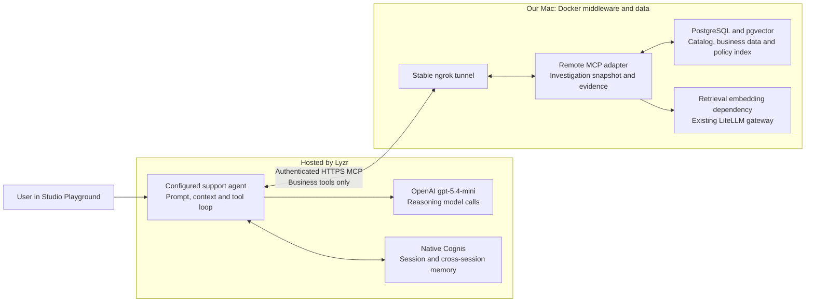

# Agent platforms: landscape, ownership and lab guide

Companion to [Part E of the course outline](COURSE-PLAN.md#e-understanding-ai-platforms-through-the-same-application). Detailed platform teaching material lives here; the course outline retains learning objectives, lab summaries and status. Vendor positioning is dated October 3, 2026. Lab evidence retains its original dates and limits.

## Contents

- [Platform positioning and customer fit](#platform-landscape-positioning-and-customer-fit)
- [Component ownership comparison](#common-comparison-agentic-system-components-and-ownership)
- [Google Gemini track](#19-google-gemini-enterprise-agent-platform)
- [AWS hosting track](#20-aws-bedrock-agentcore-runtime-the-hosting-lesson)
- [Lyzr lab: architecture, setup, results and enhancements](#21-lyzr-agent-studio)
- [Platform decision lesson](#22-choosing-an-ai-platform)

Reuse business tasks, tools through MCP and evaluation contracts across platforms. Walk the component map from section 1 to show what the application owns and what the platform provides. The baseline uses OpenAI Agents SDK; Gemini explores a native implementation, AWS explores hosting the existing agent logic, and Lyzr runs a managed agent with our remote business MCP tools and native Cognis memory. These are different comparisons, not an isolated platform leaderboard or a production-certification exercise. Only the setup needed to run the learning labs is included.

### Platform landscape: positioning and customer fit

**Learning objective:** Distinguish vendor positioning from technical capability coverage, and explain why different customers choose different agent stacks. This orientation comes before the platform labs; it is not a ranking or an additional implementation requirement. Product positioning and references reviewed October 3, 2026; refresh before recording.

#### Four provider categories

The categories describe starting points and product emphasis, not exclusive boundaries. Framework vendors can offer managed platforms, model vendors can offer hosted agent execution, and independent platforms can run on hyperscaler infrastructure.

| Category | Representative offerings | Positioning and likely customer fit | What the customer must examine |
|---|---|---|---|
| Cloud platforms / hyperscalers | Google ADK and Gemini Enterprise Agent Platform; AWS Strands Agents and Bedrock AgentCore; Microsoft Agent Framework, Foundry Agent Service and Copilot Studio | Agent development plus cloud infrastructure and managed services. Often attractive to teams with existing cloud, identity, procurement and operations commitments. | Which services must be assembled; framework versus hosted runtime; supported models; deployment, persistence, identity and cost boundaries. |
| Frontier model providers with agent tooling | OpenAI Agents SDK / Agents API; Anthropic Claude Agent SDK / Claude Managed Agents | Models plus developer tooling and execution services. Often attractive when access to model capabilities and control over application behavior matter. | SDK execution versus managed execution; supplied tools/state/guardrail mechanisms; additional memory, business authorization, retrieval and operational integrations. Claude Managed Agents is currently beta. |
| Framework-led independent providers | LangChain / LangGraph with LangSmith; CrewAI framework with CrewAI AMP | Code-based composition and orchestration, complemented by commercial evaluation, monitoring and deployment products. Often attractive to engineering teams that need customization and can own integration. | Compare the full product family, not only the library; state and failure handling; portability; operational services; remaining engineering effort. |
| Platform-led independent providers | Lyzr, Dify, Stack AI, Relevance AI and Hyperagent | Integrated building and operating experiences, with varying support for models, clouds, enterprise workflows and existing external agents. Often attractive when reducing component integration and time to production matters. | Exact capability coverage, extensibility, deployment options and provider costs. Multiple model integrations do not establish cross-cloud portability or cross-runtime governance. |

Customer-fit descriptions are teaching hypotheses, not verified buyer segmentation or vendor win/loss evidence. Size alone does not decide the choice: engineering capacity, existing commitments, regulatory/deployment needs, agent maturity and the amount of differentiation in agent logic matter more.

#### Map providers onto five capability layers

| Layer | What to distinguish |
|---|---|
| Models | Reasoning and embedding providers; model choice is separate from framework and hosting choice. |
| Frameworks / execution logic | Agent loops, tools, workflows, state and handoffs. A client SDK that configures or invokes a remote agent is different from a framework that executes the agent locally. Lyzr exposes an ADK, but its documented Studio examples alone do not establish independently runnable local execution. |
| Managed agent infrastructure | Hosting and scaling plus execution services such as sessions, identity and operational controls. Name the exact service and which processes it hosts. |
| Agent builders | Visual, conversational or code-based authoring, configuration, testing and deployment. Builder availability does not prove every operational component is bundled. |
| Governance / control planes | Discovery, policy, access, spend and audit across an agent estate. Separate visibility from enforcement, and a common control plane from inter-agent collaboration. |

The same company may cover several layers. Evaluate capabilities as **provided**, **customer-configured**, **customer-built/integrated**, or **unverified**. Guardrail hooks differ from configured business policies; conversation state differs from deliberate cross-session memory. Avoid describing a provider as having no memory or guardrails merely because our chosen integration requires additional work.

#### Two buying needs: build new agents or govern existing agents

- **Build and operate:** A team wants a production agent without assembling an internal agent platform. Compare time to first working task, time to reliable production behavior, integration effort, customization, debugging and ongoing operating cost.
- **Govern an existing agent estate:** Teams already use different frameworks, runtimes or SaaS agents. Compare supported integration points, identity propagation, telemetry, policy enforcement, required code changes and coverage limits. External agents need not move into one runtime; verify what is actually supported.

These needs can coexist, but they are separate product promises. Lyzr's Studio/Opencontroller distinction is one example; do not assume every independent platform provides heterogeneous governance. For control-plane comparisons, include relevant enterprise offerings such as ServiceNow AI Control Tower and Salesforce/MuleSoft Agent Fabric alongside cloud and independent products.

**Discussion prompts:** Which customer problem initiates adoption? Why would the customer choose this approach over its cloud stack or an internal build? Which benefit is measured: delivery speed, task success, operating effort, cost or enforceable governance? Which capabilities are portable if the customer changes model or runtime? What integration layer gives an external-agent controller its visibility and enforcement authority?

**References:** [Google Agent Platform](https://cloud.google.com/products/gemini-enterprise-agent-platform), [AWS AgentCore](https://docs.aws.amazon.com/bedrock-agentcore/latest/devguide/what-is-bedrock-agentcore.html), [AWS Strands](https://strandsagents.com/blog/introducing-strands-agents/), [Microsoft Agent Framework](https://devblogs.microsoft.com/foundry/introducing-microsoft-agent-framework-the-open-source-engine-for-agentic-ai-apps/), [Microsoft Foundry Agent Service](https://learn.microsoft.com/en-us/azure/foundry/agents/overview), [Copilot Studio](https://learn.microsoft.com/microsoft-copilot-studio), [OpenAI Agents SDK and execution options](https://developers.openai.com/api/docs/guides/agents/sdk), [Claude Managed Agents](https://platform.claude.com/docs/en/managed-agents/overview), [LangSmith](https://www.langchain.com/resources/what-is-langsmith), [CrewAI AMP](https://docs-platform.crewai.com/platform/en/introduction), [Dify](https://www.dify.ai/), [Stack AI](https://docs.stackai.com/), [Relevance AI](https://relevanceai.com/ai-ops), [Hyperagent concepts](https://www.hyperagent.com/docs/concepts/how-hyperagent-fits-together), [Lyzr ADK](https://docs.lyzr.ai/lyzr-adk/overview), [Lyzr Opencontroller](https://www.lyzr.ai/opencontroller/), [ServiceNow agents and governance](https://www.servicenow.com/products/ai-agents.html), [Salesforce Agentforce platform](https://www.salesforce.com/platform/agentforce-platform/).

### Common comparison: agentic-system components and ownership

Reuse the component map from section 1 for OpenAI, Gemini, AWS, Claude and Lyzr. Record **who supplies the component**, **what we must configure/build**, **what was actually tested**, and **its limits/costs**. A product advertising a feature is not evidence that our integration uses it successfully. An untested entry is not an unsupported feature.

| Component | Questions every platform track must answer |
|---|---|
| Model and gateway | Who selects/calls the model? Where are credentials, budgets and provider routing enforced? Separate reasoning calls from retrieval embeddings. |
| Prompt | Where do role, instructions, versions and rollout controls live? |
| Context | What instructions, messages, tool results, memories and retrieval evidence enter each model call? |
| Tools and MCP | Which transports/auth are supported? Who implements tools and enforces permissions? |
| Knowledge and retrieval | Native KB or our backend RAG? Who owns indexing, embeddings, SQL/catalog and evidence citations? |
| Session / short-term memory | How is history supplied and scoped? Does a same-chat reference resolve, with fresh evidence when required? |
| Long-term memory | How are facts extracted/saved, retrieved, updated/deleted and scoped to users? Test overrides and stale checkpoints. |
| Agent loop / orchestration | Who chooses and executes tools, retries and termination? Can we inspect and bound execution? |
| Guardrails and identity | Separate platform policies from backend authorization, authenticated user scope and tool-level checks. |
| Runtime and hosting | Which processes are hosted? Where do middleware/data run? Compare restart, cold-start and scaling responsibilities. |
| Observability / monitoring | What traces, tool arguments/results, latency, tokens, cost and failures can we inspect/export? |
| Evaluation | Can we run the same cases and grade recall, correct use, evidence, unauthorized actions, cost and consistency separately? |
| Advanced: routing and multi-agent | Distinguish model selection from dynamic routing, parallel tools from workers, and MCP from A2A. Validate each independently. |

| Track | Comparison boundary | Current evidence |
|---|---|---|
| OpenAI Agents SDK baseline | Our application owns middleware, history selection, local memory service and hosting; SDK supplies the loop | Implemented baseline and repeatable regressions |
| Gemini (19) | ADK managed Runtime, Sessions and Memory Bank; laptop business MCP | Hosted SQL/RAG, seven memory checks and native tracing verified October 8 |
| AWS (20) | Planned hosting of existing agent logic; ownership change differs from a framework rewrite | Not yet deployed here |
| Lyzr (21) | Managed agent/model loop and native Cognis; application remains remote business MCP provider | Business and bounded memory tests recorded; checklist-use gap open |
| Claude, optional future track | Select the concrete Claude SDK/managed product and integration boundary before filling capabilities | No implementation or product-specific parity claim here |

Use the same business cases and evidence contract where possible. Disclose different models, prompts, context/history, tools, fixtures and automatic versus explicit memory saving. Do not turn our OpenAI GPT-5.4 versus Lyzr gpt-5.4-mini observations into a controlled platform ranking. Section 22 synthesizes this worksheet after the tracks have evidence.

### 19. Google Gemini Enterprise Agent Platform
- **Learning objective:** Identify which AI responsibilities a native platform takes over.
- **Lab and result:** Adapt the agent to the Gemini track and run shared cases; record model/framework/context differences before interpreting scores.
- **Approach:** build natively with ADK on Agent Runtime, using the platform's managed sessions, retrieval and memory where they fit.
- **Compare against the baseline:**
  - quality on the same evaluation set
  - cost, including platform fees
  - latency and cold starts
  - engineering effort
  - whether traces can be exported to Langfuse
  - lock-in
- **Status:** Bounded hosted lab complete and manually accepted October 8: the user validated general questions and short-/long-term memory; hosted SQL/RAG, memory controls and native trace visibility passed. [Results and replay steps](GOOGLE-PLATFORM-PLAN.md#verified-results). Wider benchmarking and recording materials remain later work.

#### Progress and evidence — October 1, 2026

- **Current state:** Planned; no native platform experiment.
- **What we learned / have available:** The ownership map, read-only tools and evaluation contracts provide the comparison baseline. Native platform capabilities and behavior have not been measured in this project.
- **Tests and references:** [Architecture baseline](../SPECIFICATION.md); [MCP contracts and current limits](../app/README.md); sections 1, 6, 14, 16 and 17.
- **Hands-on readiness:** Planned Gemini native implementation and shared-case comparison. No platform hands-on results to reuse yet.
- **Pending:** Verify current product/API names and access during implementation, verify compatibility with the implemented remote MCP adapter and its future cloud endpoint, map sessions/retrieval/memory ownership and disclose model/framework differences.

### 20. AWS Bedrock AgentCore Runtime (the hosting lesson)
- **Learning objective:** Separate hosting changes from agent-logic changes.
- **Lab and result:** Add the required runtime adapter/configuration, run the existing agent on AWS and compare a small set of calls with the local baseline.
- **Approach:** reuse the existing OpenAI Agents SDK agent logic in a container on AgentCore Runtime, adding the required deployment adapters. Inspect runtime/observability behavior without building a general identity or infrastructure module. Model calls still go through LiteLLM. There is no Strands rewrite.
- **Lesson:** the hosting platform and the framework are separate choices.
- **Status:** to build; keep this a bounded hosting comparison, with effort confirmed by a working prototype.

#### Progress and evidence — October 1, 2026

- **Current state:** Planned; no hosted AWS experiment.
- **What we learned / have available:** The local agent/hosting separation is implemented; portability to the proposed runtime is not yet verified.
- **Tests and references:** [Local deployment](../app/compose.yaml); [agent entry point](../app/backend/marketplace/agent.py); sections 6 and 11.
- **Hands-on readiness:** Planned bounded hosted-container comparison reusing agent logic. No AWS deployment/result artifact yet.
- **Pending:** Prototype required adapters, remote tools and gateway connectivity; measure cold starts, persistence and platform costs without expanding into a general infrastructure course.

### 21. Lyzr Agent Studio

- **Learning objective:** Reuse the support middleware while moving model configuration, agent execution and native memory to a managed platform.
- **Lab and result:** Configure the agent, connect the seven remote MCP actions, deploy the agent API, then run shared business and memory cases with trace inspection.
- **Approach:** Lyzr owns the model and agent loop; our backend supplies read-only SQL, retrieval, snapshots and evidence. Native Cognis connects directly within Lyzr; our OpenAI runtime uses a separate local memory MCP boundary. Remote HTTP MCP exposes business tools only.
- **Status:** Implemented bounded platform lab; packaging and unresolved validation remain. Its dedicated section does not change the existing optional release scope.

#### Integration architecture: current lab

Lyzr calls our business tools; it does not execute our OpenAI Agents SDK agent. Reasoning/model calls go through Lyzr, while the backend embedding dependency still supports policy retrieval. Cognis connects natively within Lyzr and is separate from our PostgreSQL personal-memory service. Our OpenAI baseline now reaches that service through local stdio MCP; it is not exposed through this remote business endpoint. The diagram shows current laptop/tunnel hosting, not the pending cloud deployment. Business permissions, snapshot freshness and evidence provenance remain backend responsibilities.

#### What Lyzr supplies in this integration

| Component | Lyzr contribution | What remains ours / evidence boundary |
|---|---|---|
| Model and model-access configuration | Studio provider/model selection; hosted calls to gpt-5.4-mini | Backend retrieval embeddings remain separate; no LiteLLM reasoning call in this path. Dynamic routing untested. |
| Prompt and context | Role, goal, instructions editor and runtime context assembly | We adapt the evidence prompt and verify context/behavior; exact native context-selection internals unverified. |
| Tools and MCP | Connection configuration, discovery and invocation of our seven actions | We implement/authenticate/host tools, read-only SQL and investigation lifetime. |
| Knowledge / retrieval | Native Knowledge Base and Data Query options are documented | This lab uses our PostgreSQL/pgvector/policy retrieval via MCP; native KB/Data Query not tested. |
| Session / short-term memory | Playground sessions plus configured Cognis continuity | Same-chat order reference passed; Memory-off baseline lost the reference. |
| Long-term memory | Cognis Cross Session, extraction guidance and automatic memory integration | Bounded recall/control tests passed; provider record provenance/CRUD and multi-user isolation unverified. |
| Agent loop | Hosted tool selection, execution and response generation | Domain rules and tool validation remain ours; checklist selection/execution gap persists. |
| Guardrails / identity | Platform Responsible AI and tool-auth options are documented | We retain read-only backend enforcement; native guardrails and end-user identity propagation not validated. |
| Runtime / hosting | Hosted agent and dashboard-confirmed agent API deployment | MCP middleware, data and retrieval dependencies still on the Mac; external curl request passed (HTTP 200); broader API behavior untested. |
| Observability / monitoring | Playground Activity exposed tool arguments/results, latency and run/session IDs | Aggregate monitoring/export and native memory-record audit not tested. |
| Evaluation | Native evaluation features appear in the product documentation | Our controlled cases and assistant review supplied these results; native evaluation suite not exercised. |
| Advanced routing / multi-agent | Model-selection and Manager Agent options are documented | No dynamic routing, manager/workers or A2A experiment in this lab. |

Documented options above are checked against [Studio Builder](https://docs.lyzr.ai/enterprise/agent-studio/agents/studio), [Models](https://docs.lyzr.ai/enterprise/agent-studio/connections/models), [Memory](https://docs.lyzr.ai/enterprise/agent-studio/connections/memory) and [Tracing](https://docs.lyzr.ai/enterprise/agent-studio/agent%20eval/tracing), October 3, 2026. Availability can depend on plan; a documented option is not marked verified by our lab.

#### Steps we performed

1. Created **Marketplace Support — MCP Lab** with a support-investigator role/goal, configured gpt-5.4-mini and adapted the read-only evidence prompt.
2. Added the authenticated remote MCP connection, discovered and attached all seven actions. The backend adapter/tunnel setup was our infrastructure work, outside Studio.
3. Ran order/payment/payout/history/policy questions in Playground and checked Activity, exact evidence handles and investigation cleanup.
4. Confirmed agent API deployment in Deploy. We did not publish to the App Store or test an external inference request.
5. Reconnected after the laptop reboot invalidated the temporary endpoint; later replaced it with the stable ngrok endpoint and removed retired connections. Verified same-URL service restart; actual reboot recovery still untested.
6. Enabled Cognis with Cross Session OFF and ran the short-term off/on comparison.
7. Enabled Cross Session ON, added extraction guidance and replaced conflicting no-memory prompt instructions; updated description and saved the agent.
8. Used fresh chats to test preference/unique-phrase/checklist/checkpoint recall, a temporary override and current-state refresh. Toggled Cross Session OFF for the negative control, then restored ON and confirmed recall.
9. Inspected the checklist evidence gap, added a shipment-check instruction and reran. Autonomous retrieval still missed shipment rows; a corrective follow-up succeeded. Keep this as a failed autonomous check rather than a memory-recall failure.
10. After the user deployed the latest agent, called its external inference API with curl in a fresh session. HTTP 200 in 17.23 s returned correct order-2 paid/captured status with evidence; no extra client application needed.

#### Where to inspect tracing and monitoring

Open **Monitoring → Traces** in the Studio sidebar ([dashboard](https://studio.lyzr.ai/traces-v2/)). This page has two tabs:

- **Traces:** Individual runs with start time, duration, cost, input/output tokens and trace ID. Select a row to inspect the execution waterfall, span durations and expandable logs. Filter by agent, date range, user or session. The current account's trace list includes our Marketplace Support runs.
- **Analytics:** Aggregate monitoring for the selected date/user/agent scope: credits, latency, execution reliability, token use and trends. The dashboard loaded in this account: selected September 26–October 3/user scope showed 30 traces, 2.87 credits, 11.63 s average latency, 0.00% execution error rate and 31,332 average tokens per trace. These are displayed aggregate values, not this memory experiment alone; detailed accuracy and scope reconciliation remain a separate check.

**Accepted UI review — October 3:** The user inspected tracing and monitoring in Studio and reported that both look fine. Keep this user-reported acceptance separate from automated validation. Playground Activity and the Traces/Analytics pages have also been inspected during the lab. **Optional deeper checks:** Native Cognis visibility, token/cost attribution, export compatibility, aggregate metric definitions and reconciliation with our known successful/failed tests. A successful execution or platform reliability score must not be equated with a factually correct answer: our checklist run can complete while missing a required evidence query. [Official tracing guide](https://docs.lyzr.ai/enterprise/agent-studio/agent%20eval/tracing).

#### User experience and advantages over building the full stack ourselves

**Observed experience:** The main configuration work fit one interface: model, prompt, MCP tools, Playground, memory and deployment. Cognis setup required configuration and prompt alignment rather than a new memory integration in our backend. Fresh-chat boundaries and Activity made the experiments practical. These are qualitative observations from this one lab, not a measured development-time or usability benchmark.

**Where it reduced our work:** Lyzr supplied the hosted agent loop, model-access configuration, test chat, session/memory integration and agent API deployment. We reused our existing business middleware instead of rebuilding its rules in Studio. Compared with our baseline, we did not need to implement a second agent loop, chat-history adapter or native Cognis adapter for this path. This reduces integration/operations work, but does not remove domain design or verification.

**Friction and trade-offs:** Connection recovery and changing tunnel URLs came from our laptop/tunnel setup; stable ngrok addressed the hostname churn, while full cloud hosting remains pending. Agent prompt/save versions and memory toggles required careful readback. The Memory-off baseline did not maintain the expected follow-up context. A smaller model and configured prompt still skipped required business evidence despite successful memory recall. Activity helped diagnose business calls, but did not expose the same native memory audit/permission controls as our backend. Platform credit/provider costs and broader export/control behavior remain to be measured.

#### Progress and evidence — October 3, 2026

**Original October 2 baseline:** Private agent with seven remote MCP actions, Memory removed and `gpt-5.4-mini`; adapted instructions and Activity inspection. Final combined order/payment/payout/history/policy question completed in 13.39 seconds with three verified citations and cleanup. Agent API deployment confirmed in the dashboard; middleware remains behind a temporary tunnel. Nano failures and runtime guarantees missing from this integration are recorded in [validation](../app/lyzr/VALIDATION.md).

**Lab material:** Follow the [exact dashboard setup steps](../app/lyzr/README.md), inspect [saved instructions](../app/lyzr/agent-instructions.txt) and compare the component ownership map with the OpenAI SDK baseline. Treat model, context, validation and telemetry differences as confounders; no platform winner or broad quality result is claimed.

**Current agent and memory:** Stable ngrok business MCP and native Cognis Cross Session ON are now configured. Short-term continuity, fresh-chat preference/checklist/checkpoint recall, temporary-override reconfirmation and the Cross Session off/on control passed. The Memory-off configuration above records the original October 2 baseline. [Native-memory test report and exact prompts](../app/lyzr/cognis-memory-2026-10-03/REPORT.md).

**Dashboard lab:** Follow [the exact setup steps](../app/lyzr/README.md): configure gpt-5.4-mini and the evidence prompt, attach **Marketplace Support MCP Lab — Stable** with seven actions, save/update, test in Playground and inspect Activity. Agent API deployment is confirmed; external inference curl smoke test now passed; see the result below. Cognis setup: Build → Memory → Configure Memory → Cross Session ON → Extraction Instructions → Save → Update. Use fresh chats for long-term comparisons and an OFF/ON control. Preserve model, prompt and context differences when comparing outcomes.

**Connectivity and hosting:** The [stable ngrok runbook](../app/lyzr/ngrok-2026-10-03/REPORT.md) supersedes the changing Cloudflare quick-tunnel hostname and retired connections. Login startup, Docker restart policies, authenticated tool discovery and a same-URL service restart passed; an actual laptop reboot remains untested. Stable URL, service availability and proper cloud hosting are separate checks. Cloud deployment must move the middleware, PostgreSQL/pgvector, policy/index data and embedding/gateway dependencies off the Mac; validate with the laptop/tunnel out of the path.

**Short-term baseline:** The [controlled two-turn test](../app/lyzr/memory-session-2026-10-03/REPORT.md) asked order-2 status, then “For this order, check its payment status.” With Memory off, the agent requested the order ID on the follow-up; Cognis with Cross Session off resolved it and refreshed evidence. The later Cross Session ON run also passed. Session existence alone does not guarantee the needed context reaches the model; these tests do not establish Cognis internal storage behavior.

**Memory ownership and limits:** Compare native automatic extraction with our explicit backend save/write controls. Unique-phrase recall across fresh chats, an OFF control and restored ON recall support the bounded native result. A checkpoint is historical context, not current status. Native identity mapping, per-user isolation, provider provenance and verified update/delete remain unverified; our backend owner/version/write-permission guarantees do not automatically transfer. [OpenAI local-MCP regression](../app/results/memory-repeatable-20261003T112031250654Z/REPORT.md) passed 19 reviewed questions and source checks after 81 deterministic checks, independently of Lyzr.

**Known gap / learner checkpoint:** Remembering the accepted payout checklist did not ensure the agent executed it. On order-2, autonomous investigation retrieved history and policy but omitted actual shipment rows; it first claimed no delivery rows, then still omitted the query after an added prompt instruction. An explicit follow-up retrieved a pending shipment with delivered_at null and correctly concluded that the 24-hour hold had not started. Record procedural recall as PASS and autonomous evidence completeness as FAIL; the successful prompted diagnostic does not close the gap.

**Follow-up acceptance:** Rerun the original checklist question in a fresh chat without corrective coaching. Verify actual shipment status/delivered_at and active returns, payout-attempt history and dated policy in tool traces; require supported delivery/hold conclusions and matching citations. Keep the gap open until that autonomous case passes. Compare retrieval, use and evidence support separately in section 18; one successful sample still does not establish general reliability.

#### Lyzr enhancements and future validation

The bounded lab is available for teaching; preserve the known failed checklist case. Track the following as enhancements rather than silently implying they are validated:

- **Autonomous checklist use:** Close the shipment-retrieval gap using the acceptance case above, without corrective coaching.
- **Native memory controls:** Verify end-user identity mapping, cross-user isolation, provider provenance and actual update/delete behavior.
- **Hosting and restart:** Deploy authenticated MCP middleware/data/retrieval in the cloud without tunneling; separately verify actual laptop reboot recovery for the current stable ngrok setup.
- **Deeper observability:** Optional export/trace completeness, Cognis visibility and cost/metric reconciliation. UI tracing/monitoring review is accepted by the user.
- **Additional platform features:** Optional native evaluation, guardrails, model routing and multi-agent experiments; do not claim these are used by this lab.
- **Broader validation and teaching:** Multi-match clarification, repeated/held-out shared-case comparisons, clean learner setup and recorded checkpoints.

#### External agent API smoke test — October 3, 2026

[Saved curl request, response and reproduction steps](../app/lyzr/api-smoke-2026-10-03/REPORT.md): latest deployed agent answered order-2 via authenticated curl, HTTP 200 in 17.23 seconds. Correct paid/captured state and evidence references returned. First attempt with the masked display key got 403; obtaining the existing unmasked key resolved authentication. No additional app, key creation or permission expansion. This closes the bounded external inference smoke-test item; broader session/user isolation and API behavior remain enhancement scope.

### 22. Choosing an AI platform
- **Learning objective:** Choose an AI platform using evidence and ownership requirements.
- **Lab and result:** Change a comparison configuration to select the available tracks and generate a decision report from their saved measurements.
- **Covers:**
  - a results table across the OpenAI SDK baseline, Gemini native track, AWS hosting track and Lyzr managed-agent track
  - which AI components the platform owns and which we implement
  - quality, cost, latency, development effort and control, with confounding changes disclosed
  - a decision checklist tied to the component ownership map
- **Status:** written after the tracks are done.

#### Progress and evidence — October 1, 2026

- **Current state:** Framework available; evidence-backed platform conclusion pending.
- **What we learned / have available:** A decision method must compare ownership, quality, costs, effort and control while exposing confounding changes. Current experiments support the method, not a platform winner.
- **Tests and references:** [Methodology and ownership](../SPECIFICATION.md); [research guide](../RESEARCH-GUIDE.md); [milestone record](../MILESTONE-LOG.md).
- **Hands-on readiness:** Planned report generated from available track measurements; no completed cross-platform lab.
- **Pending:** Complete bounded tracks, define comparable tasks and cost boundaries, and produce the component-ownership/decision worksheet without generalizing small samples.
