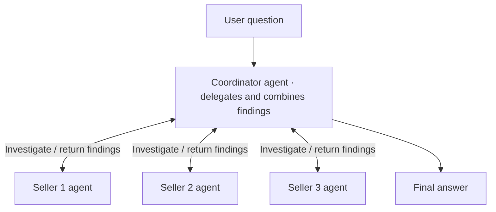
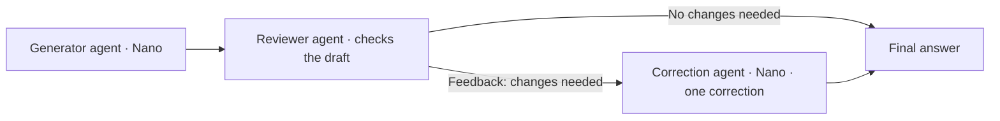

# Agent-pattern diagrams

Simplified October 2, 2026. High-level editable source diagrams for course section 17 and the multi-agent blog. These depict implemented experiment structures; neither is the default support runtime. Mermaid sources can be reused by the blogging agent when producing publication images.

## Coordinator with seller workers — M32

The diagram keeps one coordinator agent, three seller agents (workers), and the question/answer boundaries. The same coordinator delegates work and combines the returned findings; workers can investigate independently in parallel. Tool connections and snapshot details are kept in the notes. The coordinator has the same five read-only tools plus `investigate_seller`. It discovers seller IDs and delegates each seller once; code enforces the three-worker limit. Each worker is an independent model/tool loop with a seller-scoped prompt, its own MCP connection, and a verified matching fixed snapshot/document revision. Independent workers may overlap. They return findings and evidence references to the coordinator for synthesis; this is manager-style delegation, not a handoff.

The five tools are `get_catalog`, `query_business_data`, `search_documents`, `fetch_evidence` and `get_order_history`. Catalog precedes SQL; histories are order-scoped and may include other sellers, so workers must respect their seller scope. The diagram does not imply one SQL call per seller or per payout, nor that the coordinator is a general support-question router. The experiment selected this architecture in the runner.

Single-agent serial/parallel variants have one loop using those same tools, without seller workers. Parallel tool calls are a scheduling choice within that loop. The worker experiment showed added overhead without a demonstrated explanation-quality benefit on the common-policy task; one coordinator synthesis timed out. See M32 report (historical instructor evidence; retained separately) and [implemented runner](../../app/scripts/payout-orchestration.py).

[Editable worker source](seller-workers.mmd)

## Bounded evaluator–optimizer — M33/M34

The diagram shows the generator agent, reviewer agent, optional correction agent and the final answer. The correction is a separate Nano SDK Agent instance serving the generator role, not a new specialist investigation. The reviewer is fixed to Nano or GPT-5.4 for each experimental variant. Controller logic, tools, saved evidence and independent grading are explained below rather than drawn as separate boxes. The original generation box shows where the draft came from. The experiment replayed saved drafts instead of rerunning that stage. For each case, the critic receives the question, draft and full original evidence, including catalog definitions. It has no tools or golden answer. The controlled ablation changes only its model: Nano versus GPT-5.4.

The controller checks `needs_revision`; flagged cases receive feedback for one Nano correction stage, which can include multiple model/tool calls within its limits. Nano treats feedback as a hypothesis and can retrieve additional evidence. There is no repeated review/correction cycle. Unflagged answers pass through unchanged. Independent assistant grading uses the saved gold only after collection, outside the workflow; reviewer approval is not the correctness verdict.

For the two follow-up cases, earlier conversation is frozen and only the final answer is reviewed/corrected; case 28 reproduces the planned data mutation. All eighteen cases are covered. Nano-alone and Nano-review grades: 11 correct / 4 partial / 3 incorrect; GPT-5.4 review with Nano correction: 14 / 4 / 0; GPT-5.4 alone: 17 / 1 / 0. Grades are provisional. See M34 report (historical instructor evidence; retained separately) for costs, matched inputs and limitations, and [workflow runner](../../app/scripts/reviewer-workflow-core18.py).

This is a fixed workflow containing agent-controlled stages. Each role is implemented with the SDK Agent abstraction. The reviewer agent is a tool-free critic constrained to one review call; generator/correction agents can run model/tool loops. Agent labels describe roles, not equal autonomy: the application controls the review/correction sequence, and two model names alone do not define autonomous worker delegation.

[Editable evaluator source](evaluator-optimizer.mmd)
