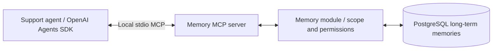
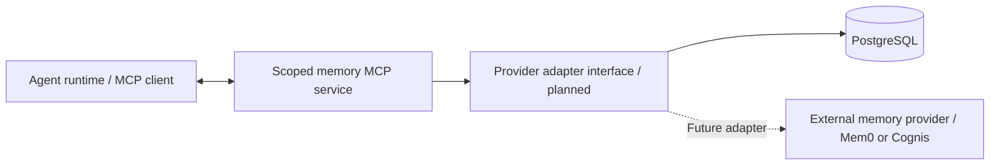
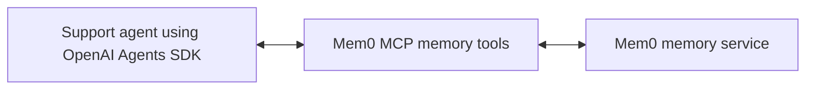

# How the agent uses memory

Scope agreed October 2, 2026. Short-term session storage exists. The PostgreSQL long-term layer is implemented for the bounded lab; Mem0 is an optional future integration, not implemented. See the [lab walkthrough](../../app/eval/memory-v1/README.md) for controls and verification.

## Our implementation — local stdio MCP memory tools

The agent chooses when to call a registered memory function such as save, search, update or delete. The SDK invokes it through the local MCP server; our backend module checks the authenticated user's scope and performs the database operation. Saving requires an explicit user request. The local MCP subprocess runs the existing memory module with trusted owner, permissions and provenance supplied at launch. This transport change was verified October 3; it does not require a remote memory service. Existing marketplace read-only tools continue using their MCP connection.

## Provider portability — proposed extension

**MCP separates the agent runtime from memory tool invocation; a provider adapter separates our memory contract from storage implementation.** Today the MCP server directly constructs the existing PostgreSQL `MemoryStore`; there is no implemented multi-provider factory, routing layer or external adapter. The proposed adapter interface would preserve our search/save/update/delete contract while selecting PostgreSQL or an external provider behind the same scoped service. External providers may instead supply their own MCP endpoint, but tool schemas and behavior must be adapted and tested; MCP compatibility alone does not preserve our write permissions, isolation, explicit-save fidelity, provenance or version checks.

Keep trusted user identity and authorized operations in the application/service boundary, outside model-chosen arguments. Our current local launch context binds the owner, conversation/run, snapshot and per-question write permission. Future remote access needs an authenticated scoped server; the existing remote HTTP marketplace endpoint is business-only and does not expose these memory tools. This is provider replacement planning, not automatic provider switching or a verified PostgreSQL/Mem0/Cognis interchangeability claim.

Editable sources: [current implementation](memory-architecture.mmd), [provider extension](memory-providers.mmd), [optional direct Mem0 MCP](memory-mem0.mmd).

## Verified transport and behavior

Reviewed the local MCP migration report (historical instructor evidence; retained separately) and real stdio regression tests: 81 tests passed in the related implementation thread, including CRUD/recall for all three memory types, permissions/isolation/version/provenance, agent wiring and initialization/disconnection failures. The post-migration GPT-5.4 run (historical instructor evidence; retained separately) completed all 19 questions with six required retrievals and ten memory-off checks passing, assistant-reviewed answer passes and zero source-resolution failures. Estimated uncached model cost $0.99; single-run evidence, not a reliability guarantee. Short-term session storage and prompt v10 remain unchanged.

## Optional Mem0 implementation — supplied MCP tools

This alternative connects the SDK to Mem0's existing MCP tools instead of building our own storage module and memory tools. Configure the allowed operations, authenticated user scope and explicit-save policy. A backend adapter or scoped wrapper may still be needed to enforce those rules; connecting a server alone does not establish them. Mem0 MCP is a documented option, not an implemented or tested integration here. Alternatively, thin SDK function tools can call Mem0's SDK/API without MCP.

**Short-term history remains separate in both diagrams:** the Agents SDK uses our existing session adapter to load/save PostgreSQL conversation history. That path is omitted here to keep the long-term comparison simple. Both PostgreSQL stores can use separate tables in the same database. Retrieved memories enter model context; they do not update model weights.

## Learning lab versus production readiness

Production readiness means reliable, controlled behavior for the intended workload, not using a particular memory vendor. Our lab implements explicit saving, provenance, user ownership, retrieval and update/delete, with a small on/off test suite. More demanding deployments may need:

| Concern | Additional engineering beyond this lab |
|---|---|
| Retrieval | Relevance ranking, thresholds, prompt limits and evaluation on representative workloads |
| Lifecycle | Conflict resolution, duplicate handling, versioning and retention/expiry appropriate to the product |
| Freshness | Rules for invalidation and checking remembered investigation facts against authoritative current data |
| Isolation | Tenant/workspace boundaries, controlled sharing and auditable access |
| Reliability | Concurrent updates, retries, migrations, backups and recovery |
| Measurement | Ongoing recall/usefulness checks, unwanted carryover, latency and total cost monitoring |

Automatic extraction, background saving and compaction are optional capabilities, not production prerequisites. Compaction manages context size; it is distinct from deliberately retaining information across conversations. This course demonstrates the memory behavior and integration boundaries, not a complete production hardening exercise.

## Optional Mem0 integration

Mem0 is included as a concrete external memory-manager example. Its documented interface supports adding memories scoped by user, searching with user filters and passing retrieved memories to a model as context. It can also be exposed through tools. See the [Mem0 quickstart](https://docs.mem0.ai/platform/quickstart).

For the SDK/API alternative, a future integration could preserve our application memory interface and substitute a Mem0 adapter for the PostgreSQL long-term storage implementation:

1. The authenticated backend supplies the user scope; the model does not choose another user's identity.
2. On an explicit save, the adapter calls Mem0's appropriate storage operation. Its extraction behavior must be checked: passing messages to `add` can produce extracted facts, which is not identical to saving a verbatim checkpoint or checklist.
3. Before a new question, the adapter searches within that scope. The application selects a bounded set and adds it to the agent's context.
4. Update/delete controls operate through the adapter. Verify supported semantics and preservation of provenance/versioned procedural guidance before adopting it.
5. Keep SDK session history and authoritative SQL/RAG evidence separate. Evaluate recall, isolation, stale facts, cost and latency again because a provider change can alter behavior.

This is a proposed integration design based on documented APIs, not a tested native plug-in or an automatic guarantee of production readiness. No switch to LangChain is required.

## References

- [LangChain memory overview](https://docs.langchain.com/oss/python/concepts/memory): short-/long-term distinctions and semantic, episodic and procedural examples.
- [OpenAI session-memory guide](https://developers.openai.com/cookbook/examples/agents_sdk/session_memory): session adapters and managing conversation history.
- [Mem0 quickstart](https://docs.mem0.ai/platform/quickstart): scoped add/search, model context and tool integration.
- [Mem0 MCP documentation](https://github.com/mem0ai/mem0/blob/main/docs/platform/mem0-mcp.mdx): supplied memory tools and hosted MCP connection. References checked October 2, 2026.
