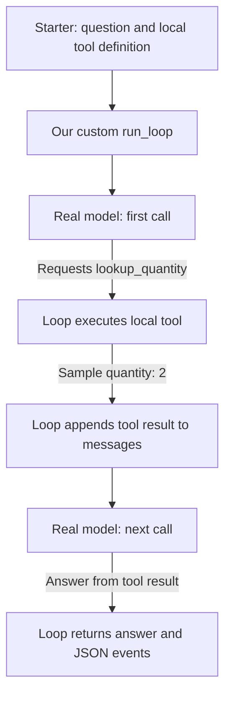

# Chapter 11 — The Agent Loop with OpenAI Agents SDK

## Workspace for this activity

Use the standard [Test workspace](http://127.0.0.1:5179/), **Support → OpenAI Agents SDK → Workspace options → Agent loop**. Inspect traces in [local Langfuse](http://localhost:3000), project **marketplace-support**. The separate legacy Agent Loop UI is not needed for these browser checks.

## Goal and starting point

Understand model steps, tool feedback and stopping within one question’s run. Repeat the three UI checks below; no code walkthrough or edits are required. The supplied-loop activity afterward runs its own loop separately; learners run it and explain the files without editing them.

Use the existing Test database; leave main and fixed evaluation data unchanged. Document preparation is automatic. Keep memory, RAG experiments, response caching, routing and other comparisons off, guardrail Off and source authority on. Changing loop mode starts a fresh conversation and turns other experiments off. The mode stays selected until changed or reset; its error injection or step allowance starts fresh for each question. Selecting a mode does not restart the service or edit source code. Live model requests consume API usage.

## Core — Normal, recovery and stopping

1. Select **Normal** and click **Use example question**. Inspect the completed model-response and tool-attempt counts beneath the answer; compare them with model generations and tool invocations in Langfuse. Do not confuse the response-cache denominator with cache hits, or evidence-save counts with tool attempts. No source-code walkthrough is needed.
2. Select **Fail first business query**, use the same example, and investigate. Only the first `query_business_data` attempt per question returns `LAB_TEMPORARY_READ_FAILURE` before SQL execution. Catalog and document tools are unaffected. Inspect the error, the later model-requested query, and its successful result. Prompt instructions and tool feedback guide recovery; no unconditional retry loop guarantees success. A failed query must not become “no matching records.”
3. Select **Stop after one model step** and repeat the example. The SDK allows one logical model invocation and its response handling. Its requested tools can finish and save evidence, but the SDK prevents another model invocation. Expect `MaxTurnsExceeded` and an incomplete result when another step is required. A prevented second model call is not a failed provider call and does not appear as a second model span. If a question finishes in one step, it has not demonstrated this stop—use the multi-step example.

Example question (also filled by the button):

> For order-2, query its current shipment and payout status using query_business_data, then retrieve settlement policy with search_documents and explain why payout is held. Include evidence citations.

One user question creates one SDK run in this application. The normal eight-step limit is per run, not per conversation. The SDK calls a model step a “turn”; tools run during response handling and do not each consume another turn. Transport retries inside a logical model request are distinct from a new model step. The current question, earlier retained question blocks, model steps and tool calls are different units.

The SDK enforces its step limit. The application adds an elapsed-time timeout and an accumulated estimated-cost check after completed model responses; a completed call can exceed the estimate before the hook stops further execution. New evidence-save attempts also have an application-specific budget across the question. The cost check is not an invoice guarantee.

Record mode, completed model responses, tool attempts, trace link, failure/recovery sequence, retained evidence and stopping reason. Counts vary with model behavior; verify the actual sequence rather than a fixed count. Read current returned records instead of assuming a historical status or demo clock.

## Run and explain the supplied loop without SDK Runner

Run the complete example unchanged, then document what each source file does. This uses a **real model and one local sample tool**. It consumes API credit but makes no MCP calls or marketplace database queries. The marketplace UI continues to use its existing SDK runner.

With Course Setup already running, run this command from the repository root (the top-level `agentic-systems` folder):

```bash
docker compose -p marketplace-lab -f app/compose.yaml -f app/compose.memory.yaml run --rm --no-deps -T memory-backend python /exercise/starter.py
```

The separate temporary process uses the configured Test gateway and the existing backend dependencies. It prints the answer, conversation messages and execution events as JSON, then exits. It does not restart the UI agent or save a Support conversation.

### How it works



The sample quantity is fixed local data; the model's tool request and answer are not scripted. The validated run used two model calls and one tool call. Inspect your actual events because model behavior can vary. The browser demo already covers the turn-limit test; do not repeat it here.

### File walkthrough

| File | Purpose |
| --- | --- |
| [starter.py](starter.py) | Defines the sample question, local quantity tool and its schema; connects the real model through the configured Test gateway; calls the loop and prints its result. |
| [solutions/minimal_loop.py](solutions/minimal_loop.py) | Implements the repeated model call, tool execution and feedback sequence, stopping at a final answer or the step limit. |
| [solutions/answers.md](solutions/answers.md) | Explains the expected execution and file responsibilities. |
| [exercise.md](exercise.md) | Supplies the command and observation task. |

**Your write-up:** explain the role of the starter and loop implementation, then identify the tool request, returned quantity and final answer in the printed JSON. No source edits, automated tests or extra live-adapter files are required.

## Cleanup

Select **Normal** or **Reset to defaults** after the comparison. Reset keeps the current conversation open; start a new one yourself for a clean run. Use a fresh conversation for each read-only repetition; no database reset is required. Stop all local workspaces through the normal Course Setup instructions when finished. Do not run Compose `down --volumes`, reset the fixed source or modify the main marketplace. Keep your transcripts outside the disposable database.

Run the supplied example first; explanations are in the worked answers.
