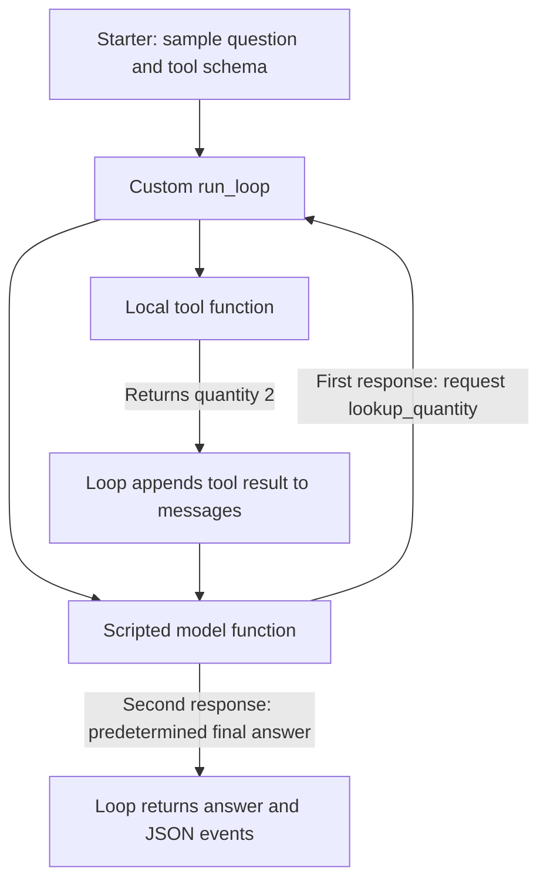

# Chapter 11 — The Agent Loop with OpenAI Agents SDK

## Workspace for this activity

Use the standard [Test workspace](http://127.0.0.1:5179/), **Support → OpenAI Agents SDK → Workspace options → Agent loop**. Inspect traces in [local Langfuse](http://localhost:3000), project **marketplace-support**. The separate legacy Agent Loop UI is not needed for these browser checks.

## Goal and starting point

Understand model steps, tool feedback and stopping within one question’s run. Repeat the three UI checks below; no code walkthrough or edits are required. The supplied-loop activity afterward runs its own loop separately; learners run it and explain the files without editing them.

Use the existing Test database; leave main and fixed evaluation data unchanged. Document preparation is automatic. Keep memory, RAG experiments, response caching, routing and other comparisons off, guardrail Off and source authority on. Changing loop mode starts a fresh conversation and turns other experiments off. The mode stays selected until changed or reset; its error injection or step allowance starts fresh for each question. Selecting a mode does not restart the service or edit source code. Live model requests consume API usage.

## Core — Normal, recovery and stopping

1. Select **Normal** and click **Use example question**. Inspect the completed model-response and tool-attempt counts beneath the answer; compare them with model generations and tool invocations in Langfuse. Do not confuse the response-cache denominator with cache hits, or evidence-save counts with tool attempts. No source-code walkthrough is needed.
2. Select **Fail first business query**, use the same example, and investigate. Only the first `query_business_data` attempt per question returns `LAB_TEMPORARY_READ_FAILURE` before SQL execution. Catalog and document tools are unaffected. Inspect the error, the later model-requested query, and its successful result. Prompt instructions and tool feedback guide recovery; no unconditional retry loop guarantees success. A failed query must not become “no matching records.”
3. Select **Stop after one model step** and repeat the example. The SDK allows one logical model invocation and its response handling. Its requested tools can finish and save evidence, but the SDK prevents another model invocation. Expect `MaxTurnsExceeded` and an incomplete result when another step is required. A prevented second model call is not a failed provider call and does not appear as a second model span. If a question finishes in one step, it has not demonstrated this stop—use the multi-step example.

Example question (also filled by the button):

> For order-2, query its current shipment and payout status using query_business_data, then retrieve settlement policy with search_documents and explain why payout is held. Include evidence citations.

One user question creates one SDK run in this application. The normal eight-step limit is per run, not per conversation. The SDK calls a model step a “turn”; tools run during response handling and do not each consume another turn. Transport retries inside a logical model request are distinct from a new model step. The current question, earlier retained question blocks, model steps and tool calls are different units.

The SDK enforces its step limit. The application adds an elapsed-time timeout and an accumulated estimated-cost check after completed model responses; a completed call can exceed the estimate before the hook stops further execution. New evidence-save attempts also have an application-specific budget across the question. The cost check is not an invoice guarantee.

Record mode, completed model responses, tool attempts, trace link, failure/recovery sequence, retained evidence and stopping reason. Counts vary with model behavior; verify the actual sequence rather than a fixed count. Read current returned records instead of assuming a historical status or demo clock.

## Run and explain the supplied loop without SDK Runner

The complete [starter.py](starter.py) is ready to run. You do not need to write a loop or edit source files. It calls a model adapter, executes requested tools, passes results back and stops when an answer or step limit is reached. This is a separate example; the marketplace UI continues to use its SDK runner.

From the repository root, first run the free offline example:

```bash
python3 course/exercises/agent-loop/starter.py
```

It uses scripted responses and a sample quantity, with no API calls or database access. Inspect the JSON: the first model step requests a tool; its result reaches the second step, which answers. The turn-limit comparison is already covered in the browser demo and does not need repeating here.

### How the offline example works

This example calls no real model and no MCP server. Both the tool request and final answer are scripted in advance; the loop still executes the local tool and passes its result back. The scripted final answer does not infer its wording from that result.



The loop code is real orchestration; the model function is a stand-in. It receives the messages but returns the next predefined response. This makes the example repeatable and free. A real-model connection would instead let the model decide which tool to request and how to answer from the returned evidence.

### File walkthrough — document these roles

After running the command, write one or two sentences about each file. No coding or feature implementation is required.

| File | Role to inspect |
| --- | --- |
| [starter.py](starter.py) | Runnable entry point: supplies scripted model responses, a sample tool and a question, then calls the loop. |
| [solutions/minimal_loop.py](solutions/minimal_loop.py) | The actual `run_loop`: calls the model, executes requested tools, passes results back, and stops at an answer or the step limit. |
| [solutions/live_adapters.py](solutions/live_adapters.py) | Optional connections to a real model and read-only MCP server. Discovers tool schemas and supplies model/tool functions to the same loop. |
| [solutions/test_loop.py](solutions/test_loop.py) | Automated checks using scripted responses. It tests the loop; it does not register an SDK agent or run the live application. |

A results JSON file is generated output containing messages, model/tool events and the stopping result. It is not another implementation file and is not needed to start the loop.

### Live adapters — reference only for this activity

Inspect `solutions/live_adapters.py` to understand where real model requests and MCP tool execution would connect to the same loop. Running it requires a configured backend environment and consumes API usage. It is not required for this activity; the supplied offline command is the runnable learner path. Live backend setup instructions are being aligned separately.

For the required write-up, document the four file roles above and describe how a tool result reaches the next model call. The live run and automated checks are optional; no files need editing.

## Cleanup

Select **Normal** or **Reset to defaults** after the comparison. Reset keeps the current conversation open; start a new one yourself for a clean run. Use a fresh conversation for each read-only repetition; no database reset is required. Stop all local workspaces through the normal Course Setup instructions when finished. Do not run Compose `down --volumes`, reset the fixed source or modify the main marketplace. Keep your transcripts outside the disposable database.

Run the supplied example first; explanations are in the worked answers.
