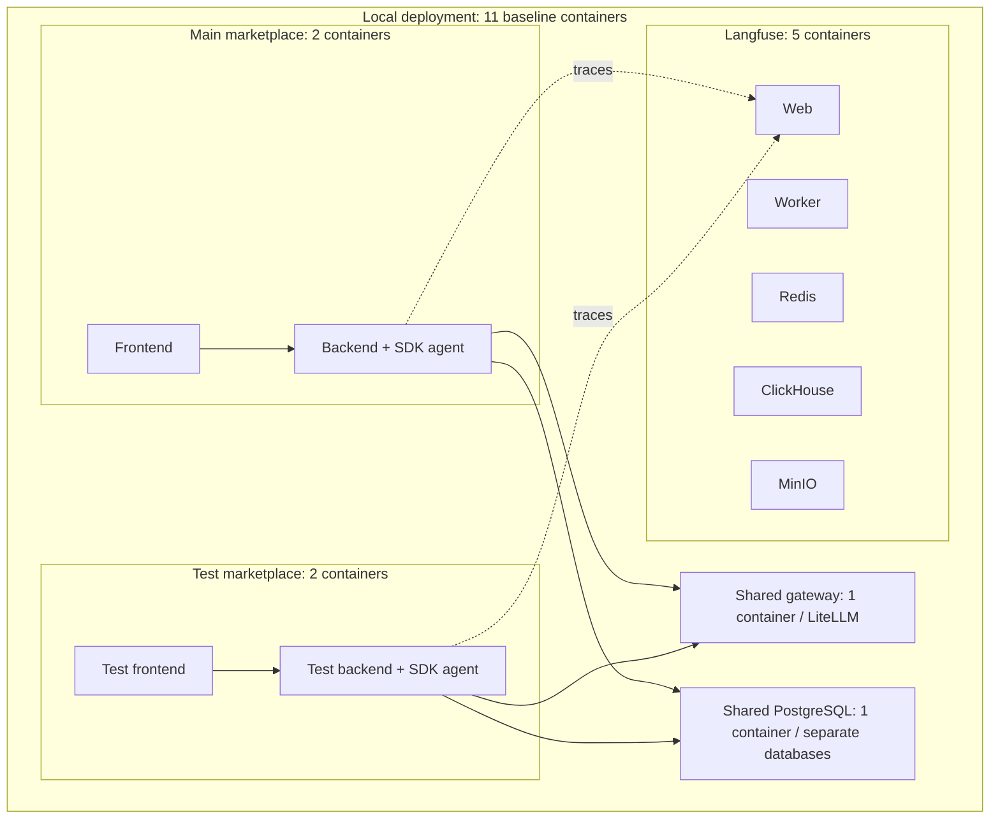

# Runtime and Hosting — deployment walkthrough

Document how the existing marketplace is deployed locally. If you have already deployed the full cloud marketplace, optionally complete the cloud comparison. Trace the connections among the chat application, OpenAI Agents SDK agent, LiteLLM model gateway, MCP tool handlers and persistent data.

This is a read-only inspection exercise. It requires no new agent service, tunnel, database reset, code change or deployment. Use the setup already prepared in [Course Setup](../../../app/LOCAL-SETUP.md). If you have deployed the full cloud marketplace, use [Cloud Setup](../../../app/CLOUD-SETUP.md) to identify its services.

## Environments and evidence

| Section | UI | Database | What to inspect |
|---|---|---|---|
| Local | Test marketplace at [127.0.0.1:5179](http://127.0.0.1:5179/), Support workspace, OpenAI Agents SDK | `market_test`, the mutable practice database | Existing Docker services, Compose configuration, SDK/MCP code, and optionally an existing trace |
| Optional cloud | Your existing full cloud marketplace web URL, Support workspace, OpenAI Agents SDK | Your cloud marketplace database in Cloud SQL; identify the actual database name from your deployment | Existing Cloud Run services and Cloud SQL configuration, with secret **references** only |
| No cloud deployment | Use only the local test UI | `market_test` | Complete Part 1; skip optional Part 2 and the cloud diagram |

The fixed evaluation database `market_eval` is not the local practice database. The separate historical hosted-agent UI on port 5192 and its `ch12_hosting_lab` database are not used by this worksheet. The cloud comparison concerns the **full cloud marketplace**, where web, MCP and LiteLLM services run in Google Cloud.

Use these source files from the repository root:

- Local: `app/compose.yaml`, `app/compose.memory.yaml`, `app/backend/marketplace/api.py`, `agent.py`, `mcp_client.py`, `tools.py`, and `db.py`.
- Cloud: `app/cloud/terraform/services.tf`, `main.tf`, `variables.tf`, `outputs.tf`, and `app/backend/marketplace/http_mcp_client.py` / `remote_mcp.py`.

Do not share full resolved Compose output, private environment files, database passwords or API keys. Record setting names, non-secret targets, and Secret Manager resource references instead. A configured source value is evidence of intended configuration; it is not proof of the current live deployment.

## Start with the running containers

Five logical groups contain the eleven baseline containers. The SDK runs inside each backend; it is not another container.

This overview groups containers by purpose. Langfuse and the gateway also use their own metadata databases on the shared PostgreSQL server. The optional remote MCP endpoint adds a twelfth container; model inference runs externally.

Run `docker ps` and use the [container-purpose map in the setup guide](../../../app/LOCAL-SETUP.md#which-container-does-what) to identify the main and Test frontend/backend pairs, shared gateway and PostgreSQL, and Langfuse services. The Test container names now say `test`; the Compose service keys still use `memory` for command compatibility. Redis, ClickHouse and MinIO support Langfuse. The optional remote MCP container is separate from the default backend-local stdio MCP connection.

Then locate the SDK runner in the backend code: it is a library running inside the backend, not another Docker container. No separate Chapter 11/12 deployment is needed.

## Part 1 — six local questions

1. **Where do the chat UI, backend and SDK agent run?** Name their Docker services or processes. Which components share a container, and which are separate?
2. **How does the chat request reach the agent?** Follow browser → frontend/API route → backend handler → SDK invocation. Is the backend-to-agent call HTTP or in-process?
3. **How does the agent reach LiteLLM and the model?** Identify the gateway address, configured model alias/provider route and where the actual model executes. Distinguish the local agent from the external model service.
4. **How do MCP requests reach the tool handlers?** Identify the selected transport, how the MCP server starts, where its handlers execute and how they query business records. Do not mistake an MCP subprocess for a separate container.
5. **Which database stores business data, history and evidence?** Identify the practice database and the roles of the tool read connection versus the application write connection. Explain what survives a backend restart.
6. **Which controls come from Docker, the SDK and our app?** Identify the host configuration, SDK model-turn limit and app timeout/cost/history controls. Name which component provides tracing or gateway controls; do not attribute these automatically to Docker.

## Part 2 — six cloud questions (optional)

Complete this section only if you have already deployed the full cloud marketplace. Otherwise skip it; creating a cloud deployment is not required.

1. **Which project, region, services and images host the app?** Record the web, MCP and LiteLLM gateway services, their container images or revisions, and where the SDK agent executes.
2. **How does the cloud chat request reach the SDK agent?** Follow the browser HTTPS request to the web service. Explain which chat/backend/agent components share its container or process.
3. **How do model calls pass through the LiteLLM service?** Identify the web-to-gateway route, service identity/authentication configuration and external provider route. Does the full cloud marketplace bypass LiteLLM?
4. **How does authenticated HTTP MCP reach tool handlers?** Identify the MCP endpoint, transport, authentication and allowed-host configuration, handler location and tool-to-database connection. Record secret references, never secret values.
5. **Where are business data, history and evidence persisted?** Identify the Cloud SQL instance/database and which services read or write it. Is that data stored only inside a Cloud Run container? How is this different from the local deployment?
6. **What resources, scaling, secrets and agent controls apply?** Record CPU, memory, request timeout, concurrency, minimum/maximum instances and service identity from your deployment or source configuration. Separate hosting controls from SDK/app/platform features, including history, observability, guardrails and retrieval.

Use your existing deployment and identify its current settings. Where you rely only on source configuration, label that evidence **configured**, not live-observed. Do not start Cloud SQL merely to read its configuration.

## Document your answers

For every question, include:

| Field | Record |
|---|---|
| Component or service | Its name and purpose |
| Container/process and location | What runs together; what is external |
| Connection | Caller, target, protocol and data purpose |
| Supporting evidence | File and relevant setting/function, service configuration, or existing trace |
| Verification status | **Observed**, **configured**, or **unavailable** |

Draw one annotated local diagram. Add a cloud diagram only if you complete the optional cloud section. Include chat → agent, agent → LiteLLM → model, agent → MCP → tool handlers → database, and the application’s history/run persistence. State the main deployment differences and which responsibilities would move to a managed agent platform.

You do not need a fresh model call. If you choose to inspect a fresh local trace, use the test Support workspace, SDK, memory off and normal mode, and ask: **“What is the current shipment status for order-2?”** This optional read consumes model credits and uses the current practice data; the worksheet does not require a fixed business answer or exact call count.

## Completion and cleanup

Complete six evidence-backed local answers and one local diagram. If you have a cloud deployment, optionally add six cloud answers and a cloud diagram. Clearly distinguish live observations from intended source configuration. The worksheet makes no business-data changes and needs no reset, cloud cleanup or code restoration. If you started services for inspection, follow the normal setup guide’s stop/resume instructions and preserve data.

Compare your work with the [reference answers](solutions/answers.md) after completing the walkthrough.
